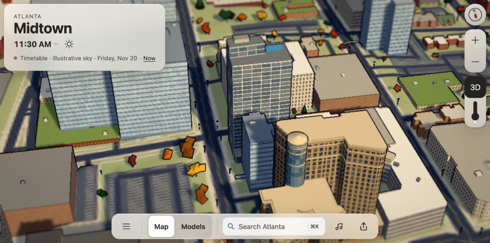
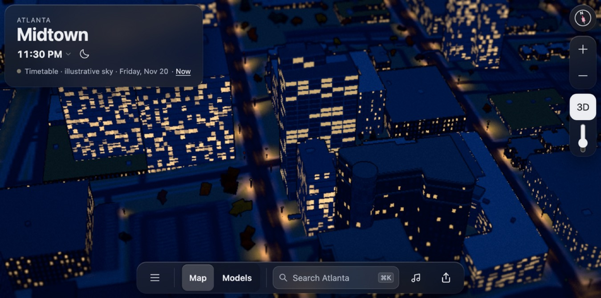
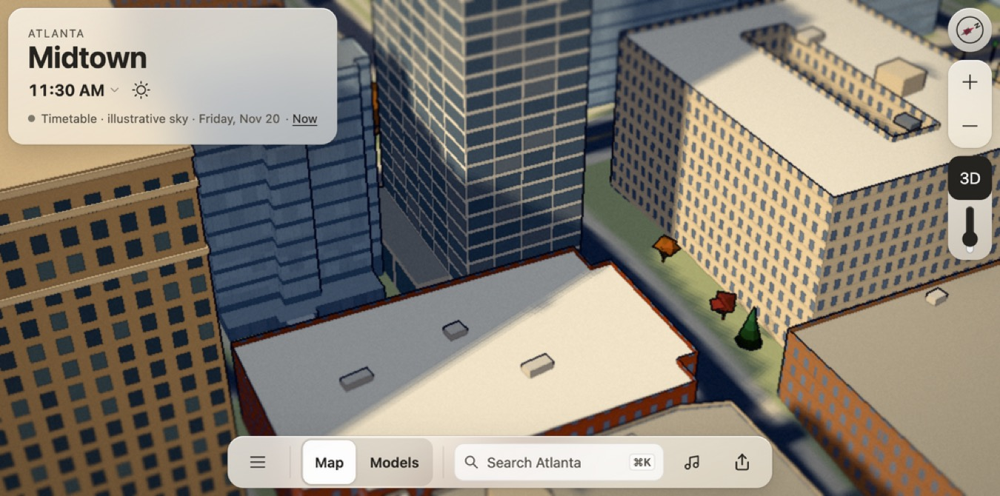

# Lilli Midtown

City replaces the generic mesh for `osm:way:886041059`, Lilli Midtown at 693 Peachtree and 3rd Street (JPX Works, 2018), a slender 24-storey apartment tower on a 0.31-acre site. **Height basis: lidar 2019.** An 8 m grid of 90th-percentile returns over 310.6 m ground replaces the inferred 86.4 m:

- **Main roof:** 78 m.
- **North-west half:** rises to 85–89 m for the rooftop amenity level, with plant on top.
- **Retail strip (south):** a single storey at about 8 m.

The completed-building dusk photograph shows grey glass in a white frame of slab bands, broken by irregular opaque grey panels. The roof carries a pool deck, which the amenity photographs show at the top of the tower. City draws grey glass with a sparse mix of lighter panels, white slab edges, the raised amenity level, plant, and a pool on the main roof. Estimated details: the 3 m glazing module (doubled on low tier), the 3.15 m floor pitch, the extent of the amenity level (from the lidar), and the pool footprint. The low tier uses double-width panes to stay within the skin budget.

Sources, consulted in a fresh Orca tab:
- [Brasfield & Gorrie project page](https://www.brasfieldgorrie.com/?p=13758): dusk exterior and rooftop pool.
- [Midtown Alliance project page](https://www.midtownatl.com/view/lilli-midtown): rendering, used only to confirm the massing.
- [Apartments.com listing](https://apartments.com/lilli-midtown-atlanta-ga/xqpcymm/): rooftop pool deck.

**Lighting:** The dusk photograph shows many lit apartments and a lit retail base, but there is no full-night exterior. City treats it as residential, with about a third of units lit at 23:30 through the shared lit-pane hash, and the amenity level a little brighter.

| Review view | City query |
|---|---|
| Day, from the south | `?view=city&q=low&t=2026-11-20T11:30:00-05:00&cam=660,-2210,15,52,480` |
| Full night, matched | `?view=city&q=low&t=2026-11-20T23:30:00-05:00&cam=660,-2210,15,52,480` |
| Closer, from the west | `?view=city&q=low&t=2026-11-20T11:30:00-05:00&cam=660,-2185,300,55,240` |

