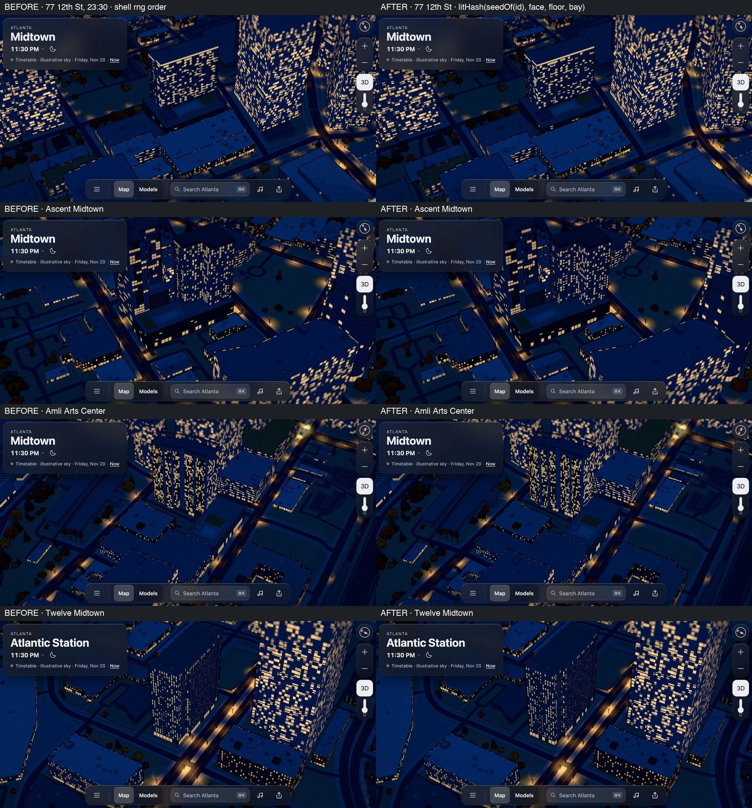

# Shared lit-pane hash for 77 12th Street, Ascent Midtown, Amli Arts Center and Twelve Midtown

These four skins used `landmarkShell.facade`, which picks lit panes from the shell's rng stream. Adding or removing geometry earlier in a builder therefore reshuffled the night pattern. Each `shell.facade` call is now skin-kit's `litFacade`, and a pane is lit when `litHash(seedOf(id), face, floor, bay) < occupancy`. Each call site owns a block of 50 face ids (block × 50 + edge index). Geometry, colours and occupancy are unchanged. 25 Pine lights all of its open tiers without an rng, so it is untouched.

Matched night views at 23:30, high tier, each skin's hero camera: 77 12th `611,-3375,30,50,560`, Ascent `300,-4330,30,50,520`, Amli `290,-3885,150,48,600`, Twelve `-600,-4190,60,48,520`.

