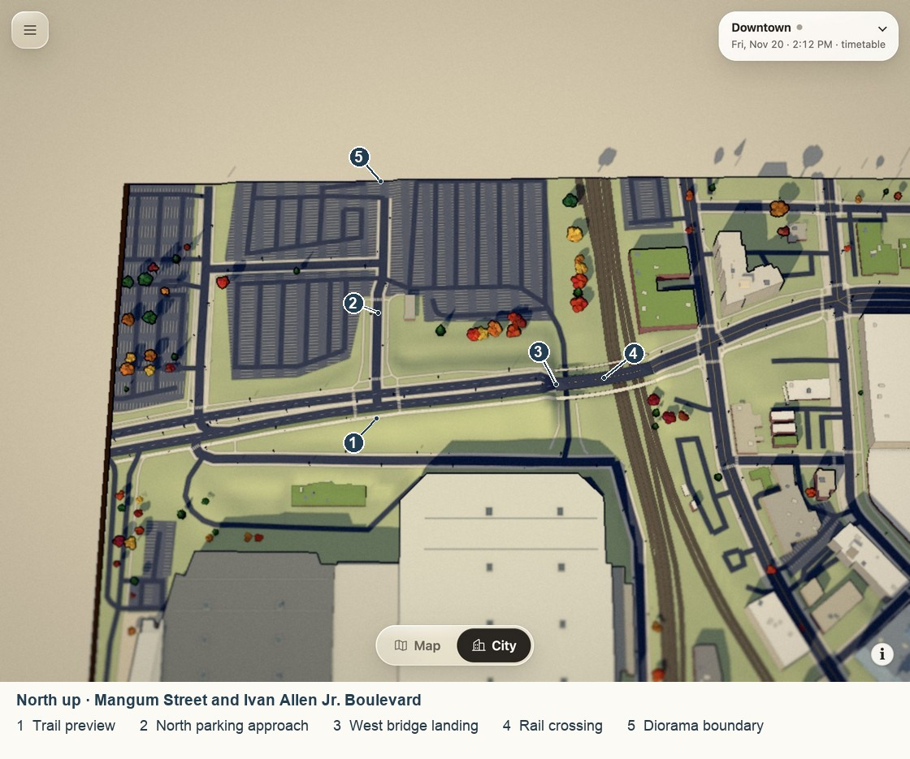

# Ground north of the Mangum trail preview

**The parking approach descends on real ground. The abrupt dip at the west end of the Ivan Allen bridge is a separate modeling error.** Bearing 64° puts the bridge toward the top of the trail preview, although it is roughly 180 m east of the trail center. Geographic north points toward screen left. Sam’s report did not include a marked pixel, so the exact feature he saw is uncertain. [Trail camera](trail.jpg) · [Oblique view of the existing bridge](bridge.jpg)



## What the camera shows

**1–2 · Mangum and the parking approach.** The trail center at 33.76371° N, 84.40014° W samples 311.4 m NAVD88. Along a northbound line at local x = −790 m, the rendered surface drops to 310.2 m at z = −1140 m, 308.8 m at −1160 m, and 307.4 m at −1180 m. Both City terrain quality levels return the same four values at these points. About 50 m north of the trail, the west lot at x = −815 m is another 3.2 m below the road. The 5 m grid renders this bank as a short faceted slope. Mangum is mapped at grade here. January 2023 Street View shows a downhill drive flanked by railings, and the GWCCA identifies this area as surface parking. The evidence supports an embankment and a descending approach. It does not establish a deck beneath Mangum. [Northbound photograph](https://www.google.com/maps/@?api=1&map_action=pano&pano=6QA0wfYNJ6PbrznVsPJIag&heading=0&pitch=-5&fov=80) · [Lot entrance photograph](https://www.google.com/maps/@?api=1&map_action=pano&pano=npQNVSl4-Avq3PKtfQ3HBA&heading=285&pitch=-8&fov=80) · [GWCCA campus map](https://www.gwcca.org/wp-content/uploads/2024/08/Campus_Map_May2024.pdf) · [GWCCA parking guide](https://www.gwcca.org/Event-Planning-Guide)

**3–4 · Ivan Allen over the railway.** The aerial shows the rail corridor beneath the boulevard. The transport bake already provides three bridge runs at the crossing: 78.5 m of road deck, 76.9 m of north sidewalk and 80.7 m of south sidepath. The issue starts where the western ground approach follows the bare-earth grid down the bank before meeting its schematic deck. Between (−657.96, −1121.09) and (−648.54, −1117.74), the grid falls from 317.68 to 311.70 m over about 10 m. The road-center deck midpoint at (−609.66, −1123.04) renders at 311.19 m, with rendered ground at 307.15 m. This 4.04 m difference is between two model surfaces. The true deck elevation and rail clearance require independent structural data. The April 2026 west-landing photograph shows continuous pavement into the bridge with a gentle crest. It rules out the exaggerated road dip. The bridge exists in City; its approach and vertical placement merit a profile correction when better height evidence is available. [West landing looking east](https://www.google.com/maps/@?api=1&map_action=pano&pano=bGkM1jH6hcu30gGt_JuMoA&heading=78&pitch=-4&fov=85) · [Aerial covering Mangum and the rail crossing](https://server.arcgisonline.com/ArcGIS/rest/services/World_Imagery/MapServer/export?bbox=-84.4021,33.7628,-84.3972,33.7658&bboxSR=4326&imageSR=3857&size=1500,1100&format=jpg&f=image)

**5 · North edge.** The straight edge across the top of the north-up image is the diorama boundary, z = −1300 m, 210 m north of the trail. The render closes the board there with a side wall. This edge is separate from the continuous terrain at the parking entrance. [City board geometry](../../../../web/src/terrain/model.ts)

## Samples and reproduction

Ground values come from the local 5 m grid sampled from the USGS 1 m bare-earth DEM, acquired in 2018–19. Heights above are absolute NAVD88 metres. Local x points east and z south from Five Points. For the north transect, compare `GroundGrid.sample` with `GroundSurface.sampleScene` at each quality plus the 323.8 m scene zero. For a bridge midpoint, evaluate `Line.at(length / 2)` on the scoped road run, then `transport.deckAt(x, z, run) + 323.8`. The model interpolates the structural run between terrain proxies at the endpoints. A bare-earth raster cannot measure the bridge tread directly. [Grid manifest and source metadata](../../../../pipeline/prototypes/downtown-ground/ground.json) · [Transport geometry](../../../../web/src/terrain/transport.ts)

In desktop Orca, use a 1120 × 840 viewport with `/?view=city&q=high&t=2026-11-20T14:12:45-05:00&speed=0`. The numbered overlay is on the north-up screenshot only.

```js
window.__city.lookAt(-787, -1091, { bearing: 64, metresPerPixel: .06942, tilt: 72 })
window.__city.lookAt(-728, -1155, { bearing: 0, metresPerPixel: .65, tilt: 20 })
window.__city.lookAt(-615, -1123, { bearing: 27, metresPerPixel: .34, tilt: 60 })
```

The follow-up retires the one Mangum study mesh, including its 14 grass clumps and 13 small soil flecks. The 3.2 m shared sidewalk, road markings, crossings and painted green buffer remain in the terrain layer. Grass placement is parked for future study. A web rebuild and deployment pick up the removal using the existing bake. [Earlier matched frame with the grass](../trail-planting/path/intersection-after.jpg) · [Same camera after removal](trail.jpg)
