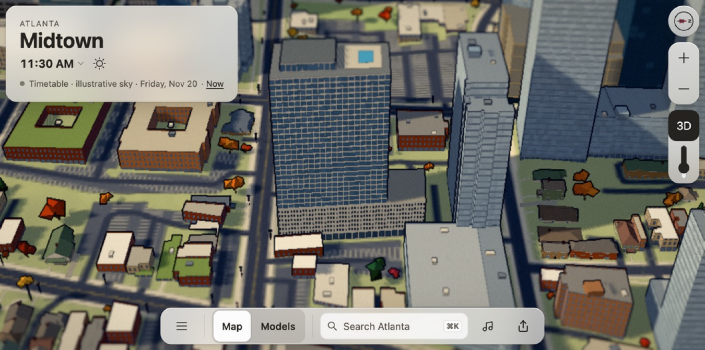
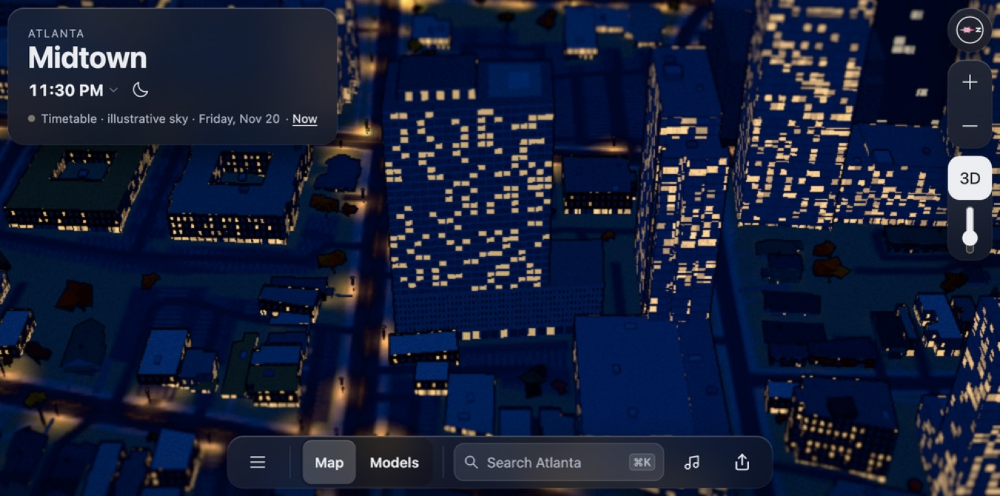
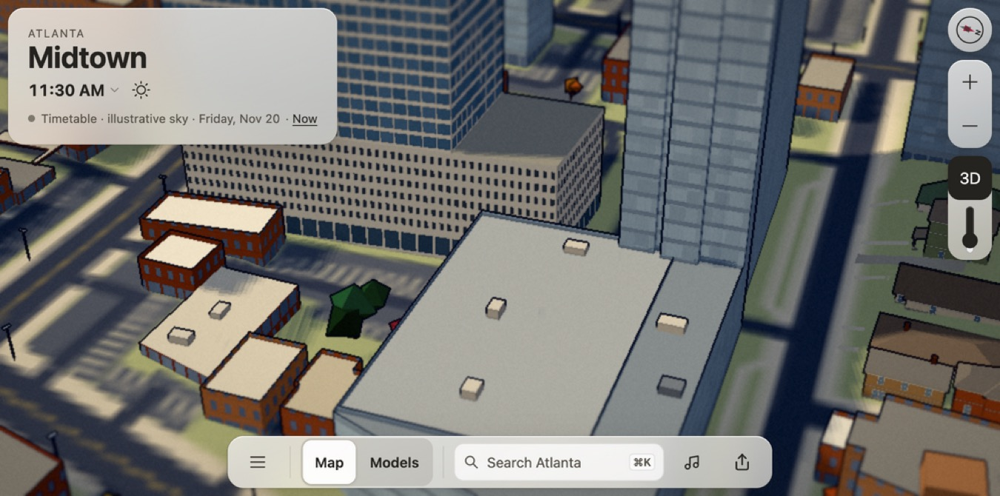

# Modera Parkside

City replaces the generic mesh for `osm:way:1300601308`, Modera Parkside at 180 10th Street (Mill Creek Residential), two blocks west of Piedmont Park. It topped out in 2024, after the April 2019 lidar was flown (the lidar shows the empty site), so the height comes from reports. **Height basis: reported.** Urbanize Atlanta reports 32 storeys with an amenity level on the roof. No published height in metres was found. City estimates 5.5 m for the retail floor and 3.15 m per apartment floor, about 103.5 m to the main roof, plus a 4.8 m rooftop club level. That's consistent with Overture's estimate of about 106 m.

The mapped outline is a 33 × 78 m block with no parts. The renderings and the topping-out photograph show a white parking podium filling the block, with tall white fins over dark openings and street retail on 10th Street. The slab is blue-grey glass with white slab edges and rises over the south part, leaving the podium roof exposed toward 10th Street. The roof has a pool deck and a glazed club and gym level. The construction photograph from Piedmont Park, April 2024, confirms the glass slab with white banding on the east face. Estimated details: the 24 m podium height, the slab's split from the podium (18 m south of the north edge), the 2.7–2.9 m glazing module, the rooftop footprints and the pool.

**Recognition audit (2026-11-24): the finished building.** The architect's photographs of the finished tower ([Gresham Smith](https://www.greshamsmith.com/projects/modera-parkside/), files edited 2025-12-13, trees in leaf) confirm three features the first skin left out, and City now draws them:
- **The rainbow slot is built.** It is a single recessed vertical slot up the middle of the east face, from the podium to about two-thirds of the height. It runs orange at the foot through yellow and pale green to pale teal, softer than the 2024 rendering ([from the Rainbow Crosswalk](https://www.greshamsmith.com/wp-content/uploads/2024/04/45200_00_N29_medium.jpg)). At dusk it glows from inside ([N25](https://www.greshamsmith.com/wp-content/uploads/2024/04/45200_00_N25_medium.jpg)), so it is part of the lamp mesh.
- **The crown visor.** A white frame rings the top, with pergola slats over the pool deck ([N24](https://www.greshamsmith.com/wp-content/uploads/2024/04/45200_00_N24_medium.jpg), [N26](https://www.greshamsmith.com/wp-content/uploads/2024/04/45200_00_N26_medium.jpg)).
- **The tall charcoal core box above it.** Its script logo is not drawn, and neither is the Modera sign on the podium: branding is never drawn.

The slot's colour stops and height, the visor's 1.4 m depth and the box size are estimated from the photographs. [East face at 500 m](audit-east.jpg) · [crown](audit-crown.jpg) · [night](audit-night.jpg)

Sources, consulted in a fresh Orca tab:
- [Urbanize Atlanta, topping out (2024)](https://atlanta.urbanize.city/post/midtown-tower-tops-out-10th-street-piedmont-design-improvements-promised): 32 storeys plus a rooftop amenity level, and the April 2024 construction photograph from Piedmont Park.
- [Urbanize Atlanta, revised visuals (December 2024)](https://atlanta.urbanize.city/post/modera-parkside-midtown-apartments-fresh-visuals-pricing-emerge-newest-tower): rendering of the east façade and pool deck.
- [Mill Creek community page](https://millcreekplaces.com/community/modera-parkside/): photographs of the finished rooftop pool deck and pergola (day and dusk).

**Lighting:** No full-night exterior photograph was found, which is a gap. City treats it as residential, with about a third of units lit at 23:30, a lit retail base and a lit club level. The rainbow slot is lit, as at dusk in the 2025 photographs; whether it stays on after dusk is unconfirmed.

| Review view | City query |
|---|---|
| Day, from the east (park side) | `?view=city&q=low&t=2026-11-20T11:30:00-05:00&cam=915,-3150,270,52,520` |
| Full night, matched | `?view=city&q=low&t=2026-11-20T23:30:00-05:00&cam=915,-3150,270,52,520` |
| Closer podium on 10th Street | `?view=city&q=low&t=2026-11-20T11:30:00-05:00&cam=955,-3175,250,58,260` |

