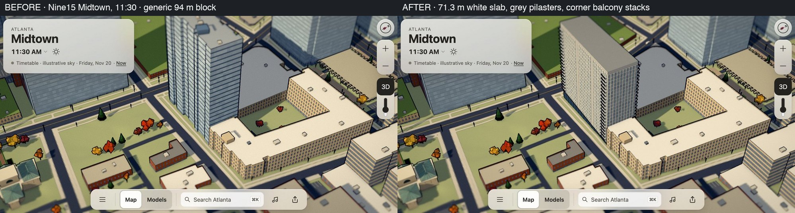
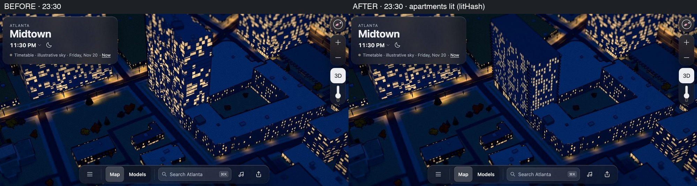
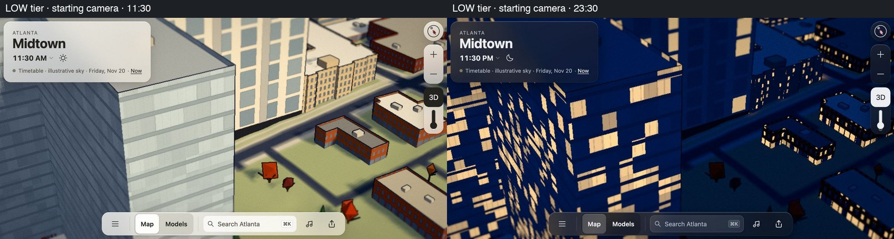
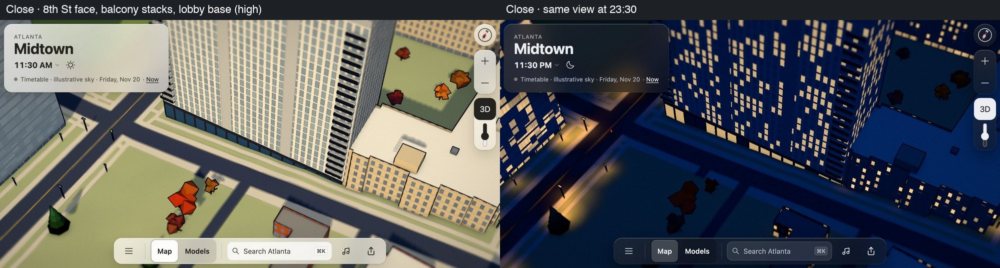

# Nine15 Midtown

`osm:way:789980819` (915 West Peachtree, on 8th Street; 21 storeys, completed 2016, formerly Alta Midtown) was drawn as a generic 94 m block. City now draws it at its lidar height with the look confirmed in dated Street View.

| Element | Plan (City m) | Height above grade | Basis |
|---|---|---|---|
| 21-storey slab | the mapped 73 × 25 m outline, squared | roof 71.3, parapet 73.6 | 3DEP lidar, 22 April 2019: median 71.3, 90th percentile 73.6, max 75.6, flat across the length. Grade is the 293.1 m NAVD88 median of ground returns. The mapped 94.4 m is the OSM tag. |

## Evidence

- **Street View, dated and cited, not copied:** December 2025 from West Peachtree and 8th looking north-east and from 915 West Peachtree looking south-east; March 2025 from 8th Street looking north-west. They show white and light-grey panel walls with tall glass, dark-railed balcony stacks at the corners of the long faces, and a glazed corner on West Peachtree. The base is dark, with shopfronts and a garage entry.
- **Midtown Alliance rendering:** the same massing, used only to confirm it. [Midtown Alliance page](https://www.midtownatl.com/view/915-midtown) · [Skyscraper Center entry](https://skyscrapercenter.com/building/nine15-midtown-apartments/38512)

## Model

- **Floors:** a 6 m base, then 20 floors at 3.15 m.
- **Glass:** base `#9fb1bd` (S 16%, V 74%). Rendered at 11:30 on the high tier: sunlit 8th Street face S 17 / V 51 at the hero camera and S 10 / V 60 at the close camera, which passes. The shaded west face reads S 10 / V 39, and generic glass in the same frames S 17–18 / V 41–42.
- **Grey pilasters:** at about 30% and 62% of each long face, splitting the bays.
- **High tier:** 2.4 m bays at 0.58 fill, dark-railed balcony stacks at both corners of the long faces, and lobby glazing.
- **Low tier:** one pane row per three floors and the pilasters.

## Night

No night photograph was found. Lit rooms come from the shared `litHash(seedOf(id), face, floor, bay)` at 45%.

## Measurements

- **Low-tier mesh:** under 400 triangles (unit test).
- **Camera delta:** at the starting camera `453,-2875,32,60,260`, 11:30, with the skin on and off, +130 triangles and **0 draws** (90 → 90, batched into its cell). Programs unchanged at 86.

## Review views

| View | City query |
|---|---|
| Day, from the south-east (high) | `?view=city&q=high&t=2026-11-20T11:30:00-05:00&cam=451,-2875,300,48,420` |
| Full night, matched | `?view=city&q=high&t=2026-11-20T23:30:00-05:00&cam=451,-2875,300,48,420` |
| Starting camera, low, day and night | `?view=city&q=low&t=2026-11-20T11:30:00-05:00&cam=453,-2875,32,60,260` (23:30 for night) |
| Close: 8th Street face | `?view=city&dev&mindist=20&q=high&t=2026-11-20T11:30:00-05:00&cam=451,-2865,330,40,230` |

