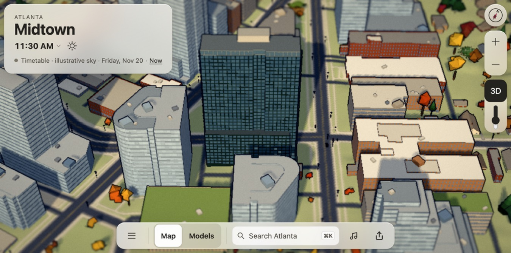
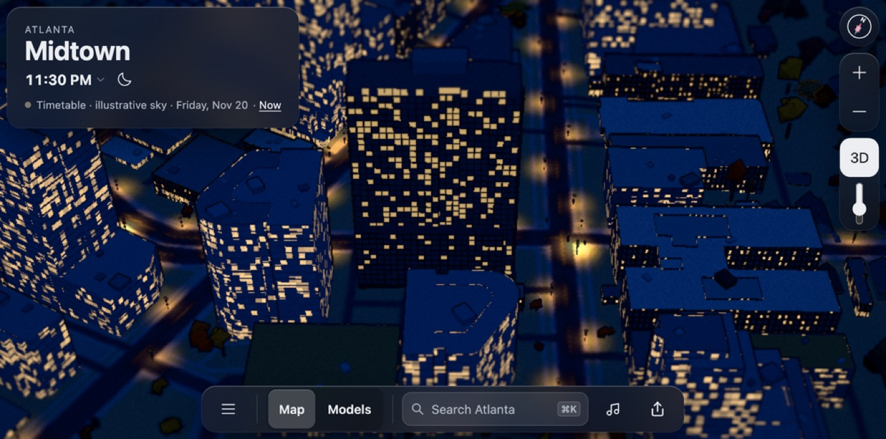
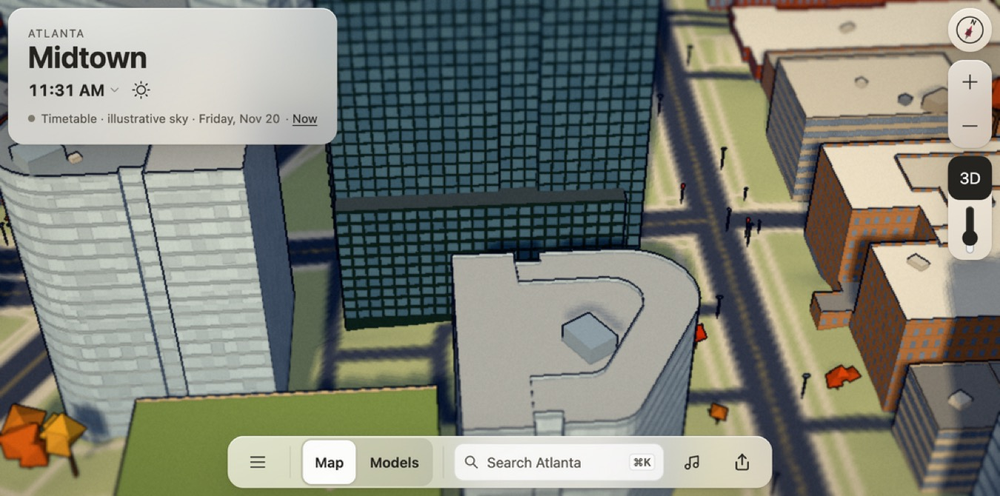

# Nomia

City replaces the generic mesh for `osm:way:1300593936`, Nomia at 1382 Peachtree on the corner of 17th Street. It is a 33-storey apartment tower that opened in late 2023, after the 2019 lidar was flown, so the lidar doesn't apply. The mapped tower parts are inferred at 111.6 m. City uses the reported 33 storeys instead: a 6.2 m lobby, 31 residential floors at about 3.12 m, a 4.4 m amenity floor, and a 5.5 m mechanical penthouse, for about 109 m to the top of the plant. The tower is the outer boundary of the five mapped tower parts, a 70 × 20 m slab about 29° off the board axis. The mapped 32.4 m block and the low east part keep their own heights.

The daytime aerials show the slab clad in a near-black green frame with a tight grid of floor-to-ceiling glass. Stacked balconies run up the narrow ends, the top amenity floor is lighter with a glazed rail, and a pale penthouse sits on the roof. The dusk aerial from the opposite side confirms the frame grid and shows scattered warm apartments. Estimated details: the 3.05 m bay on the long faces (2.9 m on the ends), the 1.6 × 5 m balconies, the penthouse footprint (about 23 × 10 m), and the colours, which were matched by eye under the City grade. The 17th Street retail frontage is simplified.

Sources, consulted in a fresh Orca tab:
- [Urbanize Atlanta photo tour, December 2023](https://atlanta.urbanize.city/node/20371): two daytime aerials, looking south toward downtown and southwest over Peachtree.
- [Greystar development page](https://www.greystar.com/business/services/development-and-construction/featured-projects/nomia): dusk aerial from the north and west.
- [R2L Architects project page](https://www.r2l-architects.com/work/nomia): dusk rendering, used only to confirm the frame and the balcony stacks.

**Lighting:** The dusk aerial shows scattered warm apartments, but there is no full-night photograph, which is a gap. City treats Nomia as residential, with about 30% of units lit at 23:30, a brighter amenity floor, and no decorative crown lighting.

| Review view | City query |
|---|---|
| Day, from the SSE | `?view=city&q=low&t=2026-11-20T11:30:00-05:00&cam=425,-4280,330,48,560` |
| Full night, matched | `?view=city&q=low&t=2026-11-20T23:30:00-05:00&cam=425,-4280,330,48,560` |
| Closer, frame grid and lower block | `?view=city&q=low&t=2026-11-20T11:30:00-05:00&cam=436,-4262,335,52,330` |

The survey's starting camera (`441,-4246,32,60,307`) looks from the SSW, where the curved tower next door blocks Nomia. The review views come from the SSE instead.

