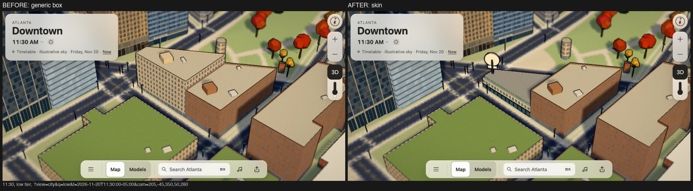
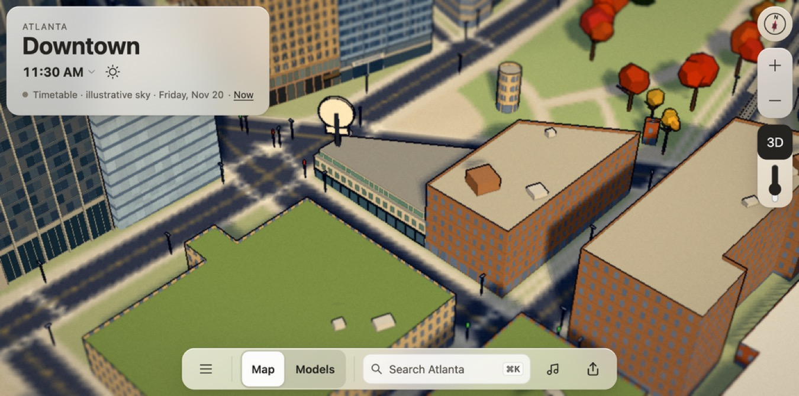
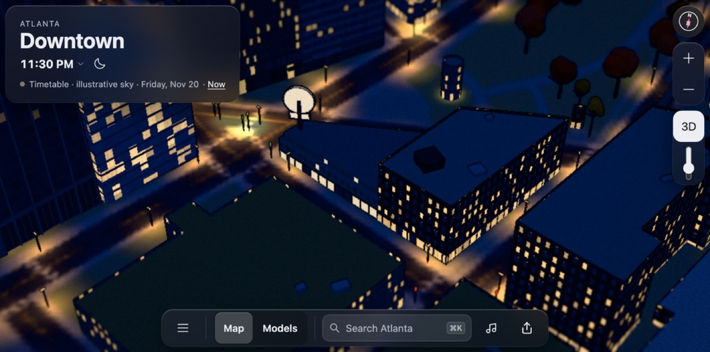
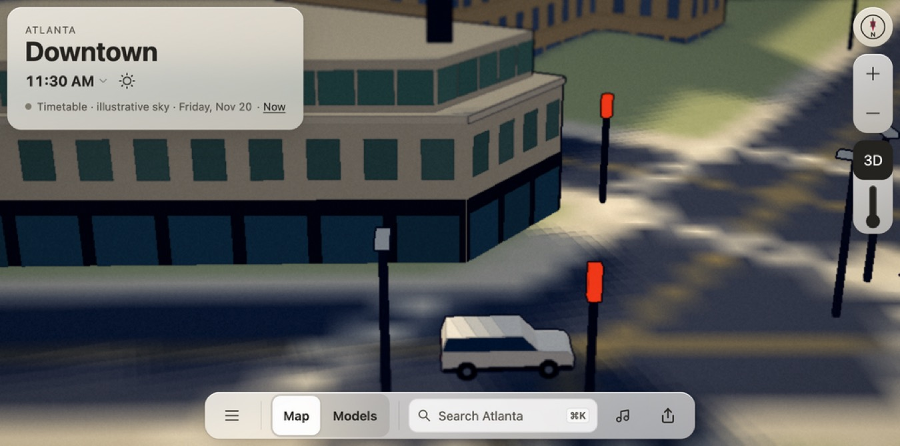
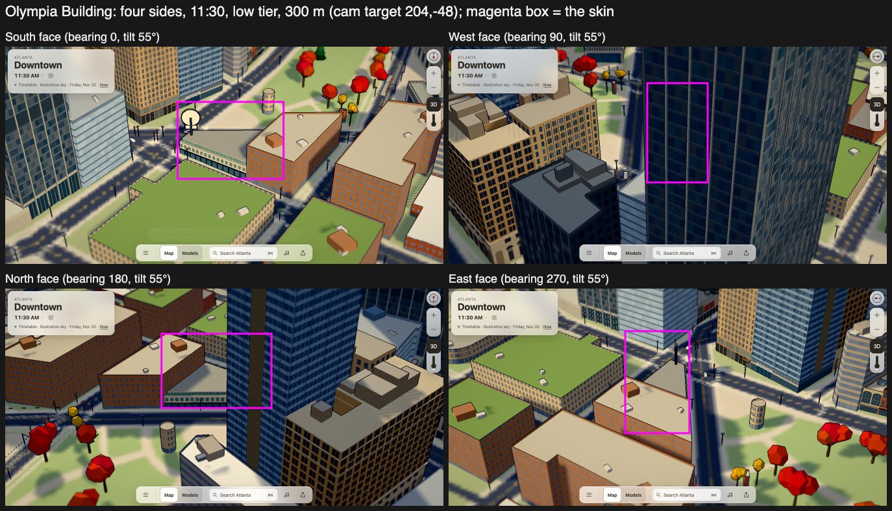

# Olympia Building

City replaces the generic downtown mesh for Overture `d1c4e582-4bcf-4986-a2df-0d0e675ea41a`, the Olympia Building (Ivey & Crook, 1935–36) at 23 Peachtree Street on the Five Points corner of Peachtree, Edgewood and Decatur. It's a City of Atlanta landmark exterior. **Height basis: lidar 2019.** A 4 m grid of 90th-percentile returns over 318.5 m ground puts the building at about 10.5 m. The mapped 27.5 m is the rooftop sign alone, which the lidar tops at 27 m over the west corner. So the old generic box was a 27.5 m block where a two-storey building stands.

**Identifying features** (Wikimedia Commons photographs, two angles):
1. A low pale-stone Art Moderne block: a dark storefront band, large green-tinted windows in the stone storey, a cornice, and a set-back green-glass top floor.
2. The big round rooftop sign on a message board atop a mast. It's drawn as a **blank neutral panel**, with no wordmark, script, bottle or brand colour (the no-logos rule, confirmed with the lead), and dark-framed.

Estimated details: the 4.6 m storefront band, the 8.6 m stone storey, the 1.6 m top-floor setback, the 2.6 m window bay, and the sign's dimensions. Sources describe the sign as nearly 50 ft with a 33 ft neon face; City uses a 10 m disc centred 22 m up, on a 6 m message board from 15 to 17.6 m.

Sources, consulted in a fresh Orca tab:
- [Wikimedia Commons: Olympia Building and sign](https://commons.wikimedia.org/wiki/File:Olympia_Building_and_Coca-Cola_sign_Atlanta.JPG)
- [Wikimedia Commons: the Peachtree frontage](https://commons.wikimedia.org/wiki/File:Olympia_Building,_ATL.jpg)
- [Wikimedia Commons: the sign at sunset](https://commons.wikimedia.org/wiki/File:Coca-Cola_neon_sign_at_the_center_of_downtown_Atlanta_at_Sunset.jpg)
- [City of Atlanta historic preservation listing](https://www.atlantaga.gov/government/departments/city-planning/historic-preservation/property-district-information/olympia-building): designation and dates.

**Lighting:** the sign's face is neon-lit nightly (it carries a time and temperature display), so the blank panel glows a neutral warm white at night. The building is lit as retail below and offices above. No full-night photograph of the building itself was found.

**Views:** Five Points is ringed by towers. From the west, a tower hides the building completely, and from the north and east it's partly hidden. The review views look from the south, down Peachtree.

| Review view | City query |
|---|---|
| Day, from the south | `?view=city&q=low&t=2026-11-20T11:30:00-05:00&cam=205,-45,350,50,280` |
| Full night, matched | `?view=city&q=low&t=2026-11-20T23:30:00-05:00&cam=205,-45,350,50,280` |
| Close, the Five Points frontage (dev server) | `?view=city&dev&mindist=40&q=low&t=2026-11-20T11:30:00-05:00&cam=186,-52,180,70,60` |

