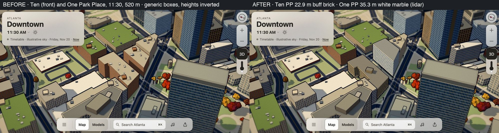
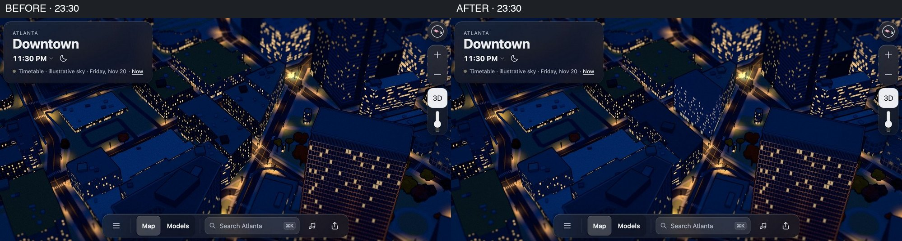
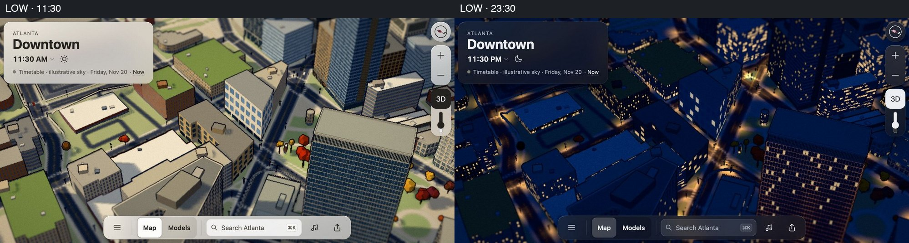
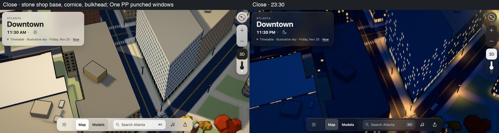
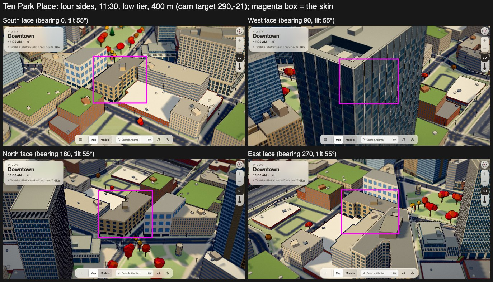
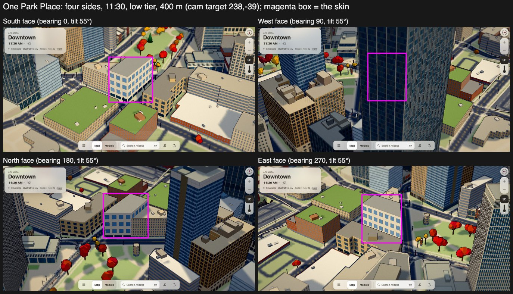

# Ten Park Place and One Park Place

These are two Georgia State buildings on Woodruff Park's south edge, drawn together.

**Overture's heights are wrong and inverted.** Its names are correct: they match OSM ways 252608909 (10 Park Place) and 252608893 (1 Park Place) by centroid. But Overture gives Ten Park Place 30.6 m and One Park Place 21.2 m, while the 22 April 2019 3DEP lidar gives **22.9 m** and **35.3 m**. Each skin uses its lidar height, so a re-run of `pnpm data` can't reintroduce the error.

| Building | Overture | Height | Basis |
|---|---|---|---|
| Ten Park Place, 1929 (Anthony Ten Eyck Brown, for Albert E. Thornton) | c44718c3 | 22.9 m roof over the 316.8 m NAVD88 grade; bulkhead to about 28 m | lidar median 22.9 (3,299 of 4,094 returns at 20–25 m); bulkhead from the raster |
| One Park Place | f3adb484 | 35.3 m roof over the 317.4 m grade | lidar median 35.3 |

## Identifying features
From Street View: 15 Edgewood Avenue, 2 Park Place, 21 Park Place (all Mar 2025) and 36 Decatur Street (Sep 2018); cited, not committed.
- **Ten Park Place:** buff brick (`#cbb894`) with punched windows over a pale stone shopfront base and a stone cornice (`#ddd2bb`).
- **One Park Place:** white marble cladding (`#e3e2dd`) with blue-tinted punched windows (`#7fa2c4`, S 35%, V 77%), a dark glazed base and a GSU sign over the entrance. The sign is omitted (no logos).

## Night
No night photograph exists. Ten Park Place (offices and shops) is lit at 35%; One Park Place (university) at 30%.

## Views
| View | Query |
|---|---|
| Money shot, 520 m, day and night | `?view=city&q=high&t=2026-11-20T11:30:00-05:00&cam=262,-25,250,48,520` (23:30 for night) |
| Close | `?view=city&dev&mindist=20&q=high&t=2026-11-20T11:30:00-05:00&cam=262,-25,230,40,200` |
| Four-side, each | `node scripts/four-side-sheet.mjs --id <id> --ground <grade> --top <roof> --dist 400`. The 25 Park Place tower hides both west faces from 400 m. |

## Deploy
This is bundled City code, so visitors see it after a `web/dist` rebuild and worker redeploy. No `pnpm data` is needed.
