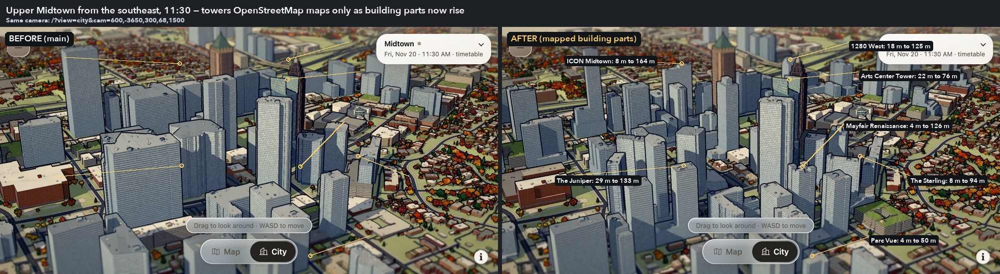
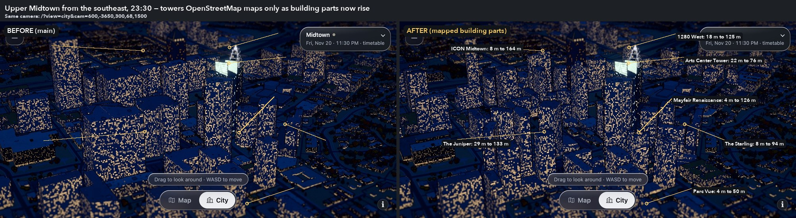
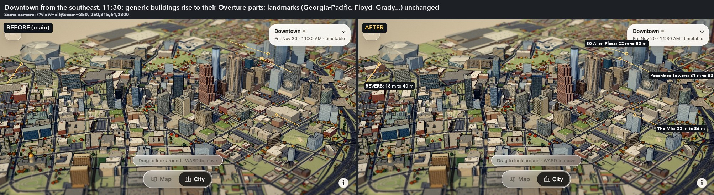
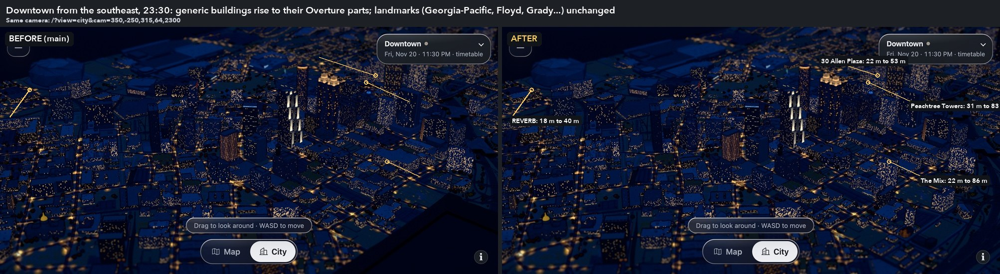

# Mapped building parts

OpenStreetMap often maps a tower as a low parent outline plus `building:part` ways, each with its own `height`, `building:levels` or `min_height`. City used to ignore the parts, so the parent's own tags won. ICON Midtown appeared as a two-storey Whole Foods. The Mayfair Renaissance appeared as a one-storey garage. 1280 West's twin 37-storey towers appeared as a five-storey block.

`extract_context` now assigns each part to the outline it sits in. It merges overlapping parts with the same vertical range, and where one part spans another's whole range, the taller one wins. Whatever the parts leave uncovered keeps the parent's own height. Where the parts map at least half the plan, that remainder is capped at the height of the lowest substantial part. Parts that lie outside every outline become buildings in their own right. City extrudes the parts in place of the parent box, and a part with a mapped underside is drawn open beneath.

Heights carry truth tiers:
- **Reported:** a part's `height` tag.
- **Inferred:** a part with levels only. When the parent reports a height, its tallest part is scaled to match it (2.5–6.5 m per level). When the parent has levels only, parts use City's usual 3.6 m. Otherwise they use 3.3 m.
- **Illustrative:** no data at all, the existing 8 m.

Hillside foundations now check the lowest grounded part, and the roof-under-terrain test checks every part's roof. King and Sweet Auburn have no mapped parts. Downtown comes from Overture and is a separate change.

**Money shot.** Upper Midtown from the southeast, with the same camera before and after (`/?view=city&cam=600,-3650,300,68,1500`), 20 November, high tier.

Closer views, each at bearing 25° and tilt 55° unless noted:

| Tower | Camera | Day | Night |
| --- | --- | --- | --- |
| icon | `/?view=city&cam=321,-3590,25,55,520` | [before](icon-before-day.jpg) · [after](icon-after-day.jpg) | [before](icon-before-night.jpg) · [after](icon-after-night.jpg) |
| mayfair | `/?view=city&cam=975,-3560,25,55,520` | [before](mayfair-before-day.jpg) · [after](mayfair-after-day.jpg) | [before](mayfair-before-night.jpg) · [after](mayfair-after-night.jpg) |
| west1280 | `/?view=city&cam=267,-3976,25,55,520` | [before](west1280-before-day.jpg) · [after](west1280-after-day.jpg) | [before](west1280-before-night.jpg) · [after](west1280-after-night.jpg) |
| juniper | `/?view=city&cam=890,-3320,25,55,520` | [before](juniper-before-day.jpg) · [after](juniper-after-day.jpg) | [before](juniper-before-night.jpg) · [after](juniper-after-night.jpg) |
| parcvue | `/?view=city&cam=1114,-3471,25,55,420` | [before](parcvue-before-day.jpg) · [after](parcvue-after-day.jpg) | [before](parcvue-before-night.jpg) · [after](parcvue-after-night.jpg) |
| artscentertower | `/?view=city&cam=313,-3945,205,55,420` | [before](artscentertower-before-day.jpg) · [after](artscentertower-after-day.jpg) | [before](artscentertower-before-night.jpg) · [after](artscentertower-after-night.jpg) |
| starling | `/?view=city&cam=911,-3680,25,55,420` | [before](starling-before-day.jpg) · [after](starling-after-day.jpg) | [before](starling-before-night.jpg) · [after](starling-after-night.jpg) |

## Downtown (Overture)

Downtown buildings come from Overture, which links each `building_part` to its parent by `building_id`. `pipeline/scripts/downtown_parts.py` runs at the end of `pnpm data:city` and attaches the parts to the staged downtown buildings, using the OSM boards' podium and tier rules. A part with no height or floors takes the parent's mapped height (inferred), not the 8 m default. Parent ids, rings and heights stay unchanged, so the hillside grades, the curated landscape and every landmark keep working. 71 downtown buildings have parts. Most of the headline cases (Georgia-Pacific, Marriott Marquis, Hyatt Regency, Omni, Sam Nunn, Georgia Power, Floyd, Grady) are custom landmarks that already suppress the parent and its parts. The generic ones that change most are Peachtree Towers (31 m to 83 m), The Mix (22 m to 86 m), 30 Allen Plaza (22 m to 53 m) and REVERB (18 m to 40 m).

