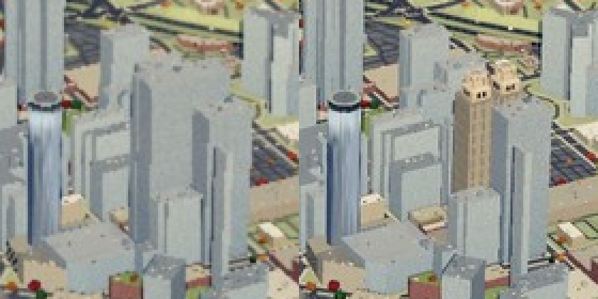

# 191 Peachtree Tower in City

**Keep the tower.** At the normal 1280 × 900 desktop opening, the two crowns appear about 14 CSS pixels apart to the right of the Westin’s round roof. From the north the narrow recess between shafts reads down the facade. At dusk the open lanterns pick up a warm wash. The neighbouring tall parking extrusion obscures part of the south face in the current bake.



| Matched view | Existing City | With 191 Peachtree |
| --- | --- | --- |
| Normal opening, afternoon | [Before](opening-before.jpg) | [After](opening-after.jpg) |
| South approach with the Westin, afternoon | [Before](south-before.jpg) | [After](south-after.jpg) |
| Same south camera, dusk | [Before](dusk-before.jpg) | [After](dusk-after.jpg) |

[Framed daylight view from the north](north-day.jpg) · [Same view at dusk](north-dusk.jpg)

## Which parts belong to 191

The downtown bake names Overture feature `cca22dcb-b333-4b2a-9371-869465370bda` **191 Peachtree Tower**, 50 floors and 234.7 m high. Its 109.5 × 49.5 m footprint includes the low entrance on Peachtree Street. The previous extrusion put its full height over the entrance. City replaces this one feature when the crown locations and terrain agree. The Westin, Ritz-Carlton and adjacent garage keep their own geometry. [Mapped parent](https://www.openstreetmap.org/way/261043963) · [Three-level entrance](https://www.openstreetmap.org/way/886346709)

The mapped shaft occupies roughly 76 × 37 m and recesses between its east and west halves. Two roughly 26 m square roof parts center on (429.5, −567.7) and (469.0, −567.2) in City’s east/south metres. The model carries each to the baked top height. The 17 m podium, 203 m shoulder, intermediate levels, column proportions, shallow dome and pane rhythm are estimates from photographs. The bare-earth grid supplies the foundation. [Shaft outline](https://www.openstreetmap.org/way/537432531) · [West roof part](https://www.openstreetmap.org/way/537432533) · [East roof part](https://www.openstreetmap.org/way/537432532)

## Photographic references

- Kendall/Heaton’s daylight street approach shows the two shafts divided by a recessed central facade and the pale vertical granite piers continuing up to the shoulders. The dusk photograph shows the lantern openings silhouetted against the sky and warm light concentrated around the two crowns. Those observations drive the massing, repeated window bays and crown lighting. The City lighting is illustrative. [Daylight street approach](https://www.kendall-heaton.com/wp-content/uploads/2014/12/191-peachtree-tower-2.jpg) · [Architect’s dusk photograph](https://www.kendall-heaton.com/wp-content/uploads/2014/12/191-peachtree-tower-1.jpg)
- Mary Ann Sullivan’s close view separates the paired round-headed windows in each shoulder from the taller openings above. Her entrance view shows the large glazed arch in the low street facade. The model uses real openings between the upper piers, a shallow roof cap and simpler glazed arches below them. [Crown close-up](https://homepages.bluffton.edu/~sullivanm/atlanta/johnsonburgee/top.jpg) · [Peachtree entrance](https://homepages.bluffton.edu/~sullivanm/atlanta/johnsonburgee/centerfront.jpg)
- Hines describes a single narrow profile viewed from the east or west and two linked profiles from the north and south. Its description places seven stories of ornament above the office elevations. [Original developer’s project account](https://www.hines.com/properties/one-ninety-one-peachtree-tower-atlanta)

## Reproduce and integrate

In desktop Orca use 1280 × 900 and `/?view=city&q=high&t=2026-11-20T14:12:45-05:00&speed=0`. The normal opening uses the untouched City camera at (−40, −260), bearing 28°, tilt 57°, 2.376 m per CSS pixel. For dusk use `2026-11-20T17:45:00-05:00`. Before frames use `ff36969`, with the same local downtown data, clock, viewport and cameras.

```js
// South comparison with the cylindrical Westin at left.
window.__city.lookAt(392, -645, { bearing: 13, metresPerPixel: .53, tilt: 64 })
// The framed daylight review view, looking southeast from the north.
window.__city.lookAt(547, -288, { bearing: 160, metresPerPixel: .48, tilt: 62 })
```

The landmark has three meshes with two shared procedural 80 × 368 RGBA textures for facade colour and room emission (230 KiB total before mipmaps). At the daylight opening the scene went from 121 to 127 draw submissions and from 2,059,257 to 2,061,585 triangle submissions. The original generic building was already part of a shared batch. At dusk the close camera went from 78 to 84 draws. A web rebuild and deployment pick up the model with the existing bake.
