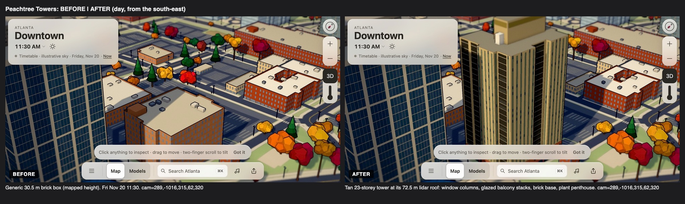
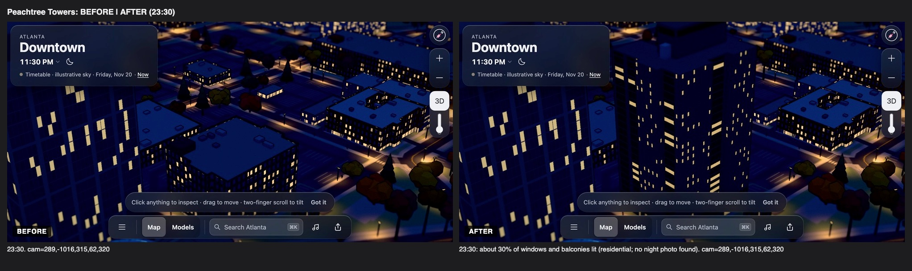
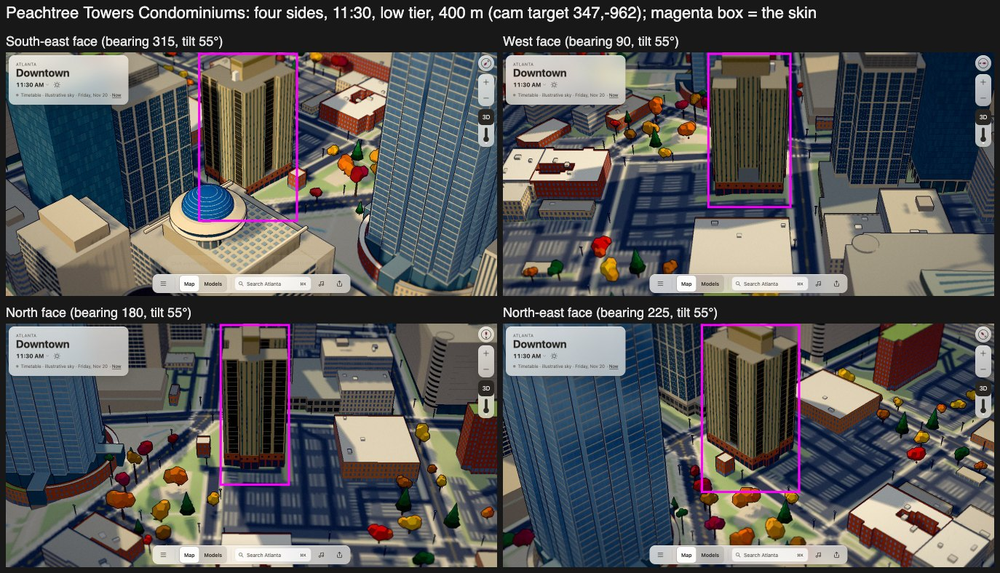

# Peachtree Towers

Peachtree Towers is a condominium tower at 300 Peachtree Street NE, downtown. It replaces Overture building `ac1b4307-c7ca-42f9-b1fd-9bb1bbb675f7`. The skin is `web/src/city/peachtree-towers.ts`, mounted in `city.ts` and batched with the downtown landmarks.

**Identity.** Francis M. Daves designed it and C.D. Spangler Construction built it in 1962. It has 23 storeys and was once Atlanta's tallest residential building. Source: Georgia DCA, *Modern Downtown Atlanta*, p. 54 (<https://dca.georgia.gov/document/document/modern-downtown-atlanta/download>). OpenStreetMap tags it with 24 levels (way 270470057).

**Height (2019 lidar, NAVD88).** Ground is 317.2 m. The main roof is 72.5 m above it (median) and the plant penthouse 84 m (95th percentile). The mapped 30.5 m was wrong.

A 3 m and 1.5 m grid of lidar roof heights shows:
- **An H plan.** A light court about 15 m deep is cut into the west side (x 326.6–342, z −968.5 to −955.5). It is floored at about 7 m.
- **A 3 m east notch** (x 360–363, z −968.5 to −958). It is floored at about 10 m.
- **The penthouse.** It covers x 342.5–352, z −977 to −950.

The skin uses one base roof at 9 m for both the court and the notch.

**Photographs.** All are daytime. I found no night exterior photograph, so that is a gap.
- **South and east faces:** [Wikimedia Commons, May 2024](https://commons.wikimedia.org/wiki/File:Peachtree_Towers_Condominiums.jpg). An aerial from a high floor of the Hyatt Regency, looking north-west.
- **Street level:** [AllAtlantaCondos gallery, about 2017](https://www.allatlantacondos.com/peach-tree-towers-downtown-atlanta-condos/).
  - Looking up at a balcony recess.
  - The granite entrance.
  - The brick base with its green panels.
  - The tower behind the Carnegie Pavilion.

**Features drawn, each seen in a photo:**
- **Walls:** painted buff tan. The aerial's sunlit wall measures S34 V68, and the skin's `#c4b48f` renders close to it.
- **Window columns:** white-framed windows over sage-green panels. Each column is one grey-green strip (`#7f8c7a`) at City range, and lit windows are lamp quads.
- **Balcony stacks:** full-height, enclosed in glass with dark bronze frames, with a light rail at each floor.
  - The south face has three: two near the west end and one east of the centre.
  - The east face has one, set in the lidar notch. The aerial shows that stack recessed in the same place.
- **Base:** two storeys of brick over polished pink granite piers and tall shop glazing.
- **Penthouse:** a tall tan plant penthouse with a perforated vent band near its top, and a white hood on its south side.

**Estimated:**
- **Unphotographed faces:** the north face, the west face and the court walls are not in any photo I found. The north face repeats the south face's stacks, and each court side wall carries one stack.
- **Sizes and positions:** stack widths and positions are scaled from the aerial. The 2.6 m column pitch and the 4.5 m base height are also estimates.
- **Not drawn:** the "300 PEACHTREE TOWERS" lettering, the Porfirio's sign and the awnings. Signs are never drawn.

**Lighting (estimated, no night photo).** City lights it as residential: about 30% of windows and balcony bays are lit at 23:30. Half of the shop bays and a quarter of the base windows are lit. No roof or sign lighting is drawn.

| Review view | City query |
|---|---|
| Day, from the south-east (the aerial's side) | `?view=city&q=low&t=2026-11-20T11:30:00-05:00&cam=289,-1016,315,62,320` |
| Full night, matched | `?view=city&q=low&t=2026-11-20T23:30:00-05:00&cam=289,-1016,315,62,320` |

