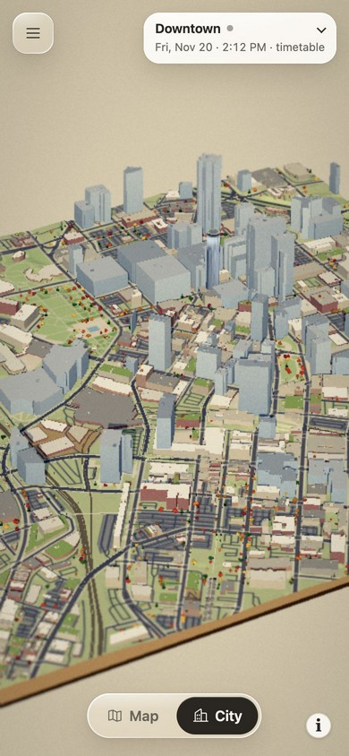
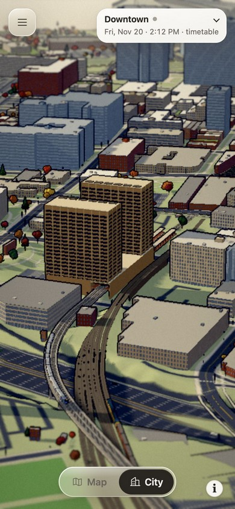
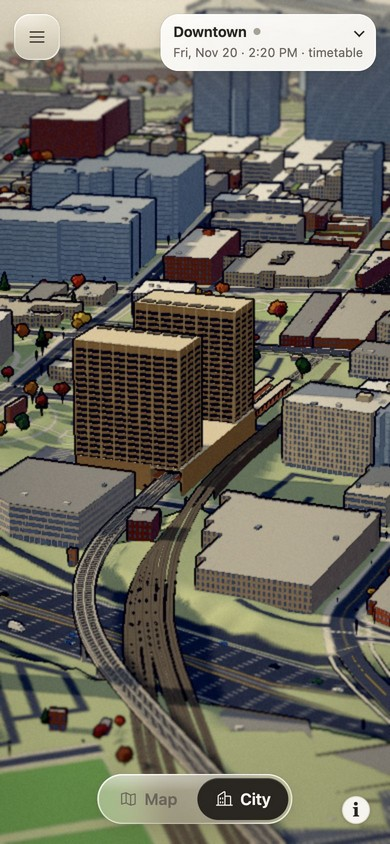

# Sim Atlanta at 390 × 844

| Current opening | Georgia State approach | Same approach between trains |
| --- | --- | --- |
|  |  |  |
| 2:12:45 p.m. EST | 2:12:45 p.m. EST | 2:20:00 p.m. EST |

**Use the Georgia State approach for a railway-first portrait opening.** The scheduled eastbound Blue Line train is visible car by car as it curves across the Downtown Connector. Even during the gap at 2:20, both tracks lead back to the opening under the Floyd towers. The towers and surrounding street grid keep the view recognizably downtown. The existing opening shows more of the Atlanta skyline and the edge of the miniature, but I could not pick out the same train at that scale.

## Reproduce the frames

On the development build at main commit `09b2fea`, open `/?view=city&q=low&t=2026-11-20T14:12:45-05:00&speed=0` in desktop Orca at 390 × 844. The paused Friday timetable supplies the train position. Both frames use the same daylight and low rendering tier.

1. Capture the opening without moving the camera. City reports target (−40, −260), bearing 28°, tilt 57° and 2.5334 m per CSS pixel.
2. Call `__city.lookAt(467, 407, { bearing: 289, metresPerPixel: 0.60, tilt: 72 })` and capture the approach.
3. Change the URL time to `2026-11-20T14:20:00-05:00`, reload and apply the same approach camera for the empty viaduct.

Camera targets use City's local east and south metres. These are desktop Orca framing captures, made with the regular City controls visible.
