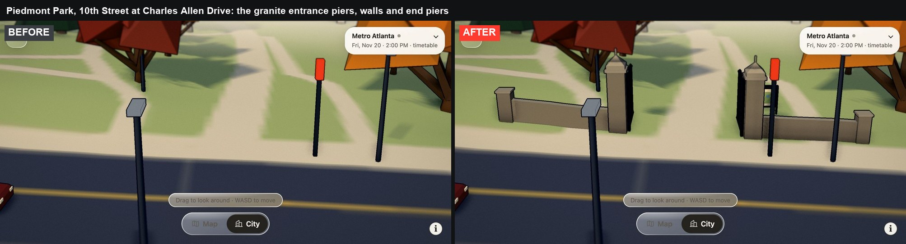

# Piedmont Park: furniture, map kiosks and the 10th Street entrance

The second part of the Piedmont Park small-details pass, after the Active Oval (#296).

- **10th Street entrance at Charles Allen Drive:** granite piers with stepped pyramid caps and finials stand either side of the drive. Taller granite walls run out to end piers, and the inner iron gate is set back. It joins the 12th and 14th Street gates in `piedmont-gates.ts` and is built on both tiers, like them.
- **Park furniture at 57 mapped OSM points:** 24 benches, 18 drinking fountains, 8 litter bins, 6 charcoal grills and a picnic site. The points lie inside the park polygon (way 208357832), outside the Botanical Garden, and are baked into `details.json`. Each piece is pushed 0.6 m clear of the nearest paving and turned to face it. High tier only.
- **Map kiosks:** one inside each main entrance (10th, 12th and 14th Streets). Each is a dark framed panel with a plain map sheet: no text and no Conservancy logo. High tier only.
- **Reusable pieces:** the bench, bin, fountain, grill, picnic table and kiosk are in `web/src/landscape/furniture.ts`, shown in the model lab under Landscape → Park furniture.
- **Hedge fix:** loose hedge clumps now sit properly on slopes (shipped in #296).

**What is reported and what is illustrative**
- **Reported (OSM):** furniture positions, the inner gate node (1595736690) and the park outline.
- **Illustrative:** every model, every dimension, the kiosk positions and the pier line.
  - The pier line is estimated 2 m nearer the street than the mapped gate node.
  - The piers are 1.2 m square with 4.2 m shafts.
  - The opening is 8 m.
  - The walls are 1.5 m high and 6.5 m long.

**Photo research**
- **Street View, cited and not copied:**
  - 10th Street NE at Charles Allen Drive, March 2025, from the street: pier caps, walls, end piers and the inner gate.
  - The same entrance from inside the park, May 2015: lamps and iron fence.
- **Photos:** Google Images results for Piedmont Park's path benches (black cast-iron ends, brown slats, backrest) and its map kiosks (black framed map panels).
- **Night:** I found no reliable night photographs of the 10th Street entrance. That gap is recorded here. The piers carry no lights of their own, and the existing path and street lamps light the approach.
- **Estimated:** all furniture sizes (bench 1.8 m, seat 0.45 m; bin 0.55 × 0.9 m; fountain bowl at 0.9 m; grill box at 0.8 m; kiosk panel 1.3 × 1.6 m).

**Cost**
- High tier: 3,284 triangles across both park boards in one furniture draw per board, plus the gate's two draws on midtown-central.
- Low tier: the gate only (as for the 12th and 14th Street gates); no furniture.

## Views (captioned BEFORE | AFTER)

The close views use a dev-only camera override, because City's orbit stops at 150 m. The standard camera for the entrance is `/?view=city&cam=1739,-3112,0,70,150`.

- [10th Street entrance](tenth-compare.jpg), from the 10th Street side: target 1739, −3112, bearing 0°, tilt 70°, 40 m
- [12th Street kiosk](twelfth-compare.jpg): target 1200, −3377, bearing 90°, tilt 66°, 35 m
- [A bench near 12th Street](bench-compare.jpg): target 1263, −3280, bearing 250°, tilt 64°, 22 m
- [11 pm](tenth-night-compare.jpg) · [Low tier](tenth-low-compare.jpg)

Park Tavern is at 10th and Monroe, about x ≈ 2200, outside the board's east edge at x = 1800. Publishing needs a web rebuild only.
