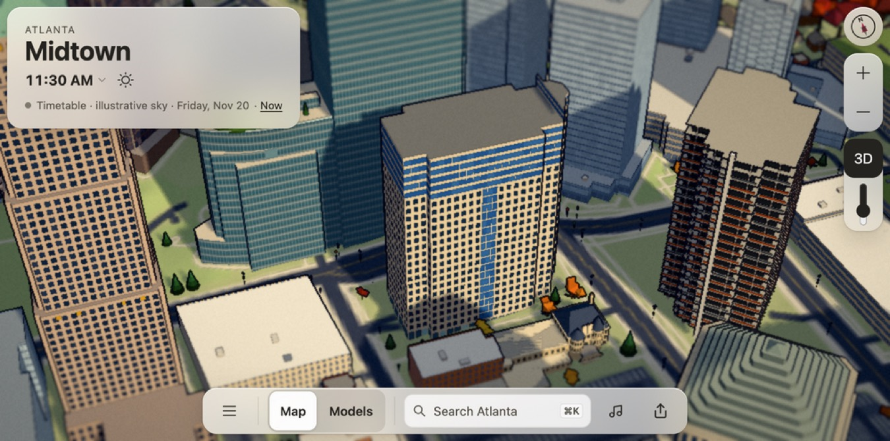
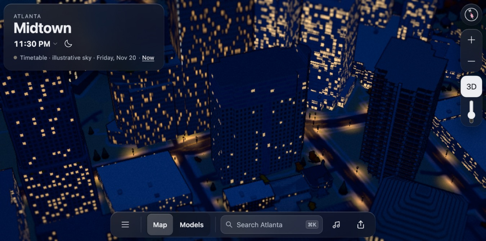
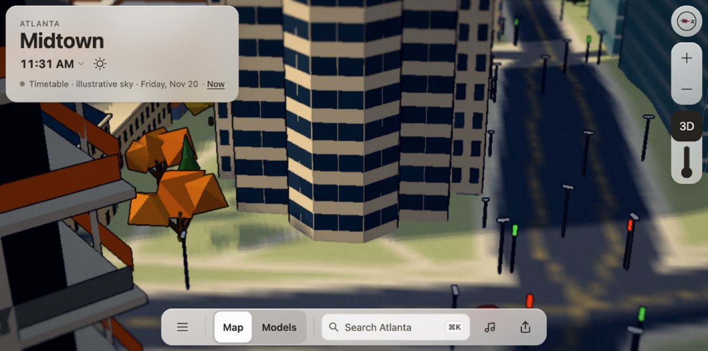

# The Proscenium

City replaces the generic mesh for `osm:way:269843396`, the 24-storey office tower at 1170 Peachtree and 14th Street (TVS, 2001). The 73 × 37 m mapped outline, with its notched corners and faceted Peachtree end, has no mapped parts. Its mapped 98 m agrees with the 2019 lidar. The CTBUH lists 104.9 m to the top of the stepped Peachtree bay, so City brings the main roof to 98 m and raises the Peachtree bay to 104 m.

The two aerial listing photographs show the north face and a three-quarter view from the northwest. The pale granite grid carries square punched windows. The top five floors are wrapped in continuous blue glass ribbons, and a narrow glazed slot climbs the middle of the long faces into that blue crown. The faceted Peachtree bay carries window ribbons for its full height and steps above the roof. The owner's brochure rendering shows the renovated corner entrance at Peachtree and 14th: tall lobby glass under the granite frame. Estimated details: the 6 m lobby, the 4 m office floors, the 3 m window bay, the slot width (about 6.4 m), the 78 m start of the ribbon crown, and the 104 m bay top.

Sources, consulted in a fresh Orca tab:
- [LoopNet listing, two aerial photographs](https://loopnet.com/Listing/1170-Peachtree-St-Atlanta-GA/4023960): the north face looking south toward downtown, and the northwest three-quarter view with the Peachtree bay.
- [Owner's leasing brochure (Cousins and Town Lane)](https://www.prosceniumatl.com/wp-content/uploads/2025/05/PROSCENIUM.pdf): rendering of the renovated Peachtree and 14th entrance. City does not draw the name sign.

**Lighting:** No full-night photograph was found. City treats it as an office at 23:30, with most windows dark, a lit lobby (brighter in the Peachtree bay), and no crown lighting.

| Review view | City query |
|---|---|
| Day, from the south | `?view=city&q=low&t=2026-11-20T11:30:00-05:00&cam=735,-3655,20,50,540` |
| Full night, matched | `?view=city&q=low&t=2026-11-20T23:30:00-05:00&cam=735,-3655,20,50,540` |
| Closer Peachtree bay (dev server; neighbours block every 150 m orbit) | `?view=city&dev&mindist=40&q=low&t=2026-11-20T11:30:00-05:00&cam=748,-3606,265,66,130` |

