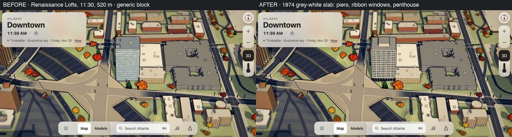
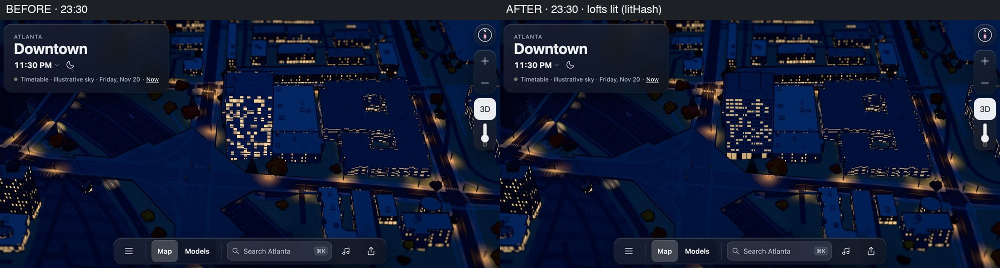
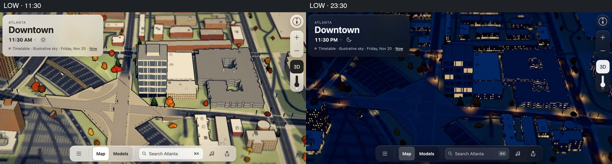
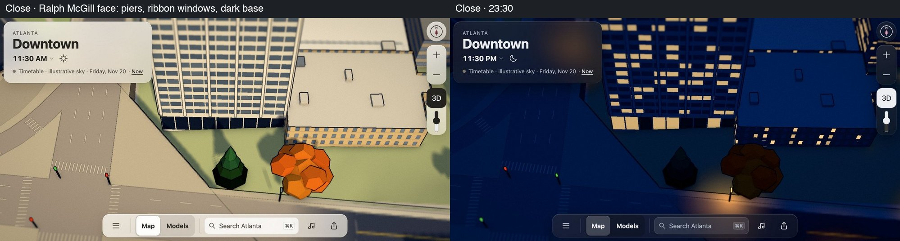
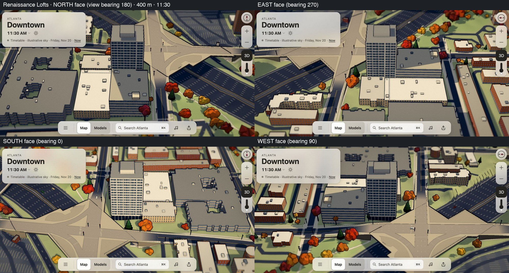

# Renaissance Lofts

Overture `591e9823-7f95-45cf-a892-896ecc5a19a3` is Renaissance Lofts at 120 Ralph McGill Boulevard: a 16-storey office building from 1974, converted to 186 lofts for the 1996 Olympics and repainted grey-white. City drew a generic glass block. It now draws the real slab.

| Element | Height | Basis |
|---|---|---|
| Slab, full outline | roof 57.8 m above the 303.6 m NAVD88 grade | 3DEP lidar, 22 April 2019, median of returns inside the outline. The mapped 62.9 m is closer to the penthouse. |
| Penthouse, centred, 16 × 18 m (estimated) | 63.4 m | lidar 90th percentile (max 64.4) |

## Identifying features
From the [Urbanize Atlanta 2022 exterior photograph](https://atlanta.urbanize.city/post/affordable-downtown-loft-condo-for-sale-asking-205k), and Street View from Ralph McGill (Dec 2025) and Courtland Street (Oct 2026), both cited, not committed:
- A grey-white painted concrete slab (`#dcdcd8`), which the Urbanize article calls "a snazzy grey-white paint scheme".
- Deep vertical piers (`#e9e9e6`) framing dark ribbon windows (`#6f7c86`) on every face.
- A dark recessed ground floor under the entrance canopy.
- A rooftop penthouse.

Pier spacing (7 m) and penthouse size are estimated.

## Night
No night photograph exists. Lofts are lit from the shared litHash at 40%, and the lobby at 45%.

## Views
| View | Query |
|---|---|
| Money shot, 520 m, day and night | `?view=city&q=high&t=2026-11-20T11:30:00-05:00&cam=729,-1207,0,50,520` (23:30 for night) |
| Close, Ralph McGill face | `?view=city&dev&mindist=20&q=high&t=2026-11-20T11:30:00-05:00&cam=729,-1190,0,32,170` |
| Four-side | `&dev&mindist=20&cam=729,-1207,{180,270,0,90},50,400` |

