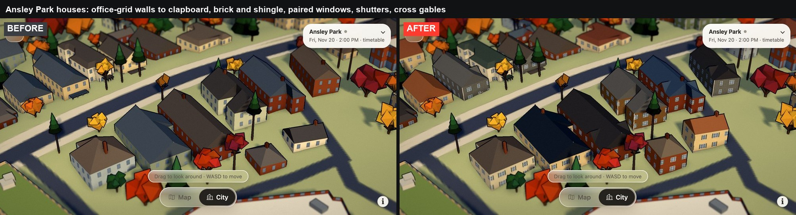

# Residential v2a: house facades, windows and massing

Sam's review of #207: the roofs worked, but the houses still read as low-rise offices, with a regular grid of small punched windows on flat colour. Version 2a changes the walls, the windows and the massing. Yards come next (v2b), built from the polished landscape primitives.

## Street View references

Viewed in Orca, not copied:

- Ansley Park, 136 Westminster Drive NE (Feb 2022): [pano](https://www.google.com/maps/@?api=1&map_action=pano&viewpoint=33.792078,-84.377013&heading=90&pitch=0&fov=80). Two- and two-and-a-half-storey houses in red brick and cedar shingle with white trim, paired and tripled double-hungs, front gables and dormers, dark asphalt roofs, low brick walls and foundation shrubs.
- Ansley Park near The Prado: [pano](https://www.google.com/maps/@?api=1&map_action=pano&viewpoint=33.789383,-84.37777&heading=0&pitch=0&fov=80). A white stucco house with an arched porte-cochère, behind clipped hedges.
- Home Park, 1209 State St NW (Mar 2025): [pano](https://www.google.com/maps/@?api=1&map_action=pano&viewpoint=33.787856,-84.398731&heading=90&pitch=0&fov=80). One-storey front-gable bungalows in olive, white and beige lap siding, with small post porches, straight front walks and side driveways.

## What changes, and how sure it is

Everything below is `illustrative` unless OSM tags it. The choices are deterministic per id.

- **Walls.** Four shader facades: clapboard lap lines, brick coursing, stucco and staggered shingle. Fine lines fade to their average below a couple of pixels, so distant walls don't shimmer. Every wall has a masonry foundation band. Clapboard and shingle houses get white corner boards (high tier).
- **Siding mix.** Ansley Park: 35 % brick, 25 % shingle, 25 % clapboard, 15 % stucco. Elsewhere: 60 % clapboard, 25 % brick, 10 % shingle, 5 % stucco. A tagged `building:material` wins.
- **Windows.** Double-hungs in 3.6 m bays on each 3.05 m storey, single or paired, with white trim and a meeting rail. About 40 % of bays have dark shutters. At night about a third of rooms are lit.
- **Front.** A front door with a white surround faces the nearest mapped street. Without a porch it gets a stoop, with steps down to the lowest ground in front.
- **Massing.**
  - Two storeys by default in Ansley Park (x 800–1750, z −4750 to −3700); elsewhere one storey under 150 m², two above. OSM levels or height win where tagged.
  - A cross gable over 65 % of long street fronts.
  - Plans longer than twice their depth get side gables, staggered toward opposite ends, which break the long "barn" ridges.
  - Half of gabled roofs with at least a 2.7 m rise facing the street get one or two dormers (high tier). Beside a cross gable they move toward the ends, and on fronts too short for that they are left out. The random draws are identical on both tiers, so a house keeps its colours on either.
- **Roofs.** Eight asphalt shades, slate on a quarter of Ansley's brick houses, and muted terracotta on 60 % of stucco.

**Budget.** The house detail drawn by the finish (roofs, gables, dormers, porches, stoops, doors and trim) is 335,960 triangles at high, 102 per house, and 262,406 at low, 80 per house, across the nine square-board rows. It is all in the existing building batch, so no draws are added.

**Footprints changed per row.** These are unchanged from #207: north-band 77, north-corner 18, south-band 205, south-corner 0, midtown-south 262, midtown-central 578, midtown-upper 607, brookwood-south 794, brookwood-station 746, downtown 25, King 0, Sweet Auburn 36.

## Views

All views are at 14:00 and 23:00 Eastern on 20 November 2026, on a 999 × 496 viewport.

- [Ansley, Sam's camera](ansley-compare.jpg): `/?view=city&cam=1280,-3950,40,58,160`
- [Ansley closer](ansley-close-compare.jpg): `/?view=city&cam=1280,-3950,40,64,70`
- [Home Park](home-park-compare.jpg): `/?view=city&cam=-660,-3780,40,58,160`
- [Ansley at night](ansley-night-compare.jpg) and [at low quality](ansley-low-compare.jpg)

Publishing needs a web rebuild only.
