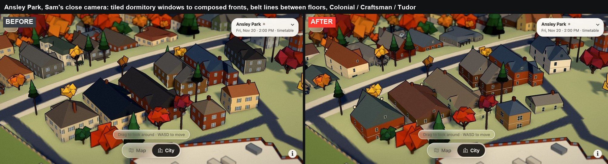

# Residential v2c: composed windows, readable storeys, material families

Sam's review of #222: the windows still tiled at equal spacing ("a dormitory"), one-, two- and three-storey houses were hard to tell apart, roofs leaned near-black, and siding and brick needed to read as different materials. Street View references (Ansley Park's Westminster Drive and The Prado; Home Park's State Street) are listed in [v2a](../residential-v2/README.md).

## Style composition

Each footprint gets a style, deterministic per id and `illustrative`. Ansley Park is weighted toward Colonial and Tudor revival among Craftsman houses (35 / 30 / 35 %); Home Park and the other side streets are mostly Craftsman bungalows (65 % Craftsman, 25 % Colonial, 10 % Tudor).

| Style | Front | Roof and porch |
| --- | --- | --- |
| Colonial | Centred door; paired double-hungs, symmetric on each side; a matching upper row with one over the door; shutters on about half | 0.72 pitch; a small portico about half the time |
| Craftsman | Off-centre door under a full porch; a ribbon of three lights on the other side | Low 0.5 pitch; porch about 90 % of the time; one or one-and-a-half storeys |
| Tudor revival | Door beside a steep front gable; a cluster of narrow lights | Steep gabled roof (1.1 pitch); a stoop rather than a porch |

Windows are geometry placed per wall, not shader tiling:
- **Sides:** one window per storey, or two on walls over 9 m.
- **Rear:** smaller and fewer.
- **Gable ends:** a small attic window.

About a third of rooms glow at night; the glass goes to the building batch's lit-glass list, so no draws are added. The wall shader keeps the siding texture through styles 7–10, which are 3–6 without shader windows.

## Storeys you can read

- **Sources:** OSM levels, or height (minus the roof), are `reported`. Otherwise storeys are `inferred` from style, size and neighbourhood.
- **Eaves:** 3.2, 6.2 and 9.2 m for one, two and three storeys.
- **Floor lines:** a trim belt marks each floor, in stone on brick.
- **Rows:** one window row per storey.
- **Half storeys:** one-and-a-half-storey houses get dormers in a one-storey eave.
- **Porch roofs:** at first-floor height.

## Material families

| Family | Colours |
| --- | --- |
| Lap siding (visible shadow lines) | White, cream, pale yellow, sage, grey-blue, muted green, the occasional deep red or navy |
| Brick (running bond, mortar speckle) | Red-orange, deep red, brown, tan, some painted white |
| Cedar shingle (staggered) | Weathered brown or grey |
| Stucco (faint grain) | Cream, pink-beige, pale ochre |

- **Trim:** white or cream on siding; on brick it contrasts (cream on red and brown, dark on painted white).
- **Roofs:** weathered greys and warm browns, with a little muted green and red. Slate goes on a quarter of Ansley's brick and Tudor houses, and muted terracotta on stucco.
- **Mix by style and neighbourhood:**
  - Tudors are 70 % brick, 30 % stucco.
  - Colonials are 45 % brick, 45 % lap siding, 10 % shingle.
  - Craftsman houses are mostly lap siding: 75 % in Home Park, 55 % in Ansley, where shingle is common.
  - A tagged `building:material` wins.

## Lab

The **Houses** section (`/models.html?v=houses` and `?v=materials`) uses the same `residential()` finish as City:

- [Style × storey grid, high vs low](styles-tiers.jpg) and [day vs night](styles-night.jpg): 189 / 123 triangles per house, including walls.
- [Siding swatch sheet, high vs low](swatches-tiers.jpg) and [day vs night](swatches-night.jpg).

## City views

All views are at 14:00 and 23:00 Eastern on 20 November 2026.

- [Ansley close, BEFORE | AFTER](ansley-close-compare.jpg): `/?view=city&cam=1280,-3950,40,64,70`
- [Ansley wide](ansley-compare.jpg): `/?view=city&cam=1280,-3950,40,58,160`
- [Ansley at night](ansley-night-compare.jpg) · [Ansley, low tier](ansley-low-compare.jpg)
- [Home Park close](home-park-compare.jpg): `/?view=city&cam=-660,-3780,40,64,70`

## Budget

House detail drawn by the finish (roofs, gables, dormers, porches, doors, windows, belts and trim) across the nine square-board rows: 637,009 triangles at high (194 per house) and 402,271 at low (122 per house). The low tier keeps front windows and ground-floor side windows, and drops rear windows, upper side windows, shutters, meeting rails, dormers and corner boards. It's all in the existing building batch, so no draws are added. Windows as geometry roughly double v2a's 102 / 80 per house. The composition needs per-wall placement, which the shader can't do. Publishing needs a web rebuild only.

The same PR fixes a closed-ring bug in `drapeRing` (hole indices were off by one when rings repeated their first vertex), with a test.
