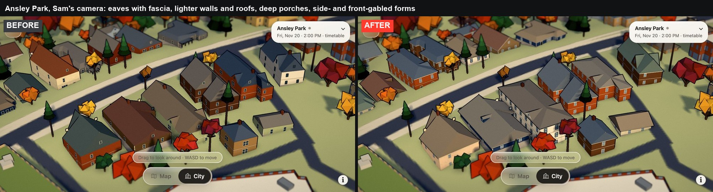

# Residential v2d: eaves, legible windows, deep porches, lighter colour, apartments

Sam on #259: better, but "something still feels funny". Changes, in order of impact:

1. **Eaves.** Eaves and rakes overhang the walls: Craftsman 0.6 m, Colonial 0.45 m, Tudor and apartments 0.3 m. Each overhang has a fascia board and a soffit, so every wall gets a shadow line under the roof edge. The roof plane simply extends outward and down, so cross gables and dormers stay on it.
2. **Roofs.** Lighter and varied: weathered mid-greys, warm browns and a little muted green or red; slate is lighter too. The Craftsman pitch is about 7/12 (rise 0.58 × half-depth).
3. **Roof forms.** Colonials are side-gabled (60 %) or hipped, with the ridge along the street. Craftsman houses are front-gabled, with the ridge running back from the street. Tudors are side-gabled under their steep front gable. Pyramids appear only where OSM tags them.
4. **Windows.** About 0.9 × 1.5 m double-hungs in sky-toned blue-grey glass with a white frame and meeting rail. They never touch: each unit keeps at least its own width of wall from the next, except a deliberate pair, a Craftsman grouped triple or a Tudor grouped pair. Fronts have two or three windows per floor plus the door.
5. **Porches.** Deep (2.4 m) porches with square white columns (four across a full porch, three on a half porch), a shed roof with a fascia, and steps down from the door. Craftsman porches are full-front, and about half of Colonials get a half-front porch.
6. **Colour.** Wall families are lighter (white, cream and pale siding; warmer brick), lifted slightly above Street View so they survive the City grade. Shutters stay dark for contrast.
Also: rake boards along every gable overhang. Front-gabled Craftsman half storeys put their dormers on the side slopes, sized to the pitch, and porch roofs stay under the main fascia line. Craftsman fronts fall back from a triple to a pair or a single so a window always clears the door. Deep Colonial fronts turn their ridge so a hip never collapses into an untagged pyramid.

7. **Apartments.** Long or large "house" footprints (over 220 m² and more than 1.8:1, or over 330 m²) are period apartment buildings, not giant houses. They are two or three storeys, mostly brick, under a low hip, with single windows in regular bays on every wall and an entry at each end of the front.

## Views (captioned BEFORE | AFTER)

- [Sam's Ansley camera](ansley-compare.jpg): `/?view=city&cam=1280,-3950,40,58,160`
- [Ansley, close](ansley-close-compare.jpg): `/?view=city&cam=1280,-3950,40,64,70`
- [Street level](street-compare.jpg), and [street level, low tier](street-low-compare.jpg): `/?view=city&cam=1300,-3960,20,74,32`
- [Night](night-compare.jpg) · [Home Park](home-park-compare.jpg): `/?view=city&cam=-660,-3780,40,64,70`
- Lab, same cameras as v2c:
  - [Swatch sheet, before and after](swatches-compare.jpg), [high vs low](swatches-tiers.jpg) and [day vs night](swatches-night.jpg)
  - [Styles × storeys](styles-compare.jpg) and [its tiers](styles-tiers.jpg)

## Budget

House detail across the nine square-board rows (roofs, eaves, fascia and soffits, rake boards, porches, doors, windows and trim) is 861,206 triangles at high, or 262 per house, and 525,001 at low, or 160 per house. It all sits in the existing building batch, so no draws are added. The low tier keeps the fascia and drops soffits; porches get two columns and two steps. In the lab, including walls: 219–226 per house at high and 145–148 at low.

Choices are `illustrative` and deterministic per id. OSM levels, height, `roof:shape` and `building:material` win where tagged. Publishing needs a web rebuild only.
