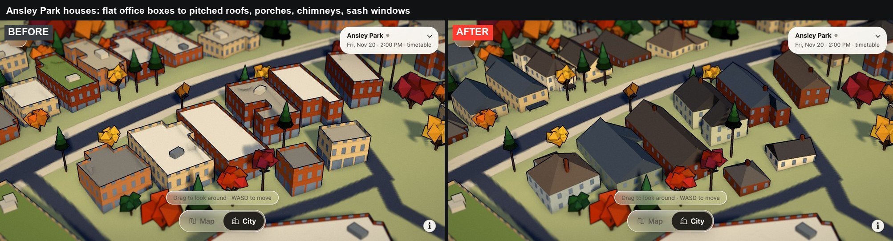

# Residential character across the rectangle

City drew every house as a flat-roofed box with storefront glazing, so neighbourhoods read as office parks. `web/src/city/residential.ts` now applies one treatment to every small residential footprint in the rectangle. It is not hand-placed. It runs inside `createDowntownTerrain`, so it reaches every board.

**Which footprints.** OSM `building` = `house`, `detached`, `semidetached_house`, `bungalow` or `terrace`, with a single ring, 25–450 m², at most 3 floors and at most 14 m. Overture downtown footprints carry the same classes where tagged. A building that already has a finish, such as the Irwin Street houses or the Edgewood and Odd Fellows blocks, keeps it.

| Row | Footprints changed |
| --- | ---: |
| north-band | 77 |
| north-corner | 18 |
| south-band | 205 |
| south-corner | 0 |
| midtown-south | 262 |
| midtown-central | 578 |
| midtown-upper | 607 |
| brookwood-south | 795 |
| brookwood-station | 746 |
| downtown (Overture) | 25 |
| King Memorial | 0 |
| Sweet Auburn | 36 (before its own house finishes claim theirs) |

These counts come from `web/src/city/residential.test.ts`.

## What it draws, and how sure it is

| Attribute | Tier | Rule |
| --- | --- | --- |
| Roof shape | `reported` where OSM tags `roof:shape` (116 footprints: 110 gabled, 4 hipped, 2 pyramidal), otherwise `inferred` | From the minimum-area oriented rectangle: a filled plan longer than 1.3:1 gables, a near-square plan is pyramidal, anything else hips. Each eave edge rises to its nearest point on the ridge, so the roof follows the actual footprint. |
| Pitch | `illustrative` | Rise 0.72 × the half-depth, between 1.6 and 4.5 m |
| Wall height | `inferred` | OSM `height` is the ridge, so walls stop at `height − rise`. Otherwise floors × 3.05 m + 0.4 m. Untagged plans are 1 storey under 95 m² (or `bungalow`) and 2 above. No parapet. |
| Walls and palette | `reported` where `building:material` is tagged (113 brick, 2 wood), otherwise `illustrative` | A seeded early-twentieth-century mix: 45 % red and brown brick, 40 % painted clapboard, 15 % stucco. Roofs are warm grey and brown asphalt. |
| Windows | `illustrative` | A new shader style (3): punched sash windows on every 3.05 m storey, nothing below the floor. At night some rooms are lit, as on other buildings. |
| Porch | `illustrative` | 70 % of non-terrace houses get a porch: a deck, four posts and a shallow roof on the frontage nearest a mapped street within 40 m |
| Chimney | `illustrative` | 80 % of brick houses and 45 % of others get a stack on the ridge line toward one end |

**Ground contact.** Lower eaves would have buried three hillside houses. The pass now runs against the rendered ground. When a house's eave would end up below its high ground, it gets the same uphill floor rule as the [hillside foundations](../midtown-foundations/README.md). The whole-rectangle roof test passes at both tiers.

## Views

All views are at 14:00 and 23:00 Eastern on 20 November 2026, on a 999 × 496 viewport.

- [Midtown side streets east of Piedmont Avenue, before and after](midtown-compare.jpg): `/?view=city&cam=1425,-2475,40,58,160`
- [Home Park, before and after](home-park-compare.jpg): `/?view=city&cam=-660,-3780,40,58,160`
- [Ansley Park at night](ansley-night-captioned.jpg) and [at low quality](ansley-low-captioned.jpg): `/?view=city&cam=1280,-3950,40,58,160`
- Raw captures: `<site>-<low|high>-<day|night>.jpg`

Publishing needs a web rebuild only. The tag fixture comes from `pipeline/scripts/residential_tags.py`.
