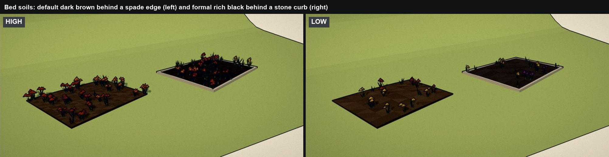

# Rich-black bed soil

Sam asked for a dark, almost black soil option for some gardens: freshly mulched or composted formal beds. It sits alongside the dark-brown default from #248. Call it with `flowerBed(b, ring, groundAt, { doy, soil: 'rich-black' })`.

- **Where:** landmark gardens and formal beds only (for example the 1180 Peachtree roof beds, where it fits). The default stays dark brown everywhere else.
- **Texture:** a calm crumble, ±6 % per triangle against the brown's ±10 %.
- **Not a hole:** the low tier uses a slightly lifted set (`#352f2b`–`#3d3631`, against `#272320`–`#2f2926` on high). In both tiers, `landscapeMesh` lifts only the very darkest colours toward a dark grey-brown as distance grows from 60 m to 260 m. Brighter colours are untouched. [Near and far](beds-far.jpg)
- [By day and at night](beds-night.jpg). Lab: `/models.html?v=bed`, with the formal bed on the right.

Soil colour is `illustrative`. Publishing needs a web rebuild only.
