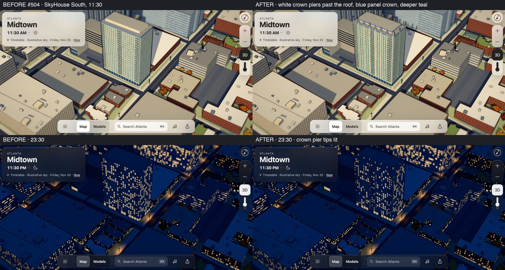
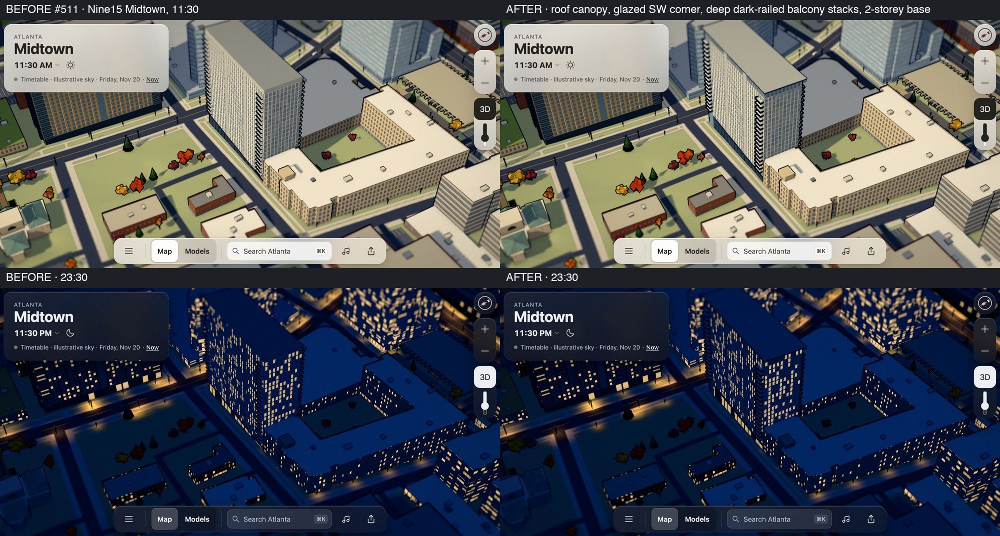
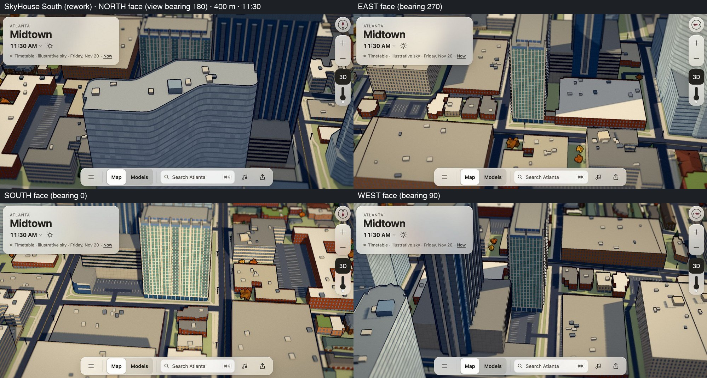
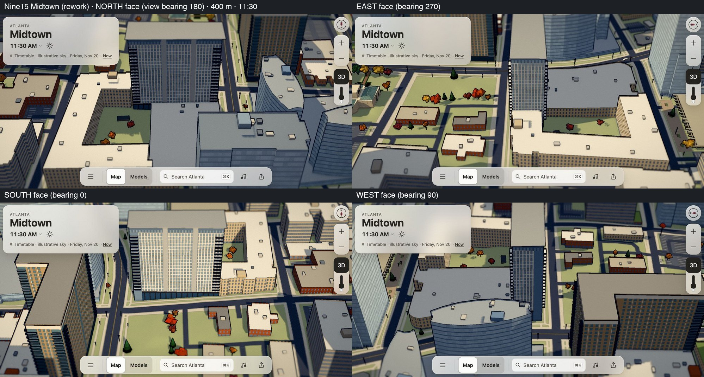

# Recognition rework: SkyHouse South and Nine15 Midtown

The recognition audit (`docs/skin-recognition-audit.md`) marked both as BORDERLINE. SkyHouse South's pale mint grid sat close to the generic beige and it had no SkyHouse crown. Nine15 had no distinct base or crown, and its white face was near generic. Each change below follows a feature named from photographs first.

## SkyHouse South (#504)

Identifying features from the property photograph ([Equity Residential](https://equityapartments.com/atlanta/central-midtown-atlanta/skyhouse-south-apartments)):

1. White piers that rise past the roof as a crown frame.
2. A storey of blue square panels around the rooftop deck.

- **Changes:** white piers about 7.4 m apart, proud of the glass and rising 1.2–2.6 m above the deck in alternating heights. A row of blue square panels (`#7b98c2`) tops the deck; the low tier uses a single blue band. The glass is deeper teal, `#7fb3ad` (S 29%, V 70%), instead of the pale `#98bdbe`.
- **Night:** the top 3 m of each pier glows in the shared warm lamp colour. This is program-level evidence: the primary image on the [SkyHouse program page](https://smallwood-us.com/projects/skyhouse-program/) is another city's SkyHouse at dusk, with its crown fins lit. No night photograph of SkyHouse South was found, and its lighting colour is unverified.

## Nine15 Midtown (#511)

Identifying features, from the Midtown Alliance rendering, confirmed by the December 2025 Street View cited in the Nine15 README:

1. A thin flat roof canopy overhanging both ends above a recessed glazed top floor.
2. Deep corner balcony stacks with dark rails.
3. A two-storey charcoal base with the tall glazed corner at West Peachtree and 8th.

- **Changes:** a 0.45 m roof canopy with a 2 m overhang at each end, and a recessed blue-grey glazed band on the top floor. The corner balcony stacks are 2.2 m deep with dark rails and side rails; the low tier keeps a dark rail band on every second floor. The charcoal base is now 8.5 m, two storeys. A full-height glazed bay runs 7 m along both faces at the south-west corner.

## Views

Before and after are taken from each skin's original money-shot camera: SkyHouse `cam=770,-2622,330,48,420`, Nine15 `cam=451,-2875,300,48,420`, both high tier at 11:30 and 23:30. The four-side sheets are at 400 m with `&dev&mindist=20`. Panels are labelled by the face shown.

