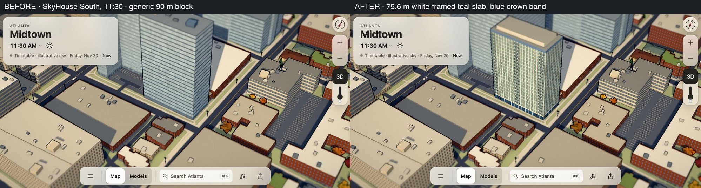
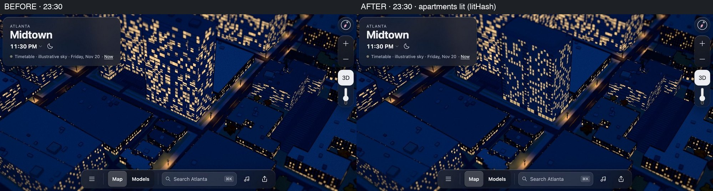
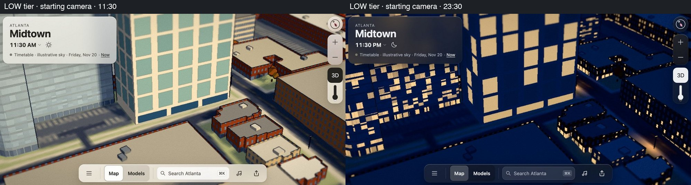
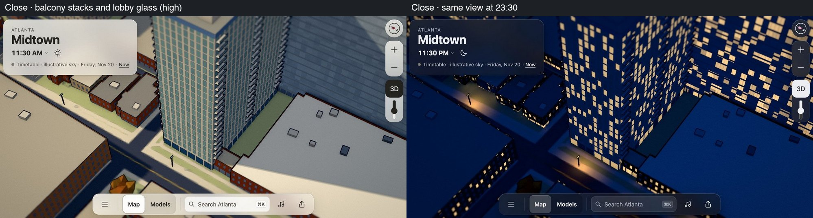

# SkyHouse South

`osm:way:445841094` (100 6th Street NE, between Peachtree and Juniper; 23 storeys, 320 units, completed 2014) was drawn as a generic 90 m block. City now draws it at its lidar height with the look in the property photograph.

| Element | Plan (City m) | Height above grade | Basis |
|---|---|---|---|
| 23-storey slab | the mapped 55 × 26 m outline, squared | roof 75.6 | 3DEP lidar, 22 April 2019: median 75.6 (3,193 of 3,827 returns between 60 and 80 m). Grade is the 305.1 m NAVD88 median of ground returns. The mapped 90.1 m is the OSM tag. |
| Rooftop sky deck | set back to 86% × 70% of the slab | 79.5 | lidar 90th percentile; max 81.3 |

## Facade

The property's aerial photograph shows a white precast frame around teal-green glass, balcony stacks at the corners and the middle of the long faces, and a band of blue glass under the white rooftop deck. The base has blue-tinted shop glazing on 6th Street. [Property exterior photograph (Equity Residential)](https://equityapartments.com/atlanta/central-midtown-atlanta/skyhouse-south-apartments) · [Skyscraper Center entry](https://www.skyscrapercenter.com/building/skyhouse-south/15702)

- **Floors:** a 5 m lobby, then 22 floors at 3.2 m.
- **Glass:** base `#98bdbe` (S 20%, V 75%), varied with `#9ec2c2` and `#92b7b9`. Rendered at 11:30 on the high tier at the hero camera: sunlit faces S 18 / V 40 and S 13 / V 42, which passes. Generic glass in the same frame reads S 8 / V 52. Shaded faces are recorded in the PR.
- **High tier:** 2.8 m bays at 0.62 fill (white frame between), balcony stacks at both ends and the middle of the long faces, lobby glazing, and the blue crown band.
- **Low tier:** one pane row per three floors, the crown band and the sky deck.

## Night

No full-night photograph was found. Lit windows come from the shared `litHash(seedOf(id), face, floor, bay)` at 45% occupancy, plus the lobby glazing. The crown band is unlit.

## Measurements

- **Low-tier mesh:** under 400 triangles (unit test).
- **Camera delta:** at the starting camera `770,-2623,32,60,240`, 11:30, with the skin on and off, +194 triangles and +1 draw (78 → 79). Programs unchanged at 87.

## Review views

| View | City query |
|---|---|
| Day, from the south-east (high) | `?view=city&q=high&t=2026-11-20T11:30:00-05:00&cam=770,-2622,330,48,420` |
| Full night, matched | `?view=city&q=high&t=2026-11-20T23:30:00-05:00&cam=770,-2622,330,48,420` |
| Starting camera, low, day and night | `?view=city&q=low&t=2026-11-20T11:30:00-05:00&cam=770,-2623,32,60,240` (23:30 for night) |
| Close: balconies and lobby | `?view=city&dev&mindist=20&q=high&t=2026-11-20T11:30:00-05:00&cam=775,-2615,240,40,240` |

