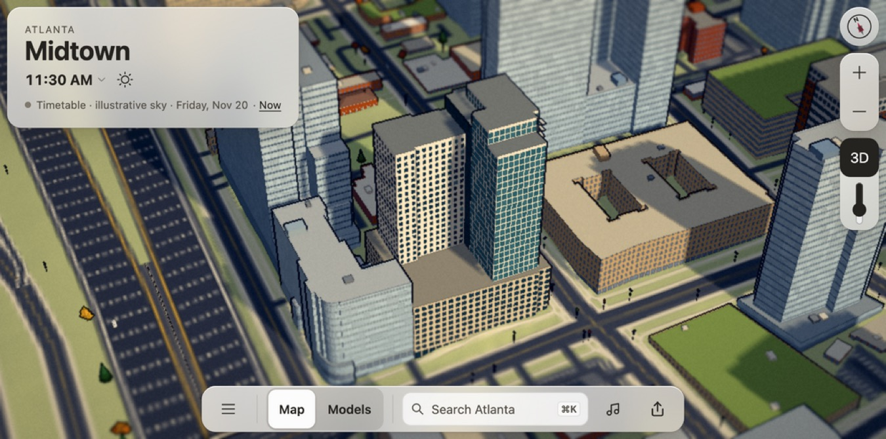
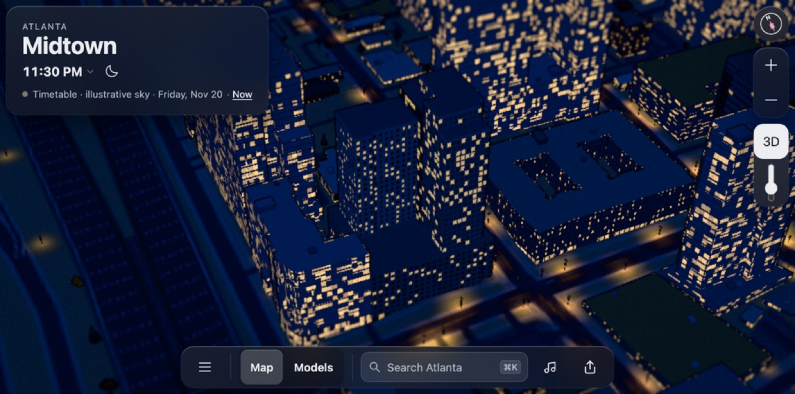
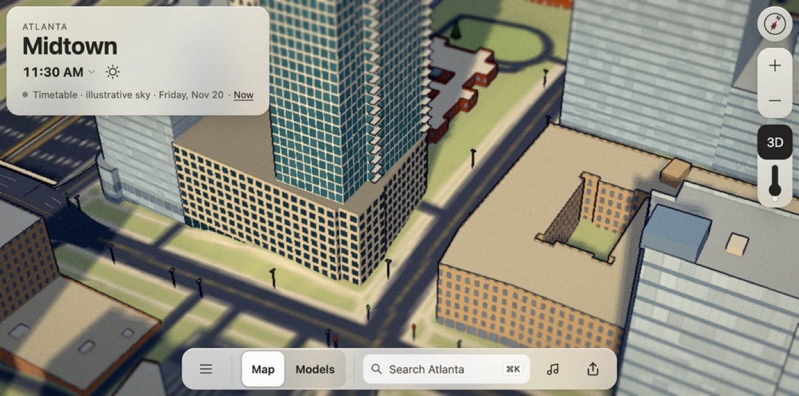

# Sora at Spring Quarter

City replaces the generic mesh for `osm:way:1300604915`, the Sora apartment tower at Spring Quarter, beside the historic chapel on West Peachtree. The building is newer than the 2019 lidar. City keeps the mapped parts and gives each one the treatment the photographs show:

- the 108 m main shaft: blue-green glass in a white frame
- the 100.8 m dark glass blade that climbs from the base
- the 100.8 m north glazed block
- the 93.6 m white wing with punched windows
- the 32.4 m podium: cream precast with tall dark storefront glass

The photographs from the street show the white punched-window wing beside a dark glass blade. That blade rises out of the podium, and the glazed shaft carries stacked projecting balconies with glass rails on its corners. The chapel's white gables sit in front, and the chapel stays a separate building in City. Estimated details: the 3.2 m floor pitch, the 2.6 m glazing module, the 3.1 m punched-window bay, the 1.7 × 4 m balconies (two stacks on the shaft's east corners), and the podium's window rhythm.

Sources, consulted in a fresh Orca tab:
- [Guardian Glass project page](https://www.guardianglass.com/ap/en/projects/project-details/sora-at-spring-quarter): three photographs. They show the base and chapel from the street, the shaft rising from the podium, and a close-up of the balcony stack and frame.

**Lighting:** No full-night photograph was found, which is a gap. City treats Sora as residential, with about a third of units lit at 23:30, a lit storefront base, and no decorative lighting.

| Review view | City query |
|---|---|
| Day, from the south | `?view=city&q=low&t=2026-11-20T11:30:00-05:00&cam=190,-3160,25,50,560` |
| Full night, matched | `?view=city&q=low&t=2026-11-20T23:30:00-05:00&cam=190,-3160,25,50,560` |
| Closer shaft, balconies and podium | `?view=city&q=low&t=2026-11-20T11:30:00-05:00&cam=200,-3125,330,52,320` |

