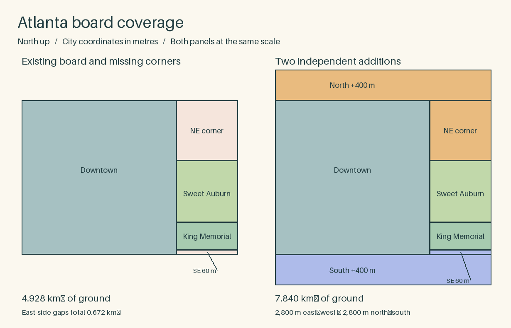

# Squaring the Atlanta board

The existing board covers 4.928 km². A pair of 400 m bands and two missing corners add 2.912 km², yielding an exact 2.8 km square. On a populated checkout run `pnpm data:square-board`, then `pnpm dev`. Open `/square-board.html?q=high` or `?q=low` on that server. Select **North** or **South** to load that section, in either order. **Overview** shows the areas loaded so far. **King Memorial** looks west along the station approach. Drag to orbit and scroll to inspect. [Existing and completed board at the same camera](overview.jpg) · [North and south streets](seams.jpg) · [King Memorial guideway](king.jpg)



## Where the additions go

All extents include both edges. Coordinates are City metres east (x) and south (z) of Five Points. The existing outer width, 2,800 m, fixes the side of the smallest axis-aligned square that retains every neighborhood. Filling the east-side gaps first leaves 800 m of north–south extent to add. Splitting it evenly keeps the existing north–south midpoint and minimizes the longest outward move. Each section touches the existing board along its entire inner boundary.

| Area | x range (m) | z range (m) | Area (km²) |
|---|---|---|---:|
| Downtown | −1000…1000 | −1300…700 | 4.000 |
| King Memorial | 1000…1800 | 280…640 | 0.288 |
| Sweet Auburn | 1000…1800 | −520…280 | 0.640 |
| North band | −1000…1800 | −1700…−1300 | 1.120 |
| Northeast corner | 1000…1800 | −1300…−520 | 0.624 |
| South band | −1000…1800 | 700…1100 | 1.120 |
| Southeast corner | 1000…1800 | 640…700 | 0.048 |

Clipping the City of Atlanta's neighborhood polygons gives these areas to the nearest 0.1 ha. The north band intersects Downtown (72.7), Old Fourth Ward (36.6) and English Avenue (2.7). The northeast corner adds Old Fourth Ward (47.6), Sweet Auburn (11.3) and Downtown (3.4). The south band adds Capitol Gateway (29.4), Grant Park (27.9), Downtown (23.2), Castleberry Hill (15.0), Mechanicsville (11.6), Oakland (3.4) and Summerhill (1.6). The narrow southeast strip joins Grant Park (2.5) and Oakland (2.3) directly to the King board. The intersects describe portions of these neighborhoods. [City of Atlanta DCP neighborhood polygons](https://gis.atlantaga.gov/dpcd/rest/services/AdministrativeArea/GeopoliticalArea/FeatureServer/1)

## Ground, streets and bytes

| Addition | Ground range (m NAVD88) | Building pieces | Road/path runs | Asset bytes | gzip-9 bytes |
|---|---:|---:|---:|---:|---:|
| North band | 283.3–312.3 | 324 | 1,037 | 407,657 | 110,626 |
| Northeast corner | 287.6–319.4 | 115 | 405 | 170,156 | 50,130 |
| South band | 290.5–324.1 | 342 | 1,046 | 342,493 | 93,044 |
| Southeast corner | 308.9–323.8 | 8 | 59 | 18,343 | 5,718 |

North adds 577,813 bytes raw (160,756 gzip), south 360,836 (98,762 gzip). The total is 938,649 raw or 259,518 gzipped. Each direction adds six static files, individually compressed for this comparison. Actual HTTP transfer depends on the host. The archive of raw OSM input stays in the pipeline.

The four grids use the same USGS 1 m bare-earth source (2018–19), sampled at the containing native pixel every 5 m. The input is NAD83 / UTM zone 16N. City uses local spherical metres from WGS84 (−84.3916°, 33.7539°), radius 6,371,008.8 m. Row zero is north and columns increase east. Check the SHA-256 and decode row-major little-endian signed int16 decimetres. Mask −32768 before multiplying by 0.1. Subtract 323.8 m NAVD88 once for scene y. Outside a grid or where a nonzero interpolation weight touches the mask, return unknown. All four grids contain zero masked nodes. A valid bare-earth sample can represent interpolated ground beneath a removed bridge. It supplies neither railhead height nor tunnel cover. [Source, datum approximation and Five Points cut measurements](../../../downtown-ground.md)

Roads, buildings and selected land-cover polygons use archived OpenStreetMap geometry clipped to each rectangle. Their mapped horizontal positions are reported. Roof heights are reported where tagged (5 pieces), inferred from floor counts at 3.6 m per floor (156), and illustrative at 8 m elsewhere (628). Deck clearances and foundations are illustrative. The initial terrain study shipped with empty tree lists in the four new sections. Staging now adds inferred crowns from the 2023 City canopy study. [Coverage and current payload increment](../expanded-canopy/README.md) Downtown in this study uses the shared ground, generic buildings and terrain transport. Production landmark and lighting passes have their own City integration. The OSM archives and derived context data are available under the ODbL. [© OpenStreetMap contributors](https://www.openstreetmap.org/copyright) · [ODbL 1.0](https://opendatacommons.org/licenses/odbl/1-0/)

## Seam evidence

- The runtime verifies registration and every shared 5 m ground node before removing either side's edge wall. Geometry tests also sample the rendered surface every 2.5 m along every shared edge at high and low detail. The downtown–north and downtown–south edges each match at 401 nodes. A one-byte corruption in the south corner leaves King's south edge closed. South can then be retried. Both load orders pass.
- Of 57 shared-edge/name pairs with a crossing on both sides, 55 match to the nearest centimetre. Examples include Peachtree Street at the north edge, Jackson Street beside Sweet Auburn and Grant Street and Oakland Avenue beside King Memorial. The audit compares sets of exact-name crossings in both directions. Unnamed streets and features present on only one side require separate inspection.
- Two names have an extra mapped carriageway. At x = 1000 the northeast Connector crosses z = −789.37 and −850.42 m. Downtown's ordinary road layer has the first named crossing only. At z = 700, Ted Turner Drive SW crosses x = −587.01 and −604.01 m in the south band. Downtown has the first named crossing only. The 61.05 m and 17.00 m separations are measured **along the edge**. Compare the additional crossings to the arterial and bridge layers before using them for vehicle animation.
- The producer's downtown Blue/Green guideway meets the King geometry at x = 1000, z ≈ 554 m. The west bed reads 324.845 m NAVD88 and the east bed 324.857 m at rail chainage 8541.6 m. The difference is 1.3 cm between models. The preview uses the rail owner's measured anchors, schematic under-canopy interpolation and existing platform/roof geometry. Neither direction installs replacement rail. [Rail evidence and interpretation](../../../king-memorial-corridor.md) · [Matched King views](king.jpg)
- The north band covers the rest of the Peachtree Summit footprint across z = −1300. For a single building, load its full footprint and sample ground on both boards, then replace both generic pieces together. The current preview clips ordinary buildings independently, so a shared footprint can retain two foundations or different heights.

## Rebuild and integrate

A fresh checkout needs normal City and route data from `pnpm data` (see the repository README). On a populated checkout, staging copies the checked-in assets. To regenerate them, use the pinned local GeoTIFF from the downtown instructions and the four archived OSM maps. Each context records its request URL and raw SHA-256. A later live OSM response can differ. [Terrain download](../../../downtown-ground.md#reproduce-the-bake) · [Archived inputs and outputs](../../../../pipeline/prototypes/square-board)

```sh
.venv/bin/python -m pip install numpy rasterio pyproj shapely pillow
.venv/bin/python -B pipeline/scripts/square_board.py data/raw/terrain/USGS_1M_16_x74y374_GA_Statewide_2018_B18_DRRA.tif
pnpm data:square-board
.venv/bin/python -B pipeline/scripts/square_board_audit.py --figure docs/log/ui/square-board/bounds.png
pnpm test
pnpm build
```

Pass `--section north` or `--section south` to bake one section. The audit also needs the staged City neighborhood polygons (`pnpm data:places`). A second full bake reproduced all twelve output hashes. The dedicated Vite entry is included when square-board data is staged. To publish that preview, stage the pack, rebuild and deploy the assets together.

In desktop Orca at 1296 × 726, normal City opening requested seven downtown scene assets and zero square-board assets on both settings. The dedicated preview opened its three existing areas, fetched six new assets on the first direction and six on the second. Revisiting a direction reused its mounted geometry. Camera targets and offsets are identical between high and low. These captures establish coverage and seam behavior. Target-device memory, frame time and recovery after switching views still need hardware validation before enabling these sections in normal City. At integration, use the same atomic section loader and neighboring skirt indices, retain the old exterior walls during fetch or failure, and keep King rail on its existing vertical model.

## Orbit the square in City

Open `/?view=city&board=square` after staging the data above. Pan toward a boundary to load the adjoining neighborhoods. To see everything from one camera, open **About this City view** (the **i** button) and choose **Show full board**. The same button retries missing sections and returns the camera to the overview. Regular City, the existing King Memorial and Sweet Auburn URLs, and the standalone coverage study remain available. The square uses City's landmark, lighting, weather, road traffic and MARTA passes. [Opening and full board on both desktop quality settings](../city-square/board.jpg) · [Scheduled train at King Memorial](../city-square/station.jpg)

The opening fetched seven downtown scene assets. From a north-first or south-first pan, the first direction brought the total to 13 and the second to 19. King Memorial, its rail and Sweet Auburn brought it to 26 unique scene assets. Each direction validates both tiles before mounting. A failed south tile left the other five areas navigable. Retrying reached all seven and reopening the overview made zero further scene requests. The camera, picking surface and walnut base follow the union of the mounted areas. Connector traffic uses one instanced layer across those areas.

At the matched station camera with all seven areas mounted, desktop Orca recorded 133 draw calls and 2.99 million triangles at high detail, and 67 calls and 1.05 million triangles at low detail. The clock is paused on the scheduled eastbound Blue train on 2026-11-20 at 14:02 EST. Pan, orbit and double-click work in the preview. Both detail settings reached all four outer corners. Default activation awaits target-device checks.

Peachtree Summit's two fallback pieces have separate handles in the square preview. In the successful north-section callback in `city.ts`, `terrain.buildingFragment` and `added.get('north-band').buildingFragment` identify them. The landmark owner can mount one complete model from the original downtown ring, sample its foundation across both grids, then hide both handles. Before north arrives, the clipped downtown fragment stays visible through delay or failure.

## Castleberry Hill freight crossing

On November 23, desktop Orca checked the deployed square near Spring Street, both ends of the Downtown Connector, Ted Turner Drive, and the joins toward Sweet Auburn and King Memorial. All 2,011 pairwise comparisons of the eleven shared ground edges returned the same valid decimetre value on either side. No ground step was visible at the sampled cameras. At the southern edge near Ted Turner Drive, five ballast strips ended together in grass. The adjacent section had loaded successfully.

The archived south-band OpenStreetMap extract contains three Griffin District ways (54032227, 471970106, 471970107) and two NS Atlanta South District ways (874501032, 874501033). At z = 700 m they meet the downtown endpoints at x = −747.94, −742.82, −751.86, −767.22 and −773.15 m respectively. Each continues 343–381 m to the west edge. The bake clips each mapped centerline separately. Horizontal position is reported from OSM. Ballast and rail heights follow the local terrain and are illustrative. The source supplies no surveyed railhead heights. The extra geometry costs 1,100 bytes raw or 370 bytes at gzip-9 in the existing south-band context request. [Archived OSM input](../../../../pipeline/prototypes/square-board/source/south-band.json.gz) · [Matched high and low City views](freight-seam.jpg)

To repeat the visual check, open the pinned map camera, then choose **City** and wait for the south section. The five tracks cross the middle of the view on their way toward the southwest. Run the south bake twice and compare the six output file hashes to check reproducibility. On a populated checkout, run `pnpm data:square-board` and `pnpm build`, then deploy the static bundle and data together. [Pinned Castleberry Hill camera](https://atlanta.solomon.io/?view=map&board=square&q=high&t=2026-11-20T14:02:00-05:00&speed=0#17.23990/33.7476048/-84.3997665/5) · [North and south inspection cameras](seam-audit.jpg)
