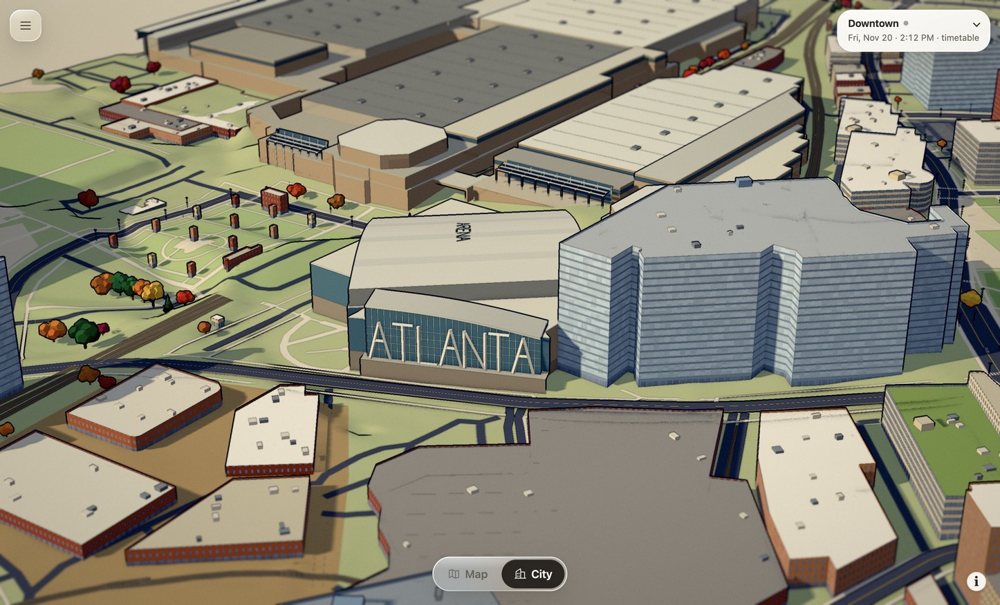

# State Farm Arena from the station and the plaza



From the station side, the arena now reads as a low silver arch above glass. The roof runs diagonally across the block. From the opposite side, the large rectangular windows in the masonry and the lower pale roofs separate the arena from the convention halls. The taller building adjoining it on the east is The CTR.

| Camera | Before | Daylight | Dusk |
| --- | --- | --- | --- |
| Ordinary City opening | [Before](opening-before.jpg) | [Day](opening-day.jpg) | [Dusk](opening-dusk.jpg) |
| Station approach | [Before](station-before.jpg) | [Day](station-day.jpg) | [Dusk](station-dusk.jpg) |
| International Plaza side | [Before](plaza-before.jpg) | [Day](plaza-day.jpg) | [Dusk](plaza-dusk.jpg) |

## What the sources establish

- The named Overture footprint is about 156 m east to west and 166 m north to south. Its 47.6 m height is a source attribute. The Esri orthophoto shows a diagonal metal roof, three exposed corner roofs and a projecting edge on the station side. The CTR to the east and the GWCC to the north have separate footprints. The model replaces just the arena ID, `274e7277-5fe9-4a57-9e5c-01a6e6458c8a`. [Overhead photograph](https://server.arcgisonline.com/ArcGIS/rest/services/World_Imagery/MapServer/export?bbox=-84.3983,33.7560,-84.3945,33.7586&bboxSR=4326&imageSR=3857&size=1000,820&format=jpg&f=image)
- Arquitectonica’s front elevation and oblique photograph show the shallow vault, overlapping roof edges and the white structural letters across the Centennial glass wall. The Hawks describe the city-name letters as 65 ft tall (19.8 m). The dark **ARENA** lettering also appears in the aerial. The model uses the city name in the structure and the generic word on the roof. [Architect’s exterior series](https://arquitectonica.com/architecture/project/state-farm-arena/) · [Hawks media guide](https://library.sfo2.cdn.digitaloceanspaces.com/publications/basketball/yearbooks/KATLHMG-2020.pdf)
- Mary Ann Sullivan’s west and north photographs show the masonry bays, triangular openings and gridded glass. Street View from the plaza confirms the treatment after the arena’s renaming. Thornton Tomasetti describes the 2018 roof work as retaining the building envelope. [Sullivan’s exterior photographs](https://homepages.bluffton.edu/~sullivanm/atlanta/philips/philips.html) · [Plaza photograph](https://www.google.com/maps/@?api=1&map_action=pano&pano=D6HX92D1onUmpDkjygDOoA&heading=88&pitch=12&fov=90) · [Structural engineer’s project account](https://www.thorntontomasetti.com/project/state-farm-arena-renovation)
- HKS’s campus plan locates International Plaza, the transportation terminal, the arena and the GWCC/CNN Center station. Its proposed connections are future work. The existing City street, rail, station and neighboring buildings supply the context in the frames. [HKS site threshold study](https://www.hksinc.com/wp-content/uploads/2025/03/20250321_GWCC-SiteThreshold-Summary-HKS-update.pdf)

## Estimated geometry and integration

The barrel spans roughly 90 m across its short axis and about 110 m along its long axis. The crown rises about 8 m above the eaves. The 29 m corner roof, bay spacing, mullions, lobby floor, lean of the lettering and individual lip depths are photographic estimates. The local height reference comes from the west corner of the footprint on City’s terrain grid. It gives the building a single level across the slope. Neither it nor the mapped outline establishes a station floor elevation or a measured clearance below the arena.

Two static vertex-colored meshes draw the shell and the foyer glazing. The latter takes the existing City night control. Its window lighting is illustrative. The matched daylight opening changes from 141 to 145 draw submissions and from 2,143,907 to 2,147,041 submitted triangles. The generic extrusion is retained if the named footprint, its expected geometry or the sampled ground is unavailable. A web build and deployment using the existing downtown data pick up the change.

Before images use `a8f2f1a`. In desktop Orca use a 1120 × 840 viewport and `/?view=city&q=high&t=2026-11-20T14:12:45-05:00&speed=0`. For dusk use `17:45:00`. The normal opening uses the default camera. The two closer cameras are reproducible with:

```js
window.__city.lookAt(-437, -383, { bearing: -36, metresPerPixel: .37, tilt: 65 })
window.__city.lookAt(-442, -338, { bearing: 128, metresPerPixel: .46, tilt: 58 })
```
