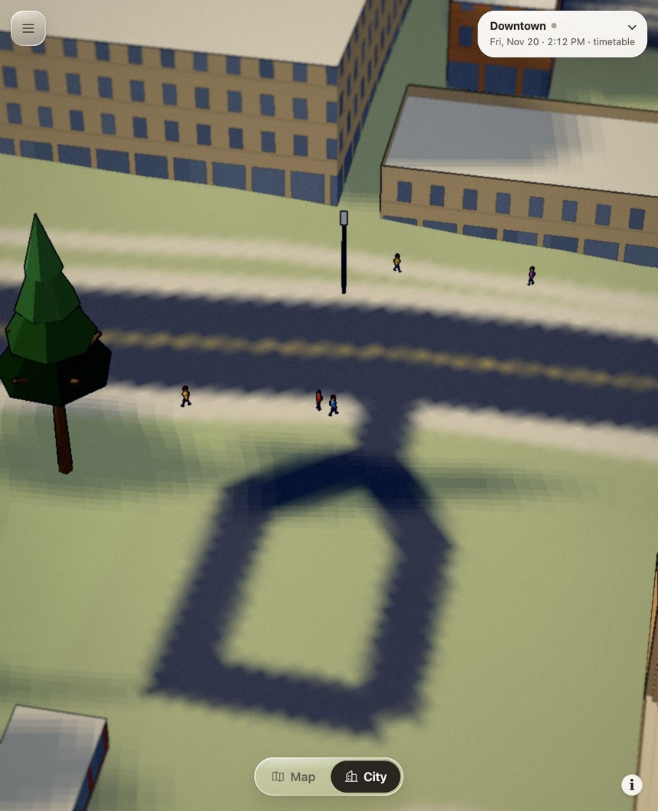
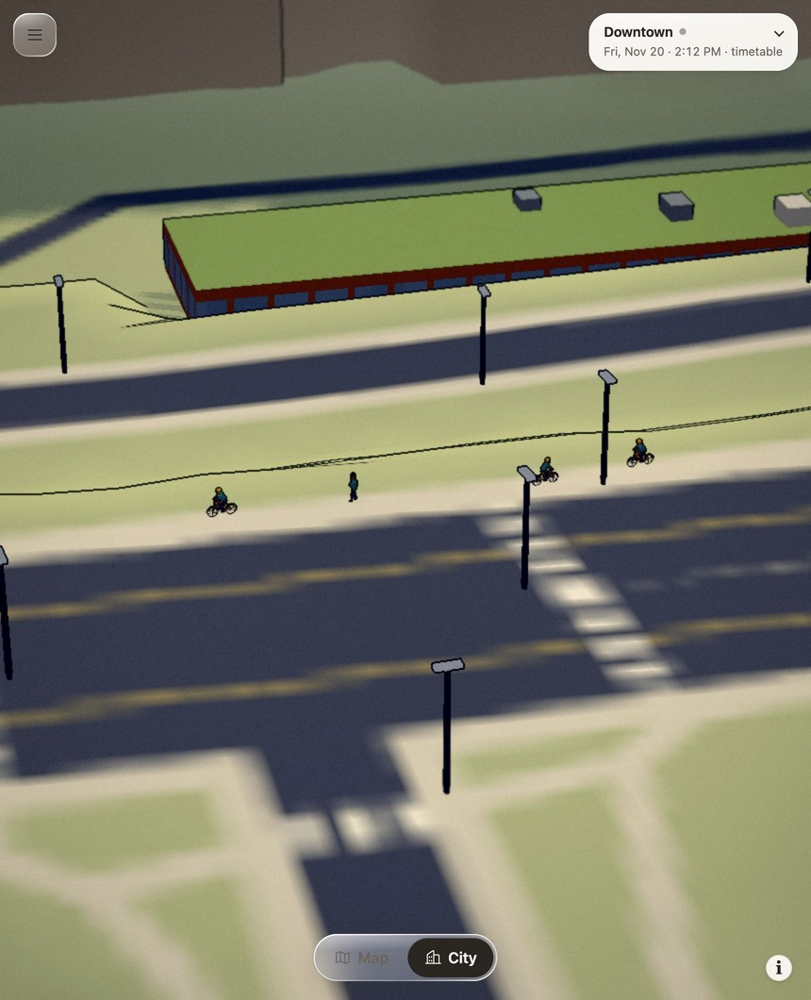
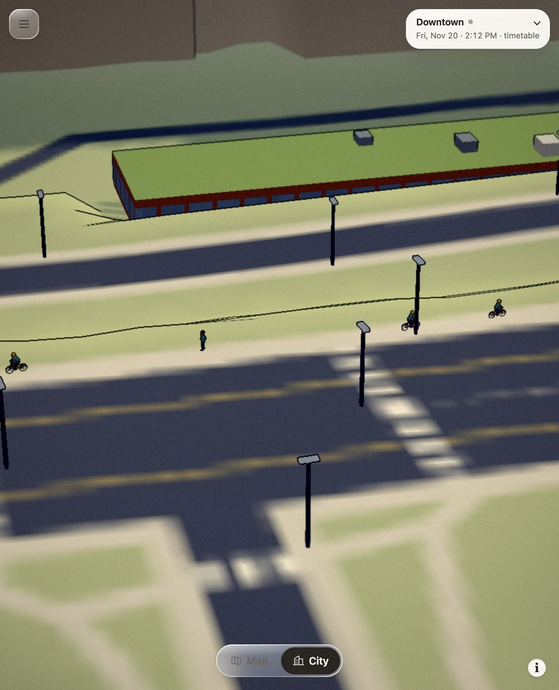

# People on downtown sidewalks and the Westside Beltline Connector

| Georgia State sidewalks | Connector walkers and cyclists | Three seconds later |
| --- | --- | --- |
|  |  |  |

The [ordinary City opening](opening.jpg) shows these figures at the same scale as the rest of the miniature. Walkers are approximately 1.6–1.85 m tall. At street scale they have sleeves, backpacks, shoes and swinging arms. A cyclist leans toward the handlebars, with bent legs and a helmet.

The downtown bake contains 1,062 sidewalk records and nine footways named Westside Beltline Connector. Three complete unflagged trail sections measure about 167, 36 and 87 m. The 242 m bridge needs its own deck placement. The figures use verified portions of the three ground sections, inset from their ends. On this bake both quality tiers place seven walkers and seven riders on the trail. Bicycles use only that named trail. Sidewalks around Georgia State use a finer selection grid to keep nearby blocks occupied.

All counts, appearances, speeds and journeys are **illustrative**. The path locations come from the existing Overture bake. Each figure travels along its section, turns at the end and stands on the drawn terrain. To avoid marching up abrupt DEM steps, the selector splits a route where the centreline rises or falls more than 0.75 m between samples 3 m apart. Pausing, scrubbing back, or reopening the same clock reproduces its position and pose.

## Reproduce in desktop Orca

Open `/?view=city&q=low&t=2026-11-20T14:12:45-05:00&speed=0` on a development build. The opening uses an untouched 390 × 844 viewport. For the close views use 860 × 1060 and the following calls. The second trail frame uses 14:12:48 EST.

| View | City camera |
| --- | --- |
| Georgia State | `__city.lookAt(437, 445, { bearing: 300, metresPerPixel: 0.055, tilt: 49 })` |
| Connector | `__city.lookAt(-801, -1090, { bearing: 194, metresPerPixel: 0.055, tilt: 63 })` |

## Integration

The [route selector and clock sampler](../../../../web/src/city/walkways.ts) use the existing polyline and ground-height APIs. Add a verified ground trail in the selector to reuse the walkers and cyclists. A future station platform or bridge can supply its own supported path and surface height. The [figure geometry and poses](../../../../web/src/city/street-figures.ts) are independent of downtown coordinates.

City batches the visible figures by body part. When a full person would be below six CSS pixels on low quality (four on high), only a simple silhouette is drawn. The sampled low-tier opening drew 103 distant walkers in one batch, 4,120 triangles. Close figures use at most six detailed batches for the whole view. Rebuild and deploy the web bundle with the existing downtown assets.
