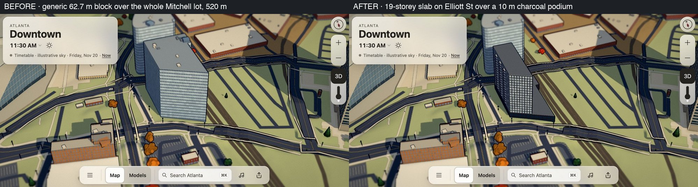
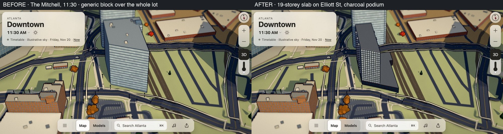
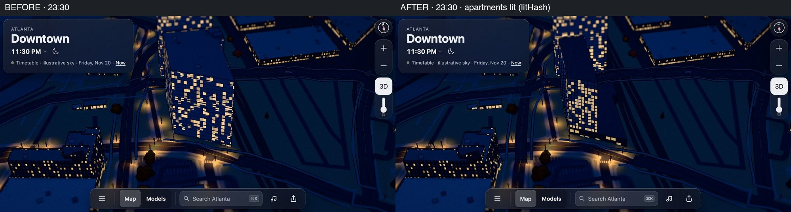
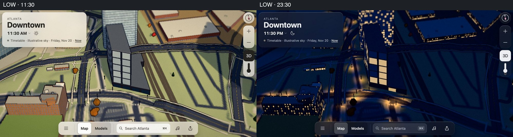
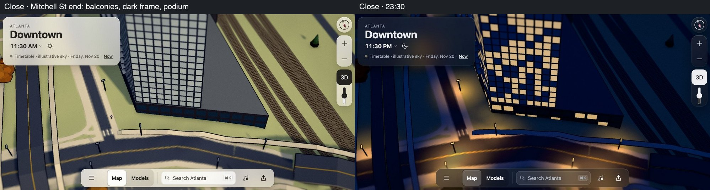
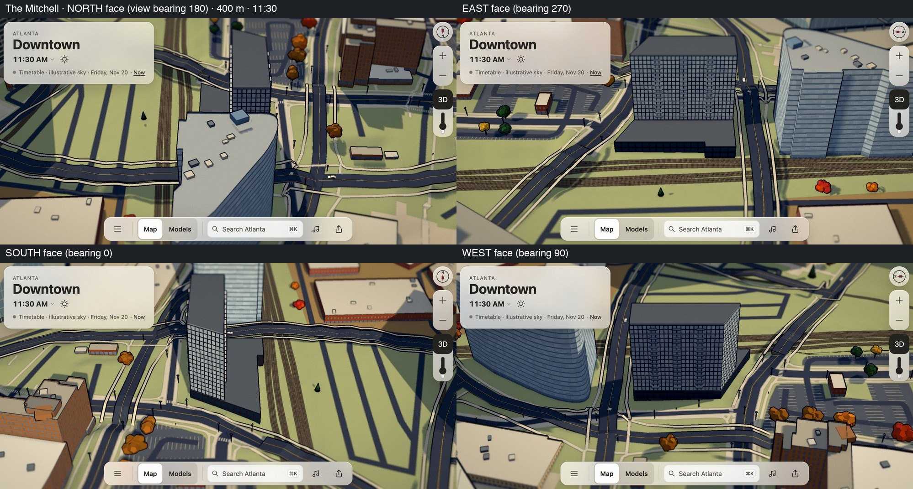

# The Mitchell

Overture `1629150e-9283-4ce6-9653-8097f4a5073c` is The Mitchell, the first residential tower at Centennial Yards: 19 storeys, 304 units, by TVS and Goode Van Slyke, opened 4 September 2025. City drew a generic 62.7 m block over the whole 50 × 79 m lot. It now draws a slab on the Elliott Street side over a charcoal podium.

| Element | Plan | Height | Basis |
|---|---|---|---|
| Tower | the west 22 m of the outline, from the north line to the Mitchell Street diagonal | 62.7 m | **Reported**: 19 storeys (BD+C, Axios). Overture's 62.7 m fits that. The 2019 lidar shows an empty lot (the building is newer). |
| Podium and garage | the full outline | 10 m (estimated, about 3 levels) | Street View |

**The tower's position on the lot is estimated.** Two April 2026 Street View frames looking north from Mitchell Street (51 and 23 Elliott Street SW; cited, not committed) show the tower end-on on the Elliott Street side, with the charcoal podium and its garage "ENTRANCE" running east toward the rail lines. The satellite imagery predates construction, and Overpass was unavailable, so no OSM part outline was found.

## Look (April 2026 Street View)
- Charcoal brick podium (`#46454a`).
- The tower: a dark window frame (`#4a4c51`) around light blue-grey glass (`#b3c3cf`, S 14%, V 81%), with stacked balconies with glass rails. Rendered sunlit, the south face reads S 8 / V 51.
- The low tier draws one pane row per three floors and no balconies.

## Night
No night photograph exists. Rooms are lit from the shared litHash at 45%, and the podium glazing at 35%.

## Views
| View | Query |
|---|---|
| Money shot, 520 m | `?view=city&q=high&t=2026-11-20T11:30:00-05:00&cam=-592,-24,20,50,520` |
| Hero (from the south-south-west), day and night | `?view=city&q=high&t=2026-11-20T11:30:00-05:00&cam=-592,-24,10,50,450` (23:30 for night) |
| Close (Mitchell Street end) | `?view=city&dev&mindist=20&q=high&t=2026-11-20T11:30:00-05:00&cam=-600,0,20,35,180` |
| Four-side | `&dev&mindist=20&cam=-592,-24,{180,270,0,90},50,400` |

