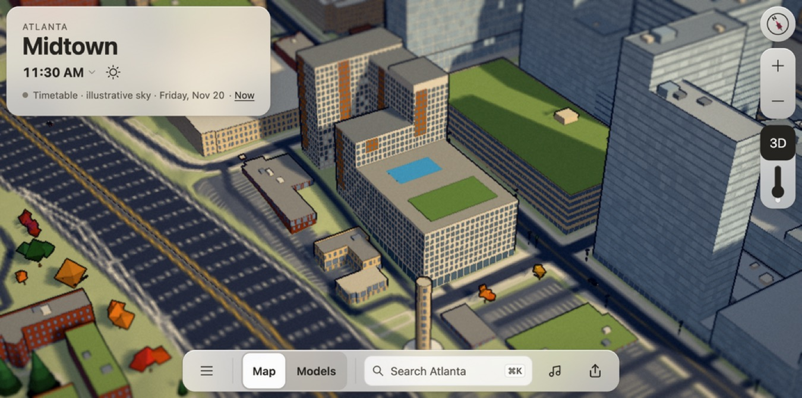
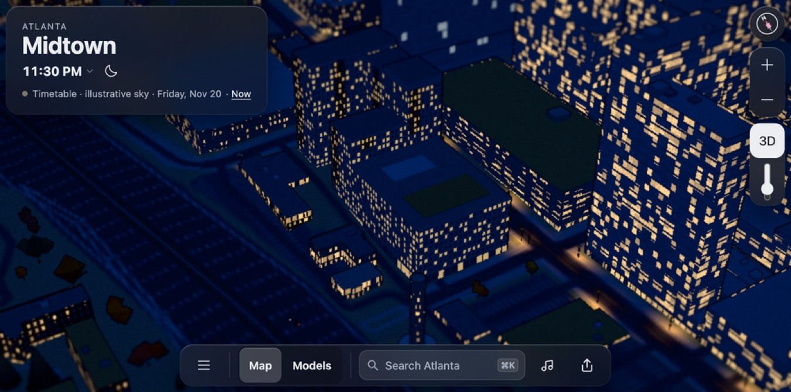
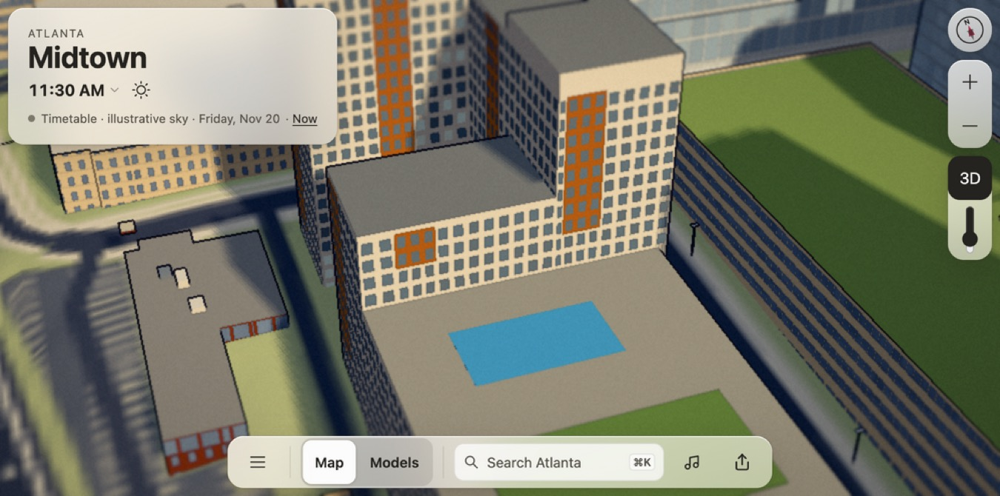

# The Standard

City replaces the generic mesh for `osm:way:779716217`, The Standard at Atlanta at 708 Spring Street (Niles Bolton Associates, 2019), a student-housing complex. **Height basis: lidar 2019.** The mapped part was inferred at 68.4 m. The April 2019 point cloud was sampled on an 8 m grid inside the footprint (90th-percentile returns, ground 294.3 m NAVD88). It resolves four masses:

- a 63 m bar along the north end
- a 61 m bar down the east side, with a 64 m core block at its south end
- a 44 m block stepping down to the west
- the 10-storey precast mid-rise and garage (31 m) filling the south, with a courtyard notch between it and the north bar

Together the north and east bars make up the reported 19-storey tower. The whole-footprint measurement reads p50 35.1 m, p95 63.4 m and max 65.5 m.

The architect's photographs show pale grey precast with tight punched windows, and the large "cutouts" in the outer skin reveal amber cladding behind it. They also show a glazed corner over a wood-soffit retail base on Spring Street, and the aerial shows the mid-rise's roof with a pool and green roofs. Estimated details: the 2.4 m window bay and 3 m floor pitch, one amber cutout per long face (about 6 m wide), the pool and green-roof footprints, and the storefront height. Shop signs are not drawn.

Sources, consulted in a fresh Orca tab:
- [Niles Bolton Associates project page](https://www.nilesbolton.com/the-standard-at-atlanta): exterior, dusk exterior, aerial amenity deck and Spring Street corner photographs.
- [Metromont project page](https://metromont.com/projects/the-standard-at-atlanta): precast tower, mid-rise and garage.

**Lighting:** The architect's dusk photographs show many lit rooms and a lit retail corner, but there is no full-night exterior. City treats it as student housing, with about 45% of rooms lit at 23:30 (more than other apartments), and the mid-rise's outer faces lit too.

| Review view | City query |
|---|---|
| Day, survey start camera | `?view=city&q=low&t=2026-11-20T11:30:00-05:00&cam=218,-2290,32,55,480` |
| Full night, matched | `?view=city&q=low&t=2026-11-20T23:30:00-05:00&cam=218,-2290,32,55,480` |
| Closer amenity deck and cutouts | `?view=city&q=low&t=2026-11-20T11:30:00-05:00&cam=230,-2330,20,55,240` |

