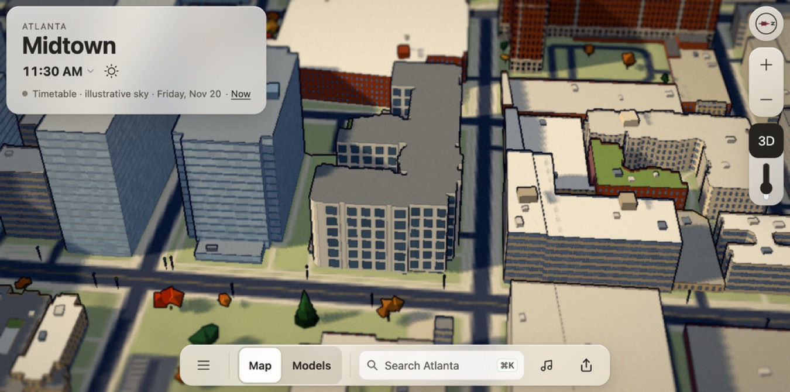
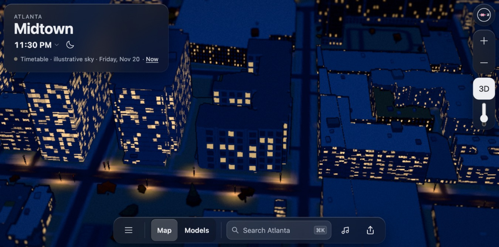
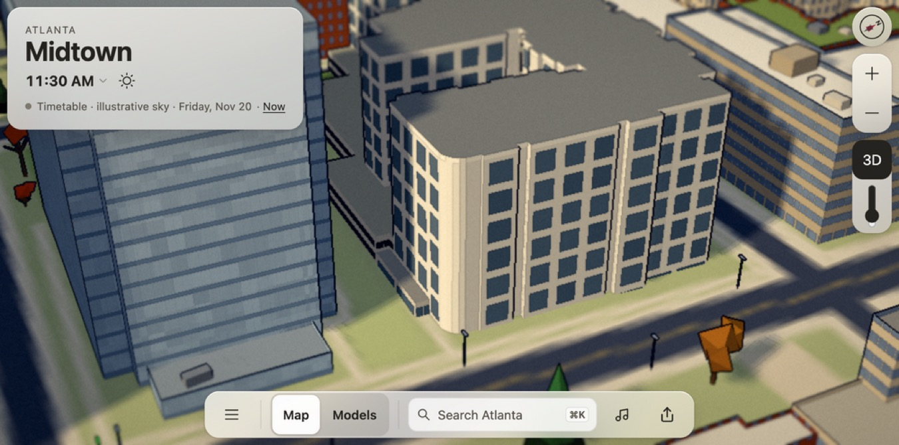

# Trace Midtown

City replaces the generic mesh for `osm:way:492105275`, Trace Midtown at 782 Peachtree Street (2016, about 11 storeys, 290 apartments), on the same Peachtree block as Crest and Lilli. **Height basis: lidar 2019.** An 8 m grid of 90th-percentile returns over 303.7 m ground puts the E-shaped residential block at 38–41 m (mapped 42.9 m) and the two courtyard decks over the garage podium at 11–16 m with planters. City uses a 39.5 m roof, an 11.5 m deck and the mapped 8 m retail corner.

The listing aerial shows a pale grey rendered block, white trim, a white cornice, regular punched windows and grey metal balcony rails stacked up the long faces. Estimated details: the 3.1 m floor pitch, the 2.8 m window bay, the balcony rails (one strip per floor across the middle half of each long face), the pool and planting on the two courtyard decks, and the dark garage screen under the decks. No logo or sign is drawn.

Sources, consulted in a fresh Orca tab:
- [Apartments.com listing](https://www.apartments.com/trace-midtown-luxury-apartments-atlanta-ga/468h0xh/): aerial of the Peachtree elevation and roofline.
- [Midtown Alliance project page](https://www.midtownatl.com/view/trace-midtown-community): unit count.

**Lighting:** No full-night photograph was found. City treats Trace as residential, with about a third of units lit at 23:30 through the shared lit-pane hash, and a lit retail base.

| Review view | City query |
|---|---|
| Day, Peachtree side from the east | `?view=city&q=low&t=2026-11-20T11:30:00-05:00&cam=584,-2440,270,52,460` |
| Full night, matched | `?view=city&q=low&t=2026-11-20T23:30:00-05:00&cam=584,-2440,270,52,460` |
| Closer south-east corner | `?view=city&q=low&t=2026-11-20T11:30:00-05:00&cam=600,-2425,300,58,230` |

