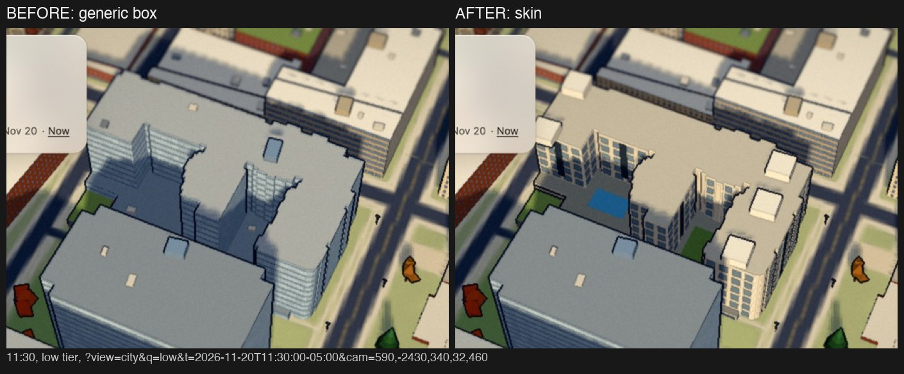
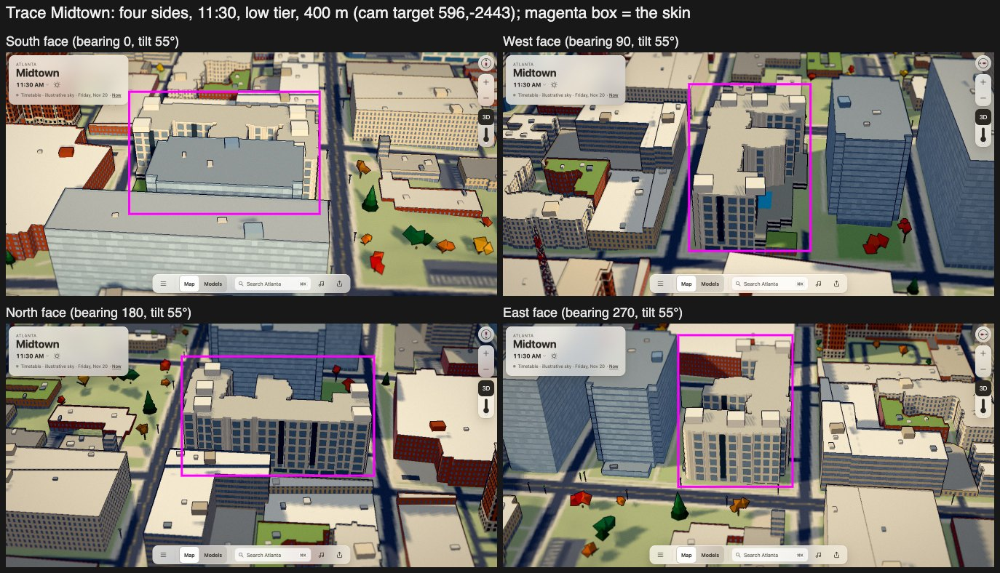

# Trace Midtown

City replaces the generic mesh for `osm:way:492105275`, Trace Midtown at 782 Peachtree Street (2016, about 11 storeys, 290 apartments), on the same Peachtree block as Crest and Lilli. **Height basis: lidar 2019.** An 8 m grid of 90th-percentile returns over 303.7 m ground puts the E-shaped residential block at 38–41 m (mapped 42.9 m) and the two courtyard decks over the garage podium at 11–16 m with planters. City uses a 39.5 m roof, an 11.5 m deck and the mapped 8 m retail corner.

**Identifying features** (from the listing aerial): (1) pale stone-coloured walls with a strong vertical rhythm of white pilaster bays, rising to raised white parapet pavilions at the corners and over the Peachtree centre; (2) vertical stacks of small dark metal balconies between the bays. Two courtyard decks open to the south over the garage podium, with a pool and planting. Estimated details: the 3.1 m floor pitch, the 2.8 m window bay, the 7.5 m pilaster spacing, the 10 m pavilions rising 4.5 m above the roof, the balcony stacks (one or two per long face, 3.2 m wide, 1.1 m deep; one dark strip each on low tier), the pool and planting, and the dark garage screen. No logo or sign is drawn.

Sources, consulted in a fresh Orca tab:
- [Apartments.com listing](https://www.apartments.com/trace-midtown-luxury-apartments-atlanta-ga/468h0xh/): aerial of the Peachtree elevation and roofline.
- [Midtown Alliance project page](https://www.midtownatl.com/view/trace-midtown-community): unit count.

**Lighting:** No full-night photograph was found. City treats Trace as residential, with about a third of units lit at 23:30 through the shared lit-pane hash, and a lit retail base.

| Review view | City query |
|---|---|
| Day, from the south over the courtyards | `?view=city&q=low&t=2026-11-20T11:30:00-05:00&cam=590,-2430,340,32,460` |
| Full night, matched | `?view=city&q=low&t=2026-11-20T23:30:00-05:00&cam=590,-2430,340,32,460` |
| Closer Peachtree corner | `?view=city&q=low&t=2026-11-20T11:30:00-05:00&cam=620,-2440,300,48,220` |

