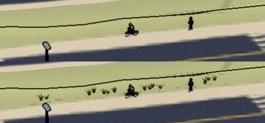

# A planted verge on the Westside Beltline Connector

**Keep this as a one-section study for inspection.** The little breaks in the grass give the path a readable edge beside the cyclist. From overhead the detail disappears. At the closest camera the clumps still read as separate silhouettes, so this example alone is a poor basis for planting the whole corridor.



[Original City frame](before.jpg) · [Planted City frame](after.jpg) · [Low quality](low.jpg) · [Four seconds of gust and passing trail users on low](gust.webp)

## Reference and placement

The Atlanta Beltline’s 2021 Connector photograph shows pale paving with a fairly straight lip, stretches of short turf, and uneven tufts of olive and straw beside it. The first pass looked like a row of pegs. Grouping blades into short drifts and leaving turf between them brought the silhouette closer to the photograph. The photograph establishes the corridor’s appearance. Species, locations, dimensions and motion in City are illustrative. [Local trail photograph](https://a-us.storyblok.com/f/1020195/1920x1080/7cf55e7cb1/westside-beltline-connector-2021_1920x1080.jpg) · [Atlanta Beltline trail gallery](https://beltline.org/parks-trails/westside-connector-trail/) · [PATH’s downtown connection description](https://www.pathfoundation.org/westside-beltline-connector)

The study uses the existing 35.6 m ground sidewalk near Mangum Street and Ivan Allen Jr. Boulevard. It matches both endpoints in the verified City walking network and ends before the bridge. Fourteen clumps sit on one side, with centers 2.1–3.35 m from the trail centerline. Thirteen small earth flecks break up the paved edge. Each blade has two fixed feet on the rendered terrain. Each fleck follows the ground at all three corners with 18 mm clearance. Missing ground suppresses the affected geometry.

## Motion and cost

The blade tips bend by at most 8.6 cm along the main wind direction. The middle bends a quarter as far. A paused City clock freezes the gust. Reduced motion restores the rest pose. Nearby grass updates at most 25 times per second on high and 12.5 on low. Low keeps four of seven blades per clump.

| Desktop Orca view | Low draw calls / triangles | High draw calls / triangles |
| --- | --- | --- |
| Trail, 0.075 m per CSS pixel | 31 → 32 / +181 | 61 → 63 / +614 |
| Above, 0.25 m per CSS pixel | 31 → 31 / +0 | 61 → 61 / +0 |
| Above, 0.65 m per CSS pixel | 27 → 27 / +0 | 53 → 53 / +0 |

High has 307 distinct triangles submitted across two passes. These are scene counters, not frame timings. The layer fades between 0.096 and 0.16 m per pixel on low, and between 0.12 and 0.20 on high, measured at the patch. Three low-quality camera bearings at 0.12 m per pixel showed the same clumps through the turn. Small silhouette details vary by pixel there. Both wider views cull the patch and skip vertex updates. [Matched view from above, before](above-before.jpg) · [After](above-after.jpg)

At the opposite bearing (14°) the gaps and individual clumps remain legible. A depth-writing comparison produced a darker ink outline on every clump at both bearings. The study keeps the softer edge. [Reverse view at trail scale](reverse.jpg)

## Reproduce the camera

Use the current downtown bake and start the web dev server with `pnpm dev`. Open City at `/?view=city&q=high&t=2026-11-20T14:12:45-05:00&speed=0`, set a 1120 × 840 CSS-pixel viewport, and run the following in the Orca page. Use `q=low` for the low comparison. The original images use commit `d972b9b` at the same clock and camera.

```js
window.__city.lookAt(-790, -1090, { bearing: 194, metresPerPixel: 0.075, tilt: 65 })
```

For the overhead pair use `metresPerPixel: 0.25` and `tilt: 24`. For the wider counter check, use `0.65` with the same tilt. If accepted, a web rebuild and deployment pick up the study with the existing downtown data.
