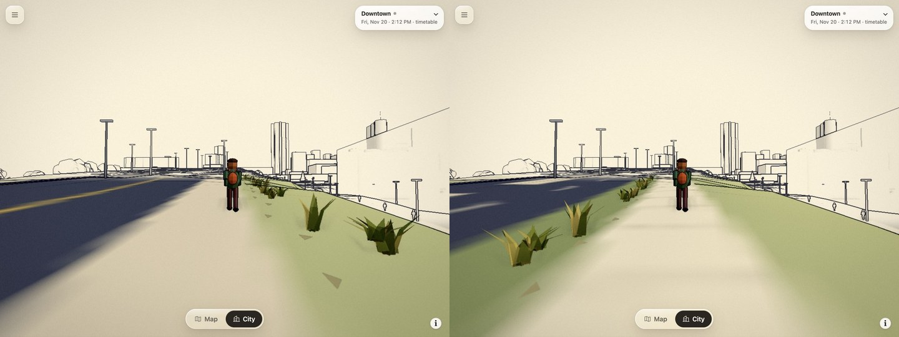
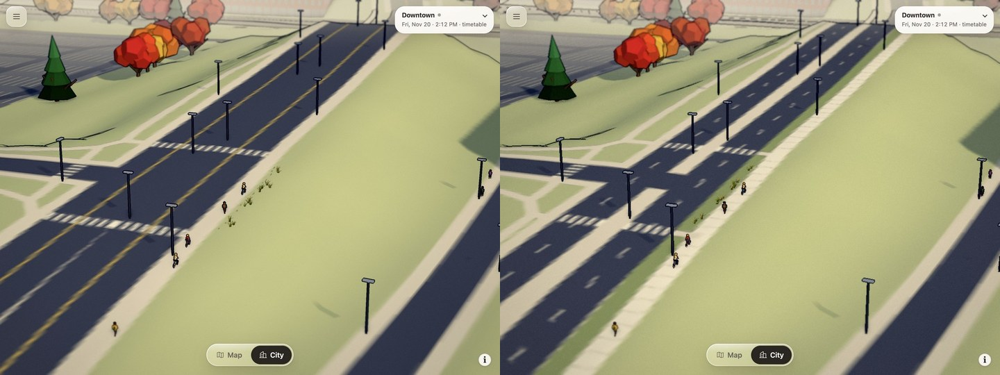
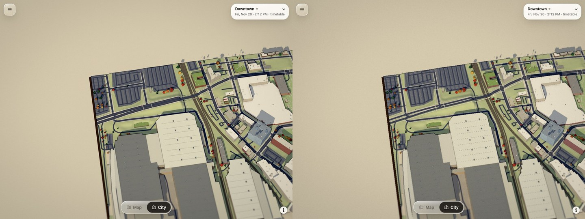

# The shared sidewalk at Mangum Street

**Recommendation for Sam: accept the path revision and keep the planting on the 35.6 m trial section.** A walker and a cyclist now share a light, jointed concrete strip. A planted curb strip separates them from the south carriageway of Ivan Allen Jr. Boulevard. Two ramps still connect the path to the marked crossings at Mangum.

| View | Planting-only draft | Revised City |
| --- | --- | --- |
| Walking height, looking east | [Before](walking-before.jpg) | [After](walking-after.jpg) |
| Intersection, closest normal City zoom | [Before](intersection-before.jpg) | [After](intersection-after.jpg) |
| City overview, both approaches | [Before](overview-before.jpg) | [After](overview-after.jpg) |







## What the photographs establish

| Photograph opened in Orca | Location and observation |
| --- | --- |
| [Mangum, facing east-southeast](https://www.google.com/maps/@?api=1&map_action=pano&pano=CQVWAy9qY00dVBPZpNn01w&heading=110&pitch=-8&fov=80) | April 2026, 33.763760, −84.400190. Looking across the T-junction toward the railway bridge. Dark asphalt, a white vehicle-lane divider and a marked crossing sit beside a shrub bed. The concrete shared sidewalk runs along the far side of the bed. |
| [Eastern crosswalk, looking back west-southwest](https://www.google.com/maps/@?api=1&map_action=pano&pano=BjwDkOM6FaeXfhUijZyLWw&heading=244&pitch=-12&fov=80) | April 2026, 33.763792, −84.399874. From just east of Mangum the crosswalk meets a curb ramp through the strip. The path has a straight outer edge, transverse concrete joints and a guardrail on the downslope side. |
| [Local aerial, north up](https://server.arcgisonline.com/ArcGIS/rest/services/World_Imagery/MapServer/export?bbox=-84.40143547,33.76300057,-84.39883547,33.76440057&bboxSR=4326&imageSR=3857&size=1100,720&format=jpg&f=image) | Centered on the south sidewalk opposite Mangum. Between the two crosswalks the pavement spans about 13–15 pixels at roughly 0.22 m per image pixel. That gives about 2.9–3.3 m across. The strip between pavement and traffic is a few metres wide and opens at both ramps. |
| [Cyclist on the fenced bridge sidepath](https://images.squarespace-cdn.com/content/v1/54b7bf9de4b0226a9004011f/1581959147643-6Q484A0ZDKV423CWW98M/DJI_0054.jpg) | KAIZEN’s lengthwise view of the south sidewalk on the Ivan Allen bridge over the railway, east of Mangum, facing west. A rider fits beside ample passing space. Concrete panels run between the fence and planted road separator. |
| [Cyclist descending the west approach](https://images.squarespace-cdn.com/content/v1/54b7bf9de4b0226a9004011f/1581959149178-ZG685WTG1TRPAE7US6QI/DJI_0068.jpg) | From the west transition of the fenced bridge looking toward Mangum. A transverse paver band and short yellow dashes are visible farther down this approach. The Mangum junction panoramas support plain concrete on the trial section. |
| [Bridge roadway looking west](https://www.google.com/maps/@?api=1&map_action=pano&pano=t-mfuCP5qBnk1w4h8zLEEA&heading=248&pitch=-6&fov=80) | April 2026, 33.763976, −84.398136. The colored history panels identify the railway span. A physical divider keeps the sidewalk distinct from the roadway here. |

KAIZEN identifies the project as the Ivan Allen PATH between Luckie Street and the Georgia World Congress Center. PATH describes the change to a rails-to-trails greenway at Northside Drive, farther west. The earlier skyline photograph informed grass colour only. [Designer’s project gallery](https://greta-demayo.squarespace.com/design/ivan-alllen-path) · [PATH Foundation corridor description](https://www.pathfoundation.org/westside-beltline-connector)

## What changed in City

The measured-terrain renderer had painted the named path with the generic 2 m footway stroke. Each of the two mapped carriageways also received the full 11 m secondary-road width and a yellow centerline. At Mangum the road casing and sidewalk blended together.

The path now uses an estimated 3.2 m pale concrete section. Ground approaches carry subdued joints at illustrative 3.2 m intervals. The two separate approach carriageways use 7.2 m each and broken white lane markings. Width is shared with City’s bus placement. The merged roadway at the railway span keeps its existing width. Mapped asphalt and crosswalks paint over path work at intersections. Ground paint and the named bridge tread share width and colour, with the existing structural height. Grass grows on the street side, with centers 2.05–2.70 m from the path center. Fences, individual shrubs, bridge artwork, paver patterns and curb heights are outside this pavement study.

These dimensions are visual estimates. The sidepath remains soft at pedestrian eye height because the 2 km ground texture supplies about one texel per 0.49 m on high and 0.98 m on low. The standard City camera shows the panel rhythm more clearly. [Low-quality City frame](low.jpg) · [Four seconds of grass movement after the revision](gust.webp)

## Verification and integration

Desktop Orca used a 1120 × 840 CSS-pixel viewport at `/?view=city&q=high&t=2026-11-20T14:12:45-05:00&speed=0`. Before is draft commit `e6d8f5f`. Both sides use the same local bake and scene time. The eye-height check placed the camera 1.65 m above the rendered ground at (−807, −1089), aimed at (−783, −1091.8) at ground + 1.25 m, with a 64° vertical field of view and a 0.15 m near plane. This is an inspection camera outside normal City orbit limits.

For the normal intersection and overview frames:

```js
window.__city.lookAt(-787, -1091, { bearing: 64, metresPerPixel: 0.06942, tilt: 72 })
window.__city.lookAt(-797, -1091, { bearing: 9, metresPerPixel: 1.05, tilt: 32 })
```

At high quality both revisions submitted 63 draws and 1,849,455 triangles at the intersection and 53 draws and 1,838,257 triangles at overview. The paint uses the existing board texture and the wider bridge uses the existing deck triangles. Comparing the generated traveller arrays on the loaded terrain returned identical routes, positions along each route, speeds, looks and counts for all 218 low-tier and 330 high-tier figures. A web build and deployment pick up this change with the existing downtown bake.

Cross-review also checked the west approach at (−900, −1090) and panned to the board edge. All seven affected source pieces trace the two separately mapped carriageways west of the merge. The wider aerial shows the median, breaks at junctions and a separate north sidewalk. The 7.2 m estimate describes the paired through lanes. It simplifies local turn pockets and median noses. [West board edge in City](west-edge.jpg) · [West approach aerial](https://server.arcgisonline.com/ArcGIS/rest/services/World_Imagery/MapServer/export?bbox=-84.403024,33.762902,-84.399624,33.764302&bboxSR=4326&imageSR=3857&size=1100,720&format=jpg&f=image)
