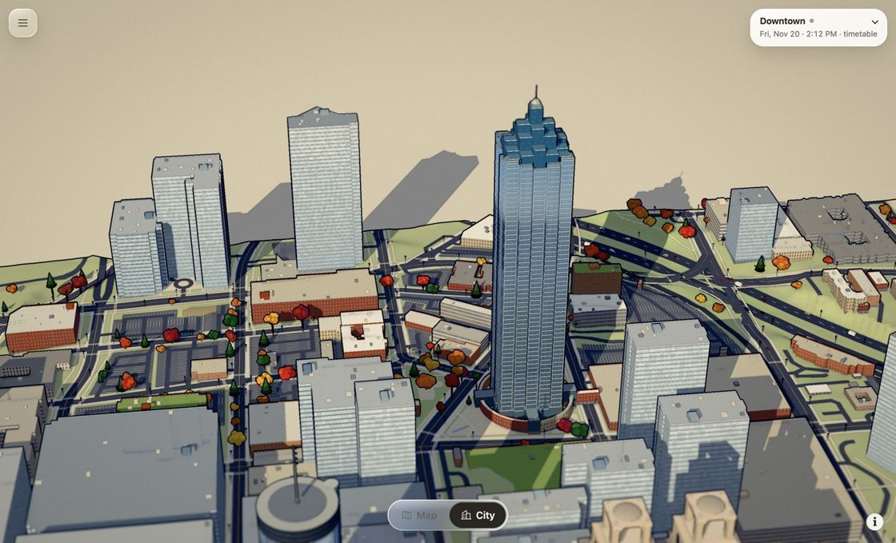

# Truist Plaza at the north end of Peachtree Center



| City camera | Before | After | Before at dusk | After at dusk |
| --- | --- | --- | --- | --- |
| Ordinary opening | [Before](opening-before.jpg) | [Day](opening-day.jpg) | [Before](opening-before-dusk.jpg) | [Dusk](opening-dusk.jpg) |
| South | [Before](south-before.jpg) | [Day](south-day.jpg) | [Before](south-before-dusk.jpg) | [Dusk](south-dusk.jpg) |
| North | [Before](north-before.jpg) | [Day](north-day.jpg) | [Before](north-before-dusk.jpg) | [Dusk](north-dusk.jpg) |

Portman describes the office plan as a square with alternating projections producing 36 corner offices per floor. The architect’s close photograph shows the pale spandrels and glazing. The developer’s upward view separates the projecting bays from their dark returns. Its distant photograph shows entire office bays terminating at different heights below the blue glass crown. The 1994 lighting account describes lit outlines on the stepped pyramid. The City model gives the lips a cool dusk light while retaining dark glass between them. [Portman Architects](https://portmanarchitects.com/project/suntrust-plaza/) · [Glazing and projections](https://www.portmanholdings.com/app/uploads/2023/08/suntrust-plaza.jpg) · [Full-height elevation](https://www.portmanholdings.com/app/uploads/2023/08/pm_0164_001_0001_Gp_x_Edited_2-2048x1078.jpg) · [Architectural Lighting award](https://www.usmodernist.org/AL/AL-1994-08-09.pdf)

**Heights.** The Council on Vertical Urbanism lists 60 floors, a highest occupied floor at 228.1 m, the architectural top at 264.3 m and the tip at 275 m. Portman gives a project height of 257 m. The model uses the Council’s architectural and tip measurements, with the 10.7 m difference represented by the thin mast. The datum in City is sampled ground at the tower center. The precise entrance datum, 49 m shaft width, individual projections, parapet heights and intermediate crown steps are estimates. Office lighting and glass reflections are illustrative. [Height definitions and measurements](https://www.skyscrapercenter.com/building/suntrust-plaza/724)

**Footprint.** The named 265 m, 46-floor Overture record is `d589ba16-ac92-4a00-8386-1d8098172a80`. Its long projecting arms belong at the base. Its short returns and square center anchor the tower near City (466.6, −978.8). Separate curved roof parts and the Truist Plaza Garden Offices retain their own records. The standard extrusion remains available when the expected tower outline or terrain is missing.

**Reproduction.** Before images use `f38db14`. In desktop Orca, use a 1446 × 876 viewport and `/?view=city&q=high&t=2026-11-20T14:12:45-05:00&speed=0`. Use `17:45:00` for dusk. Leave the opening camera untouched. The close views use:

```js
window.__city.lookAt(435, -1200, { bearing: 8, metresPerPixel: .58, tilt: 59 })
window.__city.lookAt(515, -740, { bearing: 167, metresPerPixel: .54, tilt: 60 })
```

The matched pairs above were captured before a small shoulder closure. In the reviewed final geometry the crown faces extend behind the office parapets, filling narrow gaps where their bay widths differ. [Final shoulder check](shoulder-check.jpg)

The matched daylight opening rose from 149 to 155 draw submissions and from 2,164,317 to 2,171,193 submitted triangles. A web rebuild and deployment with the existing data pick up the landmark.
