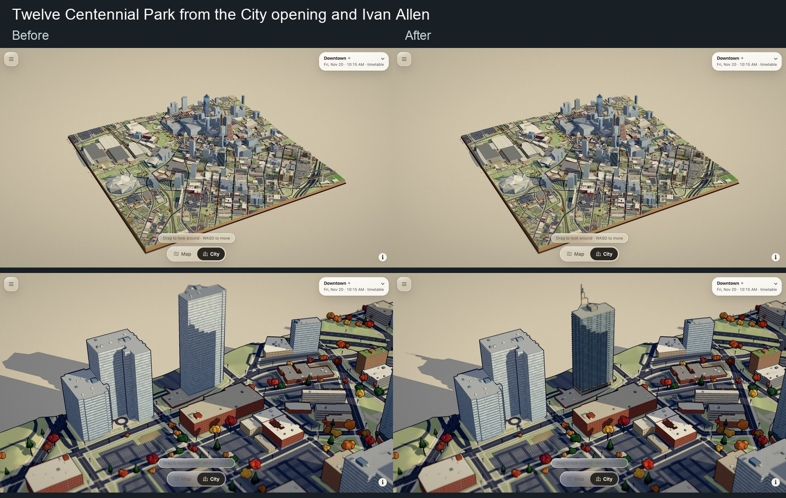

# Twelve Centennial Park Tower I

At the northern edge of the 2 km board, the 39-story residential tower at 400 West Peachtree rises above the Civic Center approach. The named 150 m footprint is entirely on the board, including its east podium. The higher 207 m record belongs to City’s existing Georgia-Pacific model, and the nearby 198.3 m record at 191 Peachtree is tagged as eight floors of parking. The paired hotel at Twelve has a separate mapped footprint that continues across the board edge. The model replaces only the residential record. [Downtown Atlanta inventory](https://www.downtownatl.com/places/twelve-centennial-park) · [CTBUH building record](https://www.skyscrapercenter.com/building/wd/4077)

## Survey and photographs

The 2018 Georgia B2 lidar has 6,224 returns inside the tower polygon. The main roof clusters around **429.2 m NAVD88** and the central equipment house reaches **435.5 m**. The north prow rises in two steps to **437.5 and 445.1 m**. The east strip at City (356, −1237) is only **314.6 m**. Mapped corner ground elevations span 303.9–308.5 m, putting the ordinary roof about 121–125 m above local ground. The main roof measures about 54 by 41 m across its widest axes. These are absolute survey elevations. CTBUH lists 150 m architectural height. The thin needle did not resolve in the returns, so its tip at 457.5 m NAVD88 is a photo-based estimate using the entrance grade and the published height. [USGS lidar](https://s3-us-west-2.amazonaws.com/usgs-lidar-public/GA_Statewide_B2_2018/ept.json) · [CTBUH contractor inventory](https://www.skyscrapercenter.com/company/2518)

The day photograph shows separate bowed balconies, silver mullions, blue-gray glazing, a tall narrow frame at the prow and low hotel in front. The hotel's blue-hour photograph from the opposite side shows the lower parking openings and separate residential bays. The September 2023 street panorama shows the concrete piers and retail glazing. Balcony projection, rail spacing, glazing subdivisions, mast width and the division of visible residential levels above the podium are estimates. [Daytime exterior](https://commons.wikimedia.org/wiki/File:12_Centennial_Park.jpg) · [Hotel’s blue-hour exterior](https://symphony.cdn.tambourine.com/twelve-hotel-residence/media/Twelve-Downtown-Gallery-11-5bc8afd5ab90b.jpg) · [Eastern street frontage](https://www.google.com/maps/@?api=1&map_action=pano&pano=CIHM0ogKEICAgICZibmb5gE&heading=253.91&pitch=27)

From the Connector, the mast and repeated balcony stacks sit in front of Truist and to the left of the paired 191 crowns. Michael Pancier photographed this alignment from the North Avenue bridge at 21:46 on December 26, 2011. Window lighting in City uses a fixed illustrative pattern. The north-facing City camera approximates the sightline from within the supported board. [55 Allen Plaza skyline photograph](https://www.55allenplaza.com/) · [North Avenue night photograph](https://www.flickr.com/photos/21467315@N00/6578955001/)

## City captures

High quality, 1296 × 726, November 20, 2026. Day is 10:15 EST, dusk 17:22 and night 20:15. Orbit cameras list target x/z, bearing, tilt and metres per pixel.

| View | Camera | Before | After |
| --- | --- | --- | --- |
| Board opening | (−40, −260), 28°, 57°, 2.945 | [Day](opening-before.jpg) | [Day](opening-after.jpg) |
| Across Ivan Allen | (323, −1245), 32°, 57°, 0.45 | [Day](ivan-allen-before.jpg) · [Dusk](ivan-allen-dusk-before.jpg) · [Night](ivan-allen-night-before.jpg) | [Day](ivan-allen-after.jpg) · [Dusk](ivan-allen-dusk-after.jpg) · [Night](ivan-allen-night-after.jpg) |
| Civic Center side, looking southeast | (322, −1240), 150°, 62°, 0.46 | [Day](civic-center-before.jpg) · [Night](civic-center-night-before.jpg) | [Day](civic-center-after.jpg) · [Night](civic-center-night-after.jpg) |

The daylight opening gains four draw calls and 47,236 triangles. The geometry uses the existing City bake and ships with the web client.
