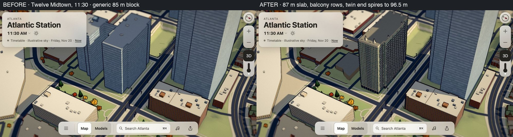
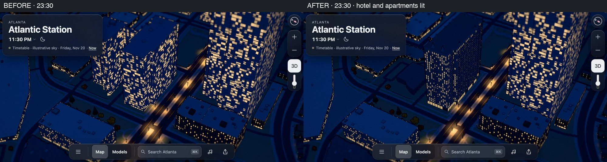
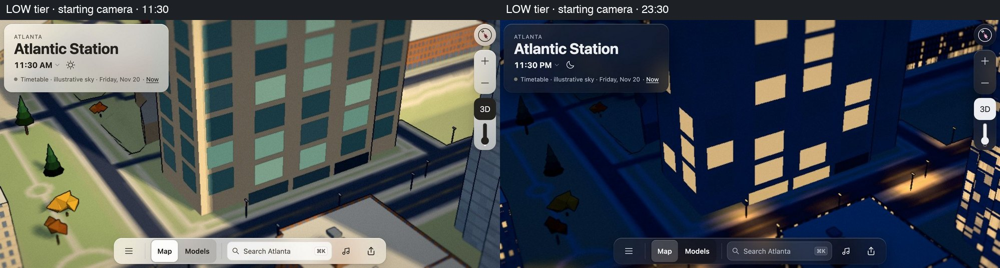
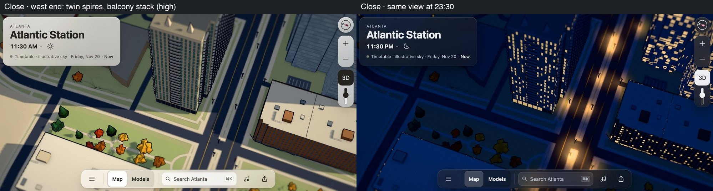

# Twelve Midtown, Autograph Collection

`osm:way:247997228` (361 17th Street NW, Atlantic Station; listed as Twelve Atlantic Station on SKYDB) was drawn as one generic 85 m block over its whole outline. That outline includes a low service wing to the north. City now draws the tower over the bar along 17th Street, with the wing as a low block behind it.

| Element | Plan (City m) | Height above grade | Basis |
|---|---|---|---|
| Hotel and residential slab, 26 storeys | x −644.5…−558.5, z −4205.3…−4171.5 | roof 87.0, parapet 89 (estimated), end spires 96.5 | 3DEP lidar, 22 April 2019: slab median 87.0, 90th percentile 90.9, max 96.5. Grade is the 276.3 m NAVD88 median of ground returns. |
| Low wing to the north | the rest of the outline | 8.5 | lidar median 7.5, 90th percentile 9.0 |

## Facade

Twenty-three photographs on SKYDB (Bugajski, Odom, Patriarca), taken from both ends and both broad faces, show:

- a pale beige precast slab with teal-green glass;
- dense balcony rows with white rails across both broad faces;
- a central balcony stack with rounded ends on each narrow end;
- a pair of tall pointed spires over each end, with small pinnacles at the corners of the broad faces.

[SKYDB building page and photographs](https://www.skydb.net/building/176242778/twelve-atlantic-station-atlanta) · [Hotel photographs](https://www.marriott.com/en-us/hotels/atlas-twelve-midtown-autograph-collection/photos/)

- **Floors:** a 6 m lobby, then 25 floors at 3.24 m.
- **High tier:** 3 m bays at 0.45 glass fill and balcony stacks about 6 m apart on the broad faces. A 6.8 m central stack runs down each end. The twin spires are four-sided pyramids from the parapet to the lidar maximum, and the corner pinnacles are 4 m. Spacing is estimated from the photographs. The rounded balcony ends are drawn square.
- **Low tier:** one pane row per three floors (20 m panes on the broad faces), one prism to the parapet, the four spires, and shop glazing on the broad faces only.

## Night

No full-night photograph was found. A hotel and apartments are noticeably lit at 23:30, so City lights a stable pattern of about 45% of the rooms, plus the lobby glazing. The spires are unlit.

## Measurements

Low tier, starting camera `-605,-4208,32,60,255`, 11:30, on main f3e5fe5a with the skin on and off: **+542 triangles** (1,233,838 → 1,234,380), **+2 draws** (61 → 63), programs unchanged (34).

## Review views

| View | City query |
|---|---|
| Day, from the west-south-west (high) | `?view=city&q=high&t=2026-11-20T11:30:00-05:00&cam=-600,-4190,60,48,520` |
| Full night, matched | `?view=city&q=high&t=2026-11-20T23:30:00-05:00&cam=-600,-4190,60,48,520` |
| Starting camera, low, day and night | `?view=city&q=low&t=2026-11-20T11:30:00-05:00&cam=-605,-4208,32,60,255` (23:30 for night) |
| Close: west end and spires | `?view=city&dev&mindist=20&q=high&t=2026-11-20T11:30:00-05:00&cam=-640,-4190,70,28,330` |

