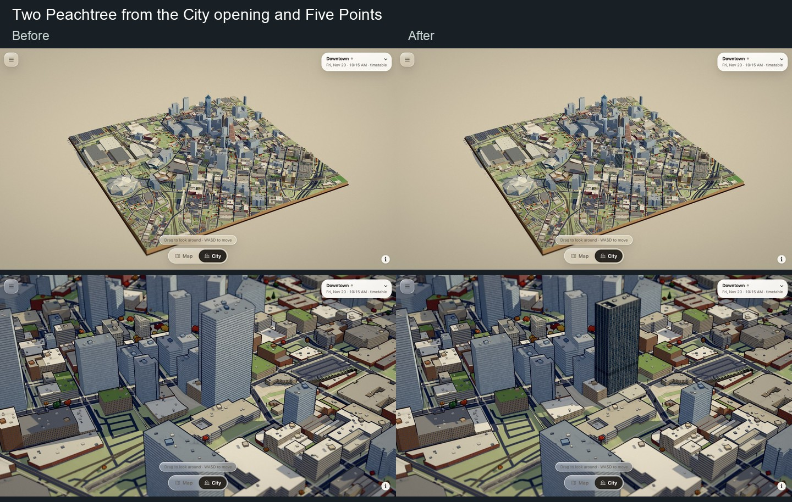

# Two Peachtree at Five Points

The second high-rise beside the station came from the eight-point, unnamed 165 m record. It shares a 63.4 m edge with the six-point State of Georgia Building (169 m, 44 levels in the bake). Of 6,746 lidar returns inside the unnamed polygon, the 25th, 50th and 90th percentiles were 327.9, 329.1 and 331.1 m NAVD88. High returns cluster along the shared edge, where the upper tower slightly overhangs its ground outline. Four metres past that seam, the station-side roofs sit around 328 and 330 m. The separate seven-story 1940 building at 14 Marietta keeps its footprint. The city's 2023 RFQ describes both properties and shows their relative positions in existing-condition photos and an aerial. [Invest Atlanta](https://www.investatlanta.com/two-peachtree) · [Existing campus and aerial in the RFQ](https://www.investatlanta.com/assets/two_peachtree_rfq_final_4.28.23_lPWLlOl.pdf#page=20)

On the named polygon, 7,158 returns put the main roof at about 483.85 m NAVD88 and the coping around 485.1 m. That coping stands about 164 m above the 321 m Five Points sidewalk, or 170 m above the lowest adjoining terrain around 315 m. The model uses absolute elevations, including the two apron levels and the recessed court within the roughly 65 × 32 m upper slab. Public 2018 Georgia lidar supplied the measurements. [USGS point-cloud dataset](https://s3-us-west-2.amazonaws.com/usgs-lidar-public/GA_Statewide_B2_2018/ept.json)

The broad and narrow elevations have about eleven and five projecting bays. The photos establish the pale metal ribs, dark glazing, lower mechanical belt, tall louvered crown and the shadow under the street frontage. Blade depth, glazing divisions, canopy dimensions, equipment outlines and individual floor pitches are estimates. A September 2026 field photograph still shows the existing facade. The circa-1970 night photograph records the older appearance. A sparse, fixed pattern of dim windows represents illustrative lighting during redevelopment. [Broad elevation](https://www.investatlanta.com/assets/2_peachtree_downtown_jll-28_Ozl3glP.jpg) · [Second elevation and street base](https://www.investatlanta.com/assets/2_peachtree_downtown_jll-35_Ozl3glP.jpg) · [December 2025 street view](https://www.google.com/maps/@?api=1&map_action=pano&pano=zQMUrmvuENdGCh_pbBgX7g&heading=258.91&pitch=29) · [AJC current exterior](https://www.ajc.com/gallery/news/2026/10/photos-some-large-office-to-residential-conversion-candidates-in-atlanta/) · [Atlanta History Center night photograph](https://dlg.usg.edu/record/geh_athpc_692)

## City cameras

Matched Orca captures at 1296 × 726, high quality, clock stopped on November 20, 2026. Daylight is 10:15 EST and night is 20:15 EST. Orbit bearings and tilts are degrees, scale is metres per pixel. Street-level coordinates are City x/z with eye and target heights relative to the City datum.

| View | Camera | Before | After |
| --- | --- | --- | --- |
| Opening | (−40, −260), 28°, 57°, 2.945 | [Day](opening-before.jpg) · [Night](opening-night-before.jpg) | [Day](opening-after.jpg) · [Night](opening-night-after.jpg) |
| Five Points, across the former duplicate | (108, −64), 74°, 59°, 0.53 | [Day](five-points-west-before.jpg) | [Day](five-points-west-after.jpg) |
| Five Points skyline | (88, −54), 28°, 54°, 0.62 | [Day](five-points-before.jpg) · [Night](five-points-night-before.jpg) | [Day](five-points-after.jpg) · [Night](five-points-night-after.jpg) |
| Street base | eye (150, −10, 2), target (117, −14, 19), FOV 65° | [Day](entry-before.jpg) | [Day](entry-after.jpg) |

At the daylight opening the pair adds four draw calls (145 to 149) and 20,928 triangles (2,252,931 to 2,273,859). The model ships with the City client and uses the existing bake.
