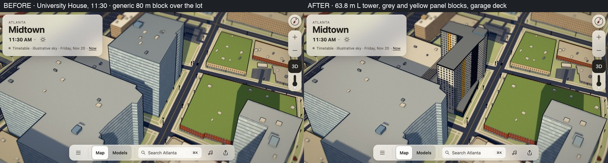
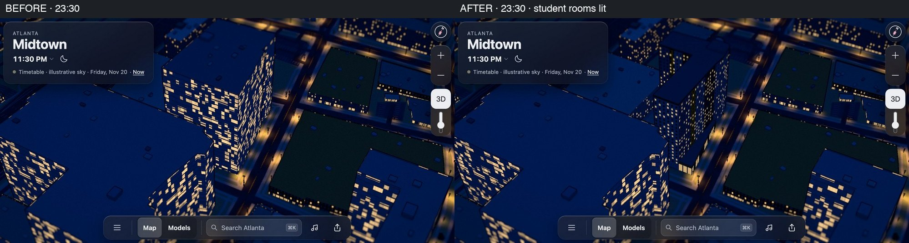
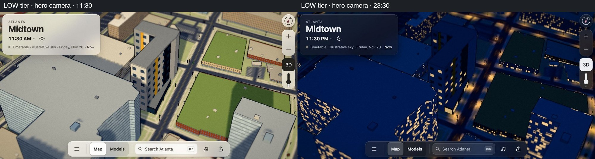
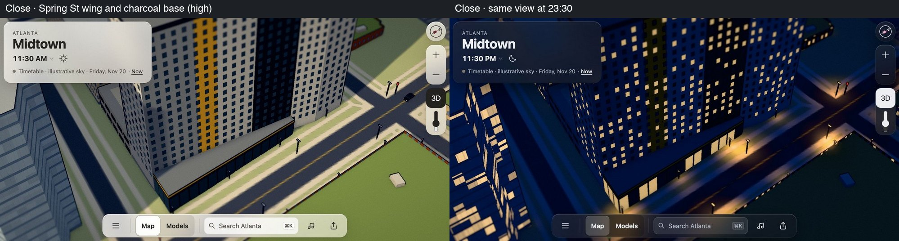

# University House Midtown

`osm:way:886034002` (930 Spring Street, at 8th Street and Peachtree Place) was drawn as one generic 80 m block over its whole 63 × 81 m lot. The tower opened in 2015 as 19-storey student housing with 268 units. City now draws it from the lidar: an L-shaped tower around a low garage that carries the amenity deck.

| Element | Plan (City m) | Height above grade | Basis |
|---|---|---|---|
| Tower: a bar on Peachtree Place and a wing down Spring Street | x 178–230, z −2950…−2926, plus x 208.5–229, z −2926…−2869 | roof 63.8, parapet 65.6, corner glass lounge 68.2 | 3DEP lidar, 22 April 2019: bar and wing median 63.8, 90th percentile 65.6–66.1, max 68.2. Grade is the 286.0 m NAVD88 median of ground returns. The mapped 80 m is the OSM tag. |
| Open garage and amenity deck | x 177–209, z −2926…−2869 | 8.1 | lidar median |
| Spring Street base wedge | x 229–240 | 9 (estimated) | lidar mixed, median 13.6 at the tower edge |

## Facade

The Midtown Alliance photograph, taken from the west across a cleared lot, shows the tower clad in vertical blocks of light grey, mid grey and charcoal panels with punched windows. Yellow-framed balcony strips run up two faces. A charcoal block with a glass-topped lounge stands at the corner, beside an open concrete garage with the amenity deck. The street base is charcoal with a yellow frame. [Midtown Alliance building page](https://midtownatl.com/view/university-house-midtown) · [Curbed Atlanta via Vineyard, on the 19-storey, 268-unit tower](https://vineyardestates.blogspot.com/2015/09/these-aint-your-daddys-dorms-via-curbed.html)

- **Glass:** the punched-window base is `#4f5c69` (S 25%, V 41%), varied with `#56636f` (23/44) and `#4a5866` (27/40). This meets the provisional glass rules: V of at least 40% and S of at most 36%.
- **Floors:** a 5 m lobby, then 18 floors at 3.3 m.
- **Panel blocks:** each long face gets four vertical blocks in one of two light/yellow/mid/charcoal orders. Block widths are estimated from the photograph.
- **High tier:** 3.2 m punched windows (0.42 × 0.55 of the bay), garage openings, the yellow trim over the base, and the corner glass lounge.
- **Low tier:** one pane row per three floors at 12 m, the panel blocks, and one prism to the parapet. No garage openings.

## Night

No night photograph was found. Student housing is noticeably lit late, so City lights a stable pattern of about 45% of the rooms and the glazed base. The garage stays dark.

## Measurements

- **Low-tier mesh:** 350 triangles (234 body, 116 night windows), against 3,256 on the high tier. This count is deterministic (unit test).
- **Camera delta:** at the starting camera `206,-2907,32,60,240`, 11:30, on main 5958b79d with the skin on and off, +1.0k to +1.8k triangles across runs and +2 draws (87 → 89), with programs unchanged (36). Run-to-run noise is about ±400 triangles, and the shadow and ink passes draw each mesh more than once, so the camera figure is several times the mesh count.
- The starting camera mostly frames a neighbour's roof, so the low-tier pair below uses the hero camera.

## Review views

| View | City query |
|---|---|
| Day, from the south-east (high) | `?view=city&q=high&t=2026-11-20T11:30:00-05:00&cam=208,-2910,330,48,480` |
| Full night, matched | `?view=city&q=high&t=2026-11-20T23:30:00-05:00&cam=208,-2910,330,48,480` |
| Low tier, same camera, day and night | `?view=city&q=low&t=2026-11-20T11:30:00-05:00&cam=208,-2910,330,48,480` (23:30 for night) |
| Close: Spring Street wing and base | `?view=city&dev&mindist=20&q=high&t=2026-11-20T11:30:00-05:00&cam=215,-2905,300,45,220` |

