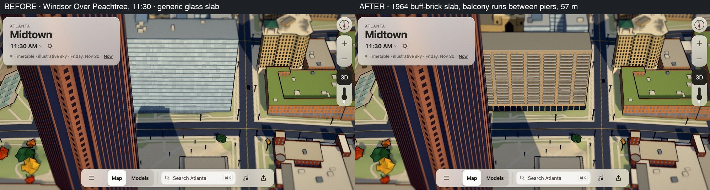
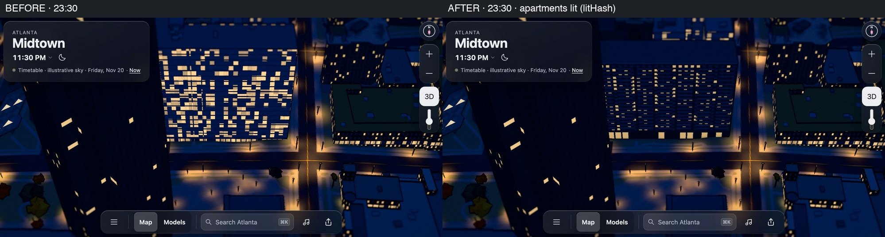
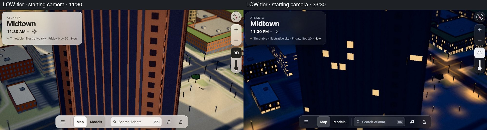
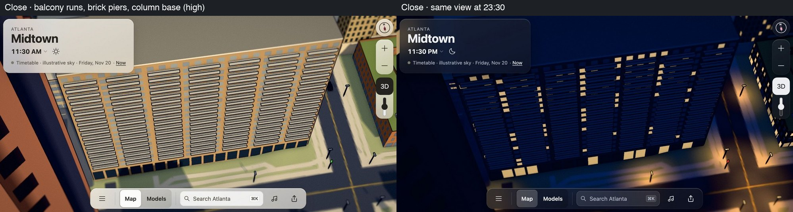
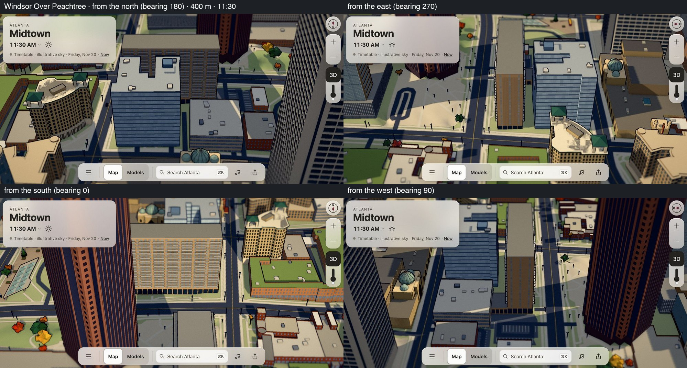

# Windsor Over Peachtree

`osm:way:234939890` (620 Peachtree Street, at North Avenue; built 1964 as the Peachtree North Apartments and converted to condominiums in 2002) was drawn as a generic glass slab with an estimated 66 m height. City now draws the 1964 slab at its lidar height, in buff brick with balcony runs between brick piers.

| Element | Plan (City m) | Roof, NAVD88 | Basis |
|---|---|---|---|
| 19-storey slab | x 517.6–598, z −1974.6…−1953.2 | 368.9, parapet 369.5 (about 57 m above the 311.2 m grade) | 3DEP lidar, 22 April 2019: median 368.9, 90th percentile 369.5, max 374.7 |
| Low south-west wing | x 517–536, z −1988…−1974 | 316 (about 5 m) | lidar median 315.9 |

## Evidence

- **Midtown Alliance photograph:** the corner of Peachtree and North Avenue, showing buff brick, balcony runs with white slab edges between brick piers, brick end walls with narrow window strips, and a white column canopy at the base. [Midtown Alliance page](https://midtownatl.com/view/the-windsor-over-peachtree)
- **2015 street photograph:** the same features seen from Peachtree. [All Atlanta Condos](https://www.allatlantacondos.com/the-windsor-over-peachtree-midtown-atlanta-condos/)

## Model

- **Long faces:** about 12 m balcony runs between 2.6 m brick piers. Each floor has a white slab edge and a light rail on the high tier, every third floor on the low tier. Glass doors sit behind the balconies.
- **End walls:** buff brick with narrow window strips.
- **Base:** lobby glazing on the high tier.
- **Glass:** base `#a3adb4` (S 9%, V 71%). Rendered at 11:30 on the high tier (close camera), the sunlit balcony bays read S 18 / V 58 overall. The glass-and-shade fraction behind the slabs reads S 24 / V 33: the 1.4 m slabs shade it, as they do on the building.
- Run widths and pier widths are estimated from the photographs.

## Night

No night photograph was found. Lit rooms come from the shared `litHash(seedOf(id), face, floor, bay)` at 40%, plus the lobby. From above, the balcony slabs hide part of each lit door, as they would in reality.

## Review views

| View | City query |
|---|---|
| Day, from the south (high) | `?view=city&q=high&t=2026-11-20T11:30:00-05:00&cam=557,-1963,0,45,360` |
| Full night, matched | `?view=city&q=high&t=2026-11-20T23:30:00-05:00&cam=557,-1963,0,45,360` |
| Starting camera, low, day and night | `?view=city&q=low&t=2026-11-20T11:30:00-05:00&cam=554,-1965,32,60,240` (23:30 for night) |
| Close: balcony runs and base | `?view=city&dev&mindist=20&q=high&t=2026-11-20T11:30:00-05:00&cam=560,-1975,10,35,200` |
| Four-side check | `&dev&mindist=20&cam=557,-1968,{180,270,0,90},50,400` |

