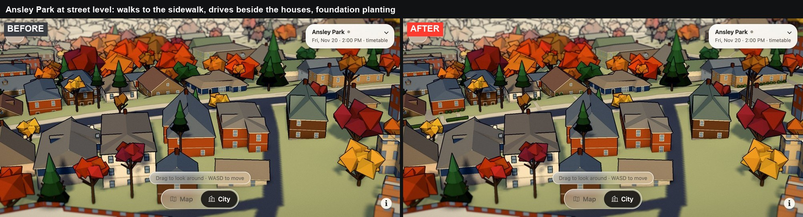

# Yards by rule

There are no parcel boundaries in our data, so yards are laid out by rule from each house footprint, its front wall and the nearest mapped street. All of it is `illustrative`, deterministic per house, and uses the calm ground standard (#248). The layer draws from the landscape primitives and ground covers.

- **Front walks:** from every entry (two on apartments), starting past the 2.4 m porch and its steps or past the stoop, straight toward the street. Each walk stops 4.5 m short of the street centreline, or at any building, whichever comes first. They are 1.2 m wide in light concrete.
- **Driveways:** along the side wall away from the door, from about 8 m back out toward the street, 3 m wide. A drive is dropped if it would cross another building; about 60 % of houses get one.
- **Foundation planting (high tier):** a pine-straw or mulch strip 1.3 m deep along the front with single-mass shrubs, broken at the door. It's left out under a full Craftsman porch and runs beside a half porch.
- **Some houses (high tier):** a small bed beside the walk (30 %), and a clipped hedge near the street broken at the walk (25 %).
- **Low tier:** walks and driveways only.
- **Street-tree rows:** not added. The staged canopy (#161) already places crowns along the streets, and new tree placement belongs to the tree-species agent.

**Budget:** across eight rows, 362,974 triangles at high (about 110 per house) and 41,982 at low (about 13). The layer is one primitives draw, plus one planting draw where beds appear, plus one ground-cover draw per board.

## Views (captioned BEFORE | AFTER)

- [Sam's Ansley camera](ansley-compare.jpg): `/?view=city&cam=1280,-3950,40,58,160`
- [Street level](street-compare.jpg) and [its low tier](street-low-compare.jpg): `/?view=city&cam=1300,-3960,20,74,32`
- [Close](close-compare.jpg) · [night](night-compare.jpg) · [Home Park](home-park-compare.jpg)

At Sam's distance the yards are deliberately quiet; they read most at street level. Publishing needs a web rebuild only.
