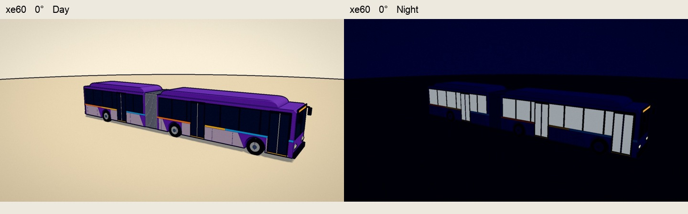
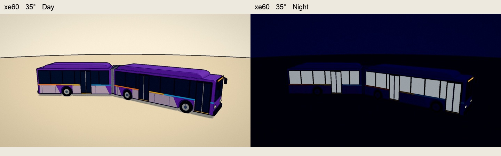
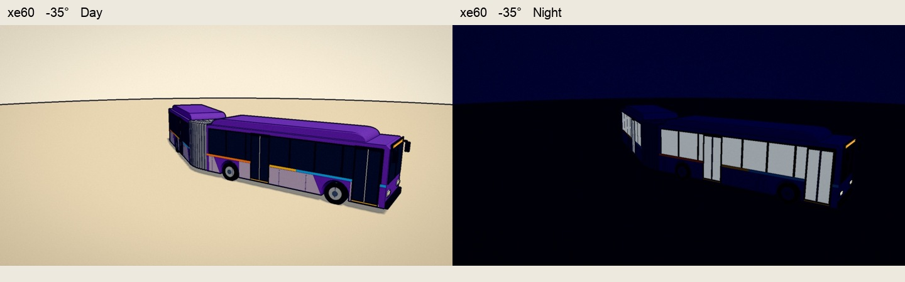
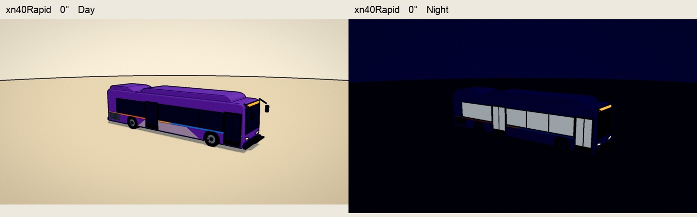

# MARTA Rapid buses — Model Lab, 2026-11-23

The lab includes the articulated electric XE60 and the purple A-Line livery of the rigid XN40.

## Identification and service caveat

[MARTA Rapid A-Line overview](https://itsmarta.com/summerhill.aspx) identifies the
purchased 60-foot articulated electric buses and the five-mile roundtrip connecting
Downtown, Capitol Gateway, Summerhill, Peoplestown and the BeltLine. Rail connections:
Five Points, Georgia State and Garnett. Downtown portion reaches our board; no
route-wide type assignment is implemented or warranted by these sources alone.

[MARTA Phase One](https://itsmarta.com/aline.aspx) explicitly says CNG buses and
shows purple bus 7108. [MARTA's phased-launch release](https://itsmarta.com/marta-rapid-a-line-to-launch-phases.aspx)
explains the New Flyer battery recall. The [7106–7142 roster](https://cptdb.ca/wiki/index.php/Metropolitan_Atlanta_Rapid_Transit_Authority_7106-7142)
identifies 7108 and 7112 as 2025 New Flyer **XN40**, 40 ft rigid CNG buses.
[Axios, April 21 2026](https://www.axios.com/local/atlanta/2026/04/21/marta-rapid-bus-line-route-transportation-atlanta)
photographs purple 7112 in service. This is not an articulated XN60.

The [CPTDB fleet roster](https://cptdb.ca/wiki/index.php/Metropolitan_Atlanta_Rapid_Transit_Authority)
identifies 9001–9006 as 2024 New Flyer **XE60** electrics. This is secondary evidence
for the exact model code; MARTA independently confirms manufacturer/power/length.
MARTA also owns XN60 articulated CNG buses (1701–1718, 1731–1734), but no sourced
purple Rapid XN60 assignment was found. Don't claim the XE60 is running revenue
service now: its return is unverified. Sam's sighting could reflect service newer
than the official page; do not claim it never entered service either.

## Photo references

- [9001 broad front/side, courtesy MARTA](https://atlanta.urbanize.city/sites/default/files/styles/1140w/public/2026-01/MARTA%20Rapid.jpg?itok=SuZLUiZm), published
  [Urbanize January 5, 2026](https://atlanta.urbanize.city/post/marta-2026-forecast-new-trains-looks-rather-promising).
  Photo capture date is unstated. Purple top/front, pale grey/lavender angular
  lower panels, blue/gold/orange thin belt, silver bellows, three curb-side doors,
  three axles. White headlight lenses; dark reflective windows. No logos to copy.
- [Alternate curb-side close view](https://assets1.cbsnewsstatic.com/hub/i/r/2026/01/27/95b1c7b0-04fd-490d-987f-d1311ffc378e/thumbnail/1200x630/29b10de1399cee2e1ce7ce5a26a5cbe0/untitled-design-35.png), published
  [CBS January 27, 2026](https://www.cbsnews.com/atlanta/news/marta-hosting-open-houses-to-educate-riders-on-upcoming-nextgen-bus-network/).
  Capture date unstated. Interior ceiling strips and amber destination sign lit
  in daylight. Bellows vertical folds, silver wheel surrounds, three doors visible.
- [Official 7108 XN40 close view](https://itsmarta.com/uploadedImages/Get_to_Know_MARTA/System_Information/A-Line/rapid-a-line-bus.jpg), on the Phase One page;
  capture/publication date unstated, accessed November 23 2026. Purple roof tank
  enclosure and body; blue/gold belt, lavender diagonal accent, no wordmark in model.

No reliable exact-fleet night image found in the searches so far. Record this gap;
night light intensity is estimated. These are linked research images, not licensed
Commons images. Do not silently mark a composite CC-licensed. Scratch copies are
in `/tmp/marta-articulated/` for local inspection.

## Manufacturer dimensions and exports

[New Flyer CHARGE NG brochure, December 2023](https://www.newflyer.com/site-content/uploads/2023/12/Xcelsior-CHARGE-NG.pdf):
60 ft model is 18.54 m over bumpers, 18.29 m body, 2.6 m wide, stated 3.3 m over
charging rails, 305/70R22.5 tyres; axle spacings 229 in (5.8166 m) front-to-middle
and 293 in (7.4422 m) middle-to-rear. Step height 356 mm. Manufacturer dimensions
are family specifications, not an as-built MARTA drawing.

`vignette/xe60.ts` exports `XE60_LAYOUT`, `xe60Geometry(detail)`,
`xe60Pose(angle)` and `xe60Material(night,angle,instanced)`.
Front local origin is front axle at ground; hitch estimated at z=-8 m. Rear and
bellows origins are hitch at ground. Front body ends z=-7.4/+2.07; rear body spans
z=-8.21/-.6 relative hitch. Hitch position, roof package locations, door positions
and +/-35 degree articulation limit are estimates. +z forward, y up, curb side -x.

Both body geometries use zero `aBendWeight`; rear rigid pose rotates at the hitch.
Bellows rest mesh spans +.6/-.6 m; shader blends each ring between fixed and
rotated positions. For future instancing, `aArticulation` is a per-instance scalar
attribute on each geometry, with instance matrices controlling rigid sections.
A uniform is used for the lab. The bellows use the same bend in the directional shadow pass.

## Review views

| Published daytime reference | Matched lab day and night |
| --- | --- |
|  |  |
| [XE60 alternate curb-side photograph, CBS](https://www.cbsnews.com/atlanta/news/marta-hosting-open-houses-to-educate-riders-on-upcoming-nextgen-bus-network/) |   |
|  |  |

[Side-by-side roof profiles in daylight and at night](log/rapid-buses/roof-profiles.jpg). Both buses use the same 36 cm fairing crown, shoulder bevel and curved end profile. The XE60 deck height and equipment locations are visual estimates.

All captures use camera position `[-16,5.8,12]`, target `[0,1.6,0]`, vertical FOV 38°, high detail.

| Geometry | Triangles | Attribute bytes | Meshes per preview |
| --- | ---: | ---: | ---: |
| XE60 low | 1,286 | 169,752 | 3 |
| XE60 high | 2,766 | 365,112 | 3 |
| XN40 Rapid | 6,060 | 727,200 | 1 |

Counts exclude shadow passes. The low XE60 fits the proposed 1,500-triangle phone budget. Future instanced draws can share one batch per section. Phone frame rate is unmeasured.

Connector confirmed `xe60` / `marta:vt:xe60` and `xn40Rapid` as a livery on `marta:vt:xn40`. The lab makes no live vehicle assignments.
