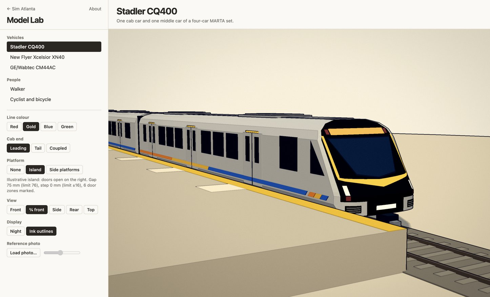
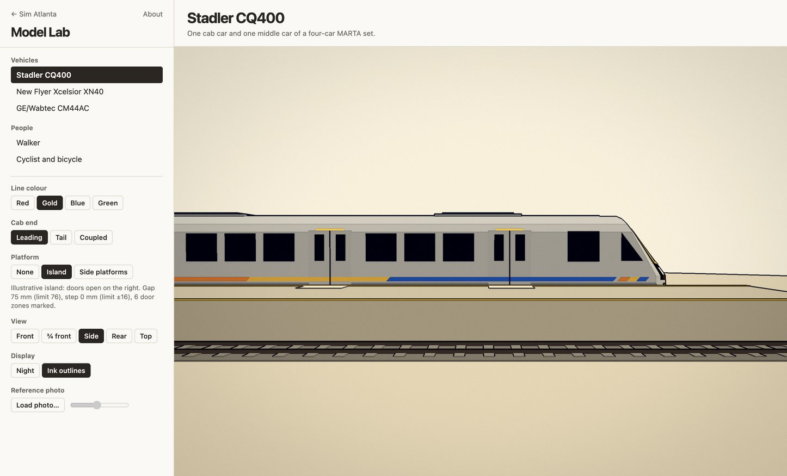
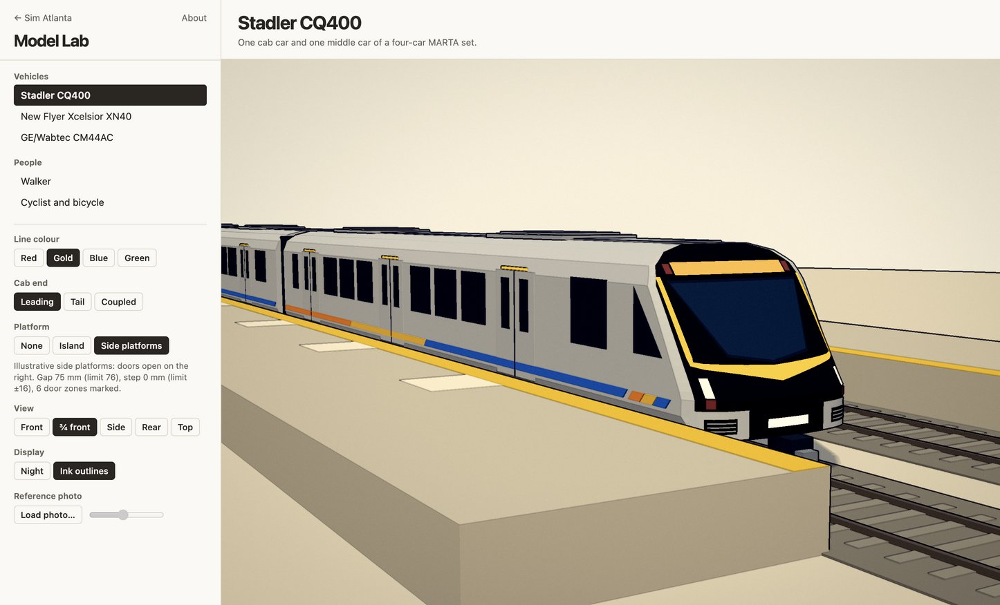
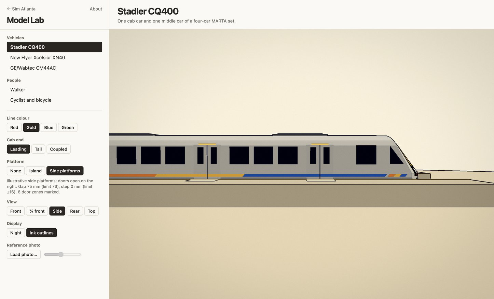
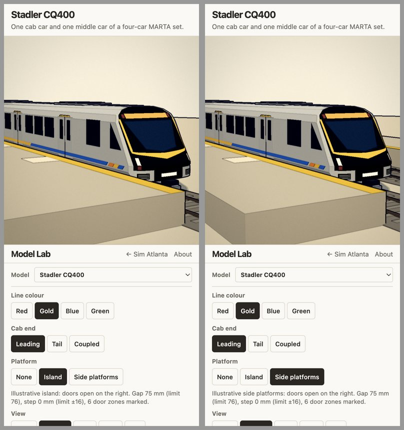

# Model Lab: station platform inspection (2026-11-22)

`/models.html?v=cq400&platform=island` or `&platform=side` stops the lab's two CQ400 cars at an
**illustrative** station, so clearance, the boarding edge and door alignment can be read at a
glance. Choose **None** in the Platform control to return to the plain lab track. City is
unchanged.

The geometry is in `web/src/models/platform-scene.ts`, and the tests are in
`platform-scene.test.ts`.

## What it reuses

- **The shared platform primitive** (`web/src/model/platforms.ts`): each layout is a `StationLayout`.
  - `boardingChoices` picks the stop track and the door side.
  - `platformSection` (`web/src/city/platform-section.ts`) places each slab's boarding lips from the
    track offsets. It is the same section code the Georgia State platforms use.
- **The CQ400 model** (`web/src/vignette/cq400.ts`), which now exports the floor height
  (`CAR_FLOOR` = 1.12 m above the railhead) and its door-pair centres (`CQ400_DOORS`).
  - The model's geometry is unchanged.
  - The platform top is level with the car floor.
  - Each door pair gets a pale zone on the platform beside it.

## Dimensions and their status

| Item | Value | Status |
|---|---|---|
| Horizontal gap, car side to platform edge | 75 mm | Set inside the **49 CFR 38.53(d)** level-boarding limit for rapid rail (≤ 3 in, 76 mm) |
| Step, car floor to platform | 0 mm | Within the same rule's ±5/8 in (16 mm) |
| Car width, floor, doors | 3.2 m, 1.12 m, 1.62 m pairs | From the lab's CQ400 model |
| Side-platform track centres | 4.86 m | Surveyed at Georgia State ([georgia-state-geometry.md](georgia-state-geometry.md)) |
| Island width 8 m, side platforms 5 m wide, 52 m long; 0.6 m tactile strip | — | **Illustrative**: not a sourced station |

The panel reports the gap, the step, the door side and the number of door zones. The train stops
on the track that boards on its right, so the lab's ¾ and Side presets look at the platform side
of the car in both layouts. The presets follow the train's offset from the lab centre line.

## Views

| | ¾ front (placement) | Side (door thresholds) |
|---|---|---|
| Island |  |  |
| Side platforms |  |  |

At phone width (390 px, both layouts), the controls and report fit with no horizontal scroll:

