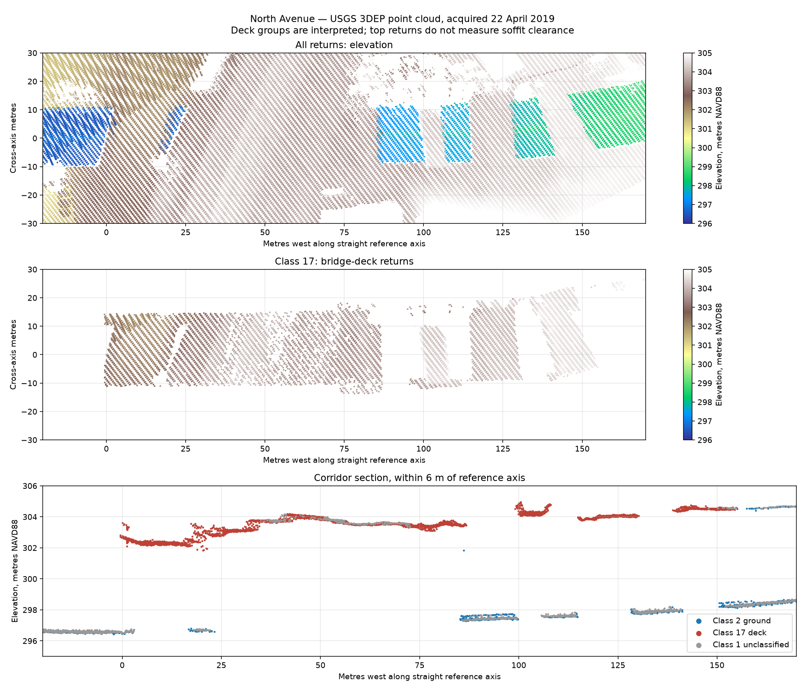

# North Avenue NW underpass — survey and model

Survey dated 2026-11-23. City implements option C. The evidence supports **five visible
cover groups**, not a proven inventory of five independent bridges: Marietta
Street, one broad active-rail cover, and three disused western deck strips.
The active cover's internal bridge joints remain unresolved. Sam approved this representation on November 23.

## Marietta Street: reported inventory

[FHWA 2025 Georgia NBI](https://www.fhwa.dot.gov/bridge/nbi/2025/delimited/GA25.txt),
structure **000000012103200**, identifies `MARIETTA STREET` over `SR 8 NORTH AVE.`.
It was built in 1951 and the record gives inspection date March 2024.
[Archived record](../pipeline/prototypes/north-ave/nbi-2025.json).

| Attribute | Reported value |
|---|---:|
| Main spans / approach spans | 2 / 0 |
| Structure length | 22.6 m |
| Maximum span length | 12.2 m |
| Deck width / roadway width | 18.0 / 12.8 m |
| Minimum vertical underclearance, item 54, reference H | **4.69 m** |
| Structure material / type | Concrete / slab (codes 1 / 01) |

The [FHWA coding guide](https://www.fhwa.dot.gov/bridge/mtguide.pdf) defines H as
highway beneath the structure. Item 54 supplies the minimum underclearance; the
99.99 values in items 10 and 53 must not be read as the tunnel height. The 4.69 m
value is **reported for Marietta Street only**. It is not a posted-clearance photo,
not a guarantee of present clearance, and not evidence for any railway soffit.
Individual lengths of both spans are not listed; do not claim that subtracting the
maximum span from structure length measures the other span.

## Photographs and historical aerials

- [East approach, March 2025](https://www.google.com/maps/@?api=1&map_action=pano&viewpoint=33.77085,-84.39935&heading=243&pitch=3&fov=30):
  balustrade, haunched square columns, two road openings and a sidewalk opening.
  This eastern crossing carries **Marietta Street**.
- [West approach, May 2022](https://www.google.com/maps/@?api=1&map_action=pano&viewpoint=33.77035,-84.40125&heading=60&pitch=3&fov=45):
  separate deck faces, daylight gaps, median piers, pipe railings and wall lamps.
  No reliable night imagery recovered; lamp placement is observed, operation and
  intensity at night remain inferred.
- [Google aerial](https://www.google.com/maps/@33.7708,-84.40025,160m/data=!3m1!1e3):
  partially obscured by foliage; acquisition date not established.
- [Esri Wayback 2022-12-14 release](https://www.arcgis.com/home/item.html?id=0c361a688a5a453487021132c878e870):
  its level-20 metadata at this crossing identifies **15 December 2018**, WV04,
  source resolution 0.31 m, source accuracy 4.06 m. The release date is not the
  acquisition date. Winter imagery exposes the three western strips and their
  gaps, with no tracks visible on those strips. **Disused** here is inferred from
  their disconnected, trackless appearance; ownership and formal abandonment
  status are unknown. A train still obscures part of the active-rail cover.
- The 2023–2026 Wayback releases inspected reuse a **27 September 2022** WV03
  image at this location; those are not independent winter observations.

[Wayback configuration](https://s3-us-west-2.amazonaws.com/config.maptiles.arcgis.com/waybackconfig.json)
and the [selected metadata query](https://metadata.maptiles.arcgis.com/arcgis/rest/services/World_Imagery_Metadata_2022_r15/MapServer/3/query?f=json&geometry=-84.4002%2C33.7706&geometryType=esriGeometryPoint&inSR=4326&spatialRel=esriSpatialRelIntersects&outFields=%2A&returnGeometry=false) make the acquisition date reproducible.
Commercial aerial and Street View imagery were viewed only, not copied into the
repository. USGS point-cloud plots below are derived from public-domain data.

## 3DEP point-cloud survey

Queried the actual [USGS GA_Statewide_B2_2018 EPT point cloud](https://s3-us-west-2.amazonaws.com/usgs-lidar-public/GA_Statewide_B2_2018/ept.json),
not the DEM, over lon/lat `[-84.4022,33.7700,-84.3990,33.7716]`.
The query returned **258,838 points**, including **7,279 class-17 deck returns**
and 66,498 class-2 ground returns. Adjusted GPS times place acquisition on
**22 April 2019, approximately 04:07–04:32 UTC** (GPS-to-UTC offset 18 seconds).
There is still vegetation in the cloud; do not describe it as entirely leaf-off.

The straight survey axis starts at City `(-761.16,-1885.765)` and runs west along
unit vector `(-0.873009,0.487705)`. It approximates the road; it is not its curved
centreline. Axis ranges below are 1st–99th percentiles of class-17 returns within
2 m of that axis, inside manually chosen group windows. They are **inferred
cover extents**, rounded to metres, not structural span measurements.

| Cover group, east to west | Along-road cover range | Approx. cover width | Median top, NAVD88 |
|---|---:|---:|---:|
| Marietta Street | 0–19 m | 19 m | 302.32 m |
| Active-rail cover envelope | 24–86 m | 62 m | 303.53 m |
| Disused east strip | 100–107 m | 7 m | 304.24 m |
| Disused middle strip | 115–130 m | 15 m | 304.03 m |
| Disused west strip | 140–153 m | 13 m | 304.52 m |

These widths run **along North Avenue**, across the rail alignment. They are not
bridge spans across the road. Deck-return cross-axis extents are about 25–31 m
but include skew, parapets and curved-road effects; use them as approximate cover
footprints, not a precise span inventory. Marietta's NBI span dimensions take
precedence over these rough extents. The plot resolves gaps between the western
strips and a narrow gap behind Marietta; it does not prove seams within the broad
active cover. Road returns in exposed gaps rise from about 296.6 m NAVD88 near
Marietta to 297.4–297.9 m farther west. No ground returns occur under most of the
active cover; interpolate that road profile and mark it inferred. Top returns
cannot supply slab thickness or minimum soffit clearance.

[Numeric summary](../pipeline/prototypes/north-ave/lidar-summary.json) ·
[Reproduction script](../pipeline/scripts/north_ave_survey.py).
The script uses the existing EPT reader/cache and requires numpy, laspy/lazrs,
pyproj and matplotlib; it does not stage City data.

## One useful walking photograph

From the **public sidewalk in the daylight opening immediately west of the active
rail cover**, approximately 33.7705, -84.4007, face **east/northeast up North Avenue**
and tilt upward enough to include the entire soffit across both carriageways.
A second frame from the opposite sidewalk would distinguish a true deck gap from
a beam shadow. The unresolved question is the active cover's internal soffit
joints and pier lines, not the three western strips now visible in lidar. No need
to enter rail property or stand in the roadway. This is a requested sightline,
not a surveyed camera position.

## City geometry

North Avenue follows an inferred lower profile from the road returns. Its
carriageways, raised sidewalks and median meet the mapped pavement at each end
of a 213 m cut. Traffic samples that lower profile on North Avenue and the upper
board triangles on Marietta. The shader blends road paint from the board's
existing texture into the two-lane cross section as the kerbs rise. Wetness
and the diffuse shading apply along the approaches and through the bore.

The five surveyed top elevations guide the board grid before either quality
tier chooses its triangles. Each cover is part of that upper board. Marietta
keeps its mapped pavement, the running tracks follow the restored formation,
and the western strips retain the surrounding ground paint. The four gaps
between them are actual holes, with retaining walls cut to the bank height.
The Marietta median and shoulder supports, portal faces and soffits share a
draw with the lower pavement. Warm wall lights are based on the west approach
photo. Their spacing, falloff and after-dark operation are inferred.

Tests sample the drawn carriageways and soffits, require open sky at each
surveyed gap, and check the mapped tracks at metre intervals over the crossing
and both banks against a 1.5% grade limit. The previous North Avenue ballast
exception has been removed from the ground-contact regression test. The low
board and structure cost is 2,590 additional triangles and one draw. This is a
web rebuild. The survey does not change the staged City data.

[Matched overview and under-deck photographs and cameras](build-log.md#2026-11-23--use-the-terrain-itself-as-the-roof-over-north-avenue)
