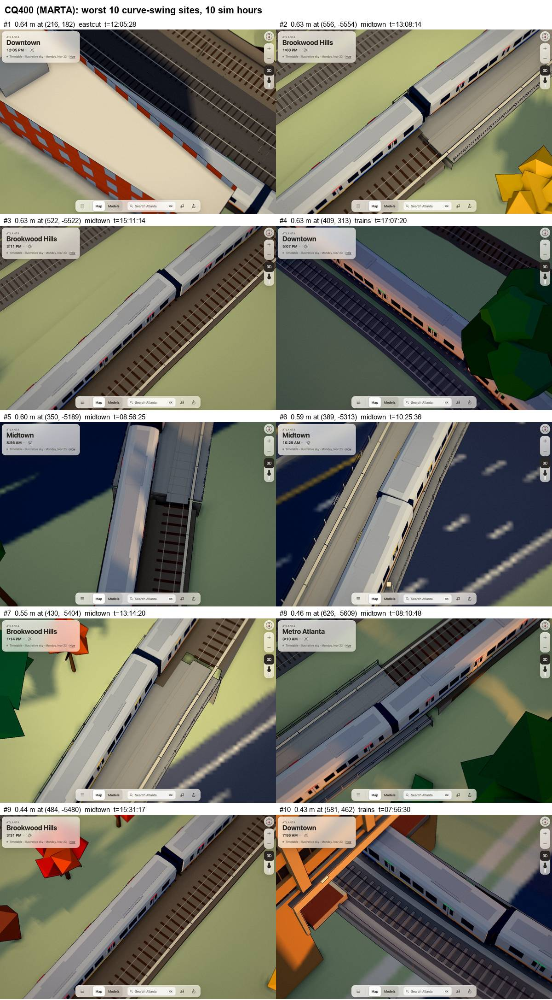
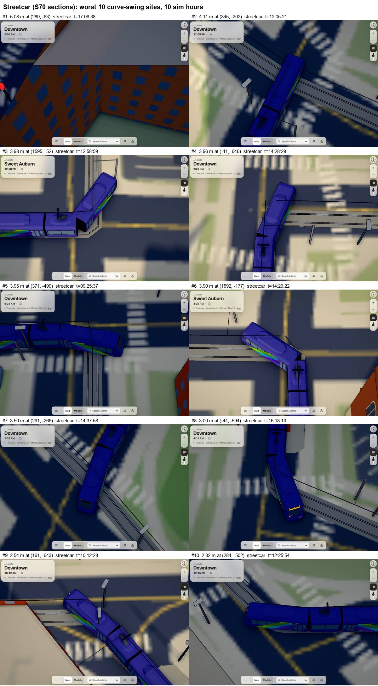

# Passenger rail curve swing (measurement, 2026-11-24)

This applies the freight curve-swing measure (`web/src/city/freight-clearance.ts`, #565) to MARTA CQ400 cars and Atlanta Streetcar S70 sections across the full City board. It is a measurement and a proposal. Nothing in the app changes here.

## Method

A temporary dev-only patch registered every line a passenger car rides: CityTracks alignments at ±2.1 m (`trains.ts`), the east-cut service tracks, the Midtown North Line tracks and the streetcar paths. It also exposed the clock.

In City (low tier, `?speed=60`, from 07:00 to 17:00 on Monday, November 23, 2026, about 36,000 frames), every drawn car was matched each frame to the line it rides:
- A CQ400 centre must lie within 5 cm of a MARTA line.
- A streetcar section must lie within 3 m of a streetcar path.

Its body corners and side midpoints were then measured against that line. *Swing* is how much further from the centreline they sit than on straight track (half the body width). Points past a line's end, at portals and board edges, are skipped. The worst value is kept per 20 m cell, with the sim time, so each site can be reloaded with `?t=<time>&speed=0`.

Coverage:
- 339,000 CQ400 car-frames matched (2,400 unmatched).
- 164,000 streetcar section-frames matched. Another 26,500 streetcar samples matched no registered path within 40 m. They are probably drawn in an area group with its own local frame, so the streetcar list may miss sites outside the downtown loop.
- The Crescent is not included.

## Results

| | Cells measured | Cells over 0.35 m | Worst |
| --- | ---: | ---: | ---: |
| CQ400 (MARTA) | 211 | 34 | 0.64 m |
| Streetcar (S70 sections) | 231 | 26 | 5.08 m |

### CQ400: worst ten sites

| # | Swing | Site | Line | Clock (−05:00) |
| ---: | ---: | --- | --- | --- |
| 1 | 0.64 m | (216, 182) | east cut | 12:05:28.926 |
| 2 | 0.63 m | (556, -5554) | Midtown North Line | 13:08:14.100 |
| 3 | 0.63 m | (522, -5522) | Midtown North Line | 15:11:14.616 |
| 4 | 0.63 m | (409, 313) | downtown CityTracks | 17:07:20.454 |
| 5 | 0.60 m | (350, -5189) | Midtown North Line | 08:56:25.488 |
| 6 | 0.59 m | (389, -5313) | Midtown North Line | 10:25:36.162 |
| 7 | 0.55 m | (430, -5404) | Midtown North Line | 13:14:20.058 |
| 8 | 0.46 m | (626, -5609) | Midtown North Line | 08:10:48.606 |
| 9 | 0.44 m | (484, -5480) | Midtown North Line | 15:31:17.514 |
| 10 | 0.43 m | (581, 462) | downtown CityTracks | 07:56:30.810 |

None of these puts a car visibly off its track, guideway, platform edge or portal at City scale. The visible effect is an angle at the couplers between cars, for example at the Brookwood Hills platform (#2 in the sheet). The 18–42 m "radii" quoted for the MARTA lines (docs/terrain-transport.md) are 12 m-chord readings at short polyline vertices, not sustained curves. A CQ400 centred on its track and aimed along it swings about L²/8R, so 0.64 m means an effective radius near 100 m.

### Streetcar: worst ten sites

| # | Swing | Site | Clock (−05:00) |
| ---: | ---: | --- | --- |
| 1 | 5.08 m | (289, −63) | 17:06:38.130 |
| 2 | 4.11 m | (345, −202) | 12:05:21.852 |
| 3 | 3.98 m | (1595, −52) | 12:58:59.772 |
| 4 | 3.96 m | (−41, −646) | 14:28:29.736 |
| 5 | 3.95 m | (371, −499) | 09:25:37.086 |
| 6 | 3.90 m | (1592, −177) | 14:29:22.632 |
| 7 | 3.50 m | (291, −266) | 14:37:58.578 |
| 8 | 3.00 m | (−44, −594) | 16:18:13.176 |
| 9 | 2.54 m | (161, −643) | 10:12:28.080 |
| 10 | 2.32 m | (284, −502) | 12:25:54.900 |

These are visibly wrong:
- Every one is a street corner where the GTFS shape turns 60–90° at a single vertex.
- The rails (`buildStreetcarTrack`) and the car paths (`streetcarPaths`) both follow that unsmoothed polyline. The rails therefore have a hard corner, and the articulated car folds into an L across the intersection (#3, #4, #6, #8).
- At #1, (289, −63), the tail section swings into the corner of the building beside the turn ([close-up](log/passenger-swing/streetcar-1-building.jpg), `cam=289,-63,0,2,90`).

All frames: `/?view=city&q=high&dev&mindist=20&speed=0&t=2026-11-23T<clock>-05:00&cam=<x>,<z>,0,25,50` (CQ400 at distance 55).

## Proposal

1. **Streetcar: yes, give it pipeline smoothing like #512, with a smaller radius.** Fillet each street-corner vertex of the streetcar paths in the pipeline at a tram-scale radius. The S70's minimum is in the 18–25 m range, to be confirmed against the Atlanta Streetcar's built curves before choosing.
   - Pin stops, run ends, junctions and board edges.
   - Feed both `streetcarLines` (rails) and `streetcarPaths` (cars) from the smoothed shape, so the two never part.
   - The GTFS `cum` distances stay proportional per segment, as today.
   - Then hold the streetcar to the 0.35 m swing rule, with its own test like `freight-clearance.test.ts`.
   - Estimate (not yet measured): a 9.75 m end section on a 20–25 m fillet swings a few tenths of a metre, against today's 2–5 m.
2. **MARTA: no pipeline smoothing needed. Optionally place CQ400s on their trucks.**
   - Today a CQ400 is centred on its track and aimed along it: in `trains.ts` at a point 4 m ahead, in Midtown along a ±2 m chord, and in the east cut along the segment direction.
   - Standing the two bogies (14.75 m apart, at z = −7.75 and +7.0) on the line, as freight and the streetcar already do, would split the swing between ends and middle. The estimate is about 0.6× today's, so the worst would be near 0.38 m.
   - That would bring most of the 34 cells over 0.35 m under it, with no data change. Since nothing reads as off-guideway today, this is polish, not a fix.

The MARTA owner would implement both. The temporary probe (registry patch and recorder) is kept by the rolling-stock workstream and can be shared to re-measure after the change.
