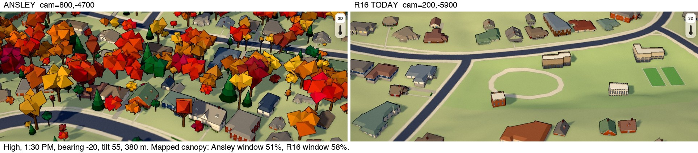
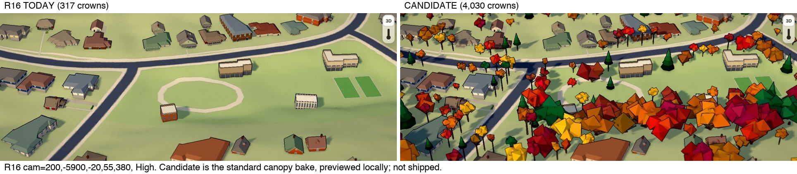

# Tree size and density: findings and a proposal

2026-11-25. Measured on `b7cc7f86` (draft #682). **Nothing here is shipped. Each fix needs Sam's approval.**

## Short answer

- **Where the expansion begins (R16), the trees are missing.** R16 draws 1.4 crowns per hectare against 18.4 just across the seam. Their median size (4.1 m radius, 11.5 m tall) is close to the rest of the city. 5.4 m and 14.8 m are that bake's upper limits.
- **The whole city draws less canopy than is mapped.** Outside Ansley Park, High draws about a quarter to a half of the mapped figure, and Low about 8–17%.
- **Ansley Park looks right** because it has the densest mapped canopy and an illustrative rule that enlarges its crowns.

## Measurements

**Mapped** is the share of 1 m cells classed as canopy in the City of Atlanta / Georgia Tech 2023 Urban Tree Canopy raster. **Staged** is the union of the crown circles in the data City loads. **Drawn** is the top-down union of the crown triangles City builds, in full summer leaf. Drawn covers the generic canopy crowns only, without named-species sites, park plantings or yard shrubs.

| Area | Mapped % | High crowns/ha | High staged % | High drawn % | Low crowns/ha | Low drawn % |
| --- | ---: | ---: | ---: | ---: | ---: | ---: |
| Ansley Park (neighbourhood) | 42 | 18.8 | 18.3 | 21.1 | 7.4 | 6.5 |
| Midtown (neighbourhood) | 21 | 8.0 | 6.8 | 5.0 | 3.6 | 1.7 |
| Downtown (neighbourhood) | 9 | 3.4 | 2.7 | 2.1 | 2.5 | 1.2 |
| downtown board | 7 | 2.2 | 2.1 | 1.8 | 2.2 | 1.2 |
| north-band | 23 | 10.4 | 8.9 | 6.4 | 4.8 | 2.3 |
| midtown-south | 20 | 8.8 | 7.2 | 5.2 | 4.1 | 2.0 |
| midtown-central | 27 | 10.9 | 10.2 | 7.4 | 4.8 | 2.6 |
| midtown-upper | 25 | 11.0 | 11.6 | 9.5 | 4.6 | 3.2 |
| brookwood-south | 31 | 15.3 | 15.9 | 15.5 | 5.9 | 4.8 |
| brookwood-station | 37 | 17.6 | 18.9 | 15.0 | 6.6 | 4.5 |
| Station, 400 m south of the R16 seam | 39 | 18.4 | 19.5 | 15.3 | 6.8 | 4.7 |
| **R16, 400 m north of the seam** | **43** | **1.4** | **1.2** | **0.6** | **0.7** | **0.2** |
| **R16** | **38** | **1.4** | **1.0** | **0.6** | **0.7** | **0.2** |

The staged percentage uses the source radius, so rows where City enlarges crowns can draw more than they stage.

**At today's date it is thinner still.** The table above is full summer leaf. Rerun for November 25, leaf drop takes a further 14–20% off the drawn canopy everywhere:

| Area | High summer → Nov 25 | Low summer → Nov 25 |
| --- | ---: | ---: |
| Ansley Park | 21.1 → 17.5 | 6.5 → 5.2 |
| Midtown | 5.0 → 4.1 | 1.7 → 1.4 |
| brookwood-station | 15.0 → 12.4 | 4.5 → 3.7 |
| R16 today | 0.6 → 0.5 | 0.2 → 0.2 |
| R16 with option A | 16.9 → 14.1 | 4.8 → 3.9 |

The option table below is also in summer leaf. The screenshots show November.

## Why

1. **R16 uses a fallback bake** (`pipeline/prototypes/combined-canopy/bake_fallback.py`). It proposes one point per 20 m cell, caps the radius at 5.4 m, and drops every residential, commercial and industrial parcel and anything within 15 m of a building. Of 5,600 proposals, 4,420 failed the canopy-interior test, 646 fell on a parcel and 317 survived. R16 also skips the tree rollout.
2. **The standard bake cannot place much of the mapped canopy.** A crown must clear buildings and carriageways by 1.3 radii and keep its distance from its neighbours. In midtown-central, 28% of mapped canopy lies over roofs, roads or water, and another 46% is too close to an edge or obstacle to take a trunk. In brookwood-station the figures are 17% and 40%.
3. **A drawn crown fills less than its circle.** City builds crowns from a few faceted clumps, and pines are narrower. In midtown-central, High draws 73% of the staged area and Low 46%. Low uses three clumps against High's eight.
4. **Low draws fewer crowns.** It keeps the largest crown per 32 m cell first (about 45% of High's count across all boards).
5. **Ansley's rule.** Inside the Ansley Park outline, about 40% of the remaining broadleaf draws are enlarged to 25–35 m tall with 9–13 m radius, and street trees gain facing partners. 38% of High crowns there have a radius of 8 m or more, against 15.5% elsewhere.

Junction and building filtering is not a cause: drawn counts match staged counts to within 0.1 per hectare outside Ansley. There is no separate per-tier crown cap beyond Low's subset.

## Options, measured offline

Drawn canopy %. Variants were measured one at a time.

| Area (mapped) | Today H / L | A: R16 standard bake | B: Low clumps ×1.35 | C: all crowns ×1.25 | D: Ansley rule everywhere |
| --- | --- | --- | --- | --- | --- |
| R16 (38) | 0.6 / 0.2 | **16.9 / 4.8** | 0.6 / 0.3 | 0.9 / 0.3 | 0.6 / 0.2 |
| midtown-central (27) | 7.4 / 2.6 | no change | 7.4 / 3.9 | 10.4 / 3.8 | 12.9 / 4.2 |
| brookwood-station (37) | 15.0 / 4.5 | no change | 15.0 / 6.6 | 20.3 / 6.6 | 21.6 / 6.2 |
| north-band (23) | 6.4 / 2.3 | no change | 6.4 / 3.4 | 9.1 / 3.4 | 11.8 / 3.9 |
| Downtown (9) | 2.1 / 1.2 | no change | 2.1 / 1.8 | 3.2 / 1.8 | 3.2 / 1.6 |

[Same view on Low](log/ui/tree-density/r16-candidate-low.jpg)

## Cost

**Frame time, Studio only.** One run each of the default view, with other agents' processes on the machine. With A, CPU update/render p50 went from 1.3/2.2 to 1.3/2.1 ms on Low and from 2.6/2.4 to 2.8/2.4 ms on High. Both builds held 60 fps (p95 16.7 ms; 16.8 ms on High with A), which is the display cap, so this says nothing about GPU headroom or phones. An A16 run on a frozen candidate build is the check to do; B and C have not been timed at all.

| Option | Added crowns | Triangles and draws |
| --- | --- | --- |
| A | R16 317 → 4,030 High, 152 → 1,422 Low | Default view, production build: Low +69k (1.937M → 2.006M, ceiling 2.06M), geometry +0.8 MB. High +521k (6.96M → 7.48M, ceiling 6.85M), geometry +3.7 MB. No added draws. |
| B | none | No added triangles or draws. Bigger clumps cost some fill on phones; unmeasured. |
| C | none | No added triangles or draws; some fill. |
| D | +759 High, +316 Low | Tree triangles in all boards +64k High, +14k Low. |
| Not proposed: Low draws every crown | about +10,200 | About +0.64M scene triangles by arithmetic (63 per Low crown), far past Low's headroom. |

Risks:

- C lets crowns reach about 0.3 radius (1.4 m on a 4.5 m crown) past the clearance the bake reserved, over roofs and lanes. D's enlarged crowns already ignore that clearance in Ansley.
- A's preview excludes golf, pitches, parking and rail by a simple filter. A real R16 bake needs the course, trail and highway sightline exclusions the fallback applies, and fresh row hashes. The counts above will move a little.
- D widens an illustrative rule. Crown sizes stay illustrative or inferred; nothing new needs a screen label.

## Recommendation

1. **Do A first**, as its own PR after the #682 performance decision. It closes the seam Sam noticed. Low fits today's ceiling with about 54k triangles to spare. High is already over its triangle ceiling on #682, so it needs R16 deferred from the default view or a ceiling Sam agrees to.
2. **Then B**, since Low is furthest from the map and the change adds no triangles. Check it on the A16.
3. **Show Sam C and D as art choices** with matched renders before building either. Even together, none of these reaches the mapped 40% in the leafiest areas. Getting closer means letting crowns overhang streets, which has not been tried.

## Method

A temporary test mounted all thirteen boards through City's own loaders at both tiers and rasterised the generic tree meshes on a 1 m grid. The raster's SHA-256 matched the one pinned in `rebuild.py`. Candidate A ran `expanded_canopy.bake` on R16. B, C and D were temporary local patches. No product code changed on this branch.
